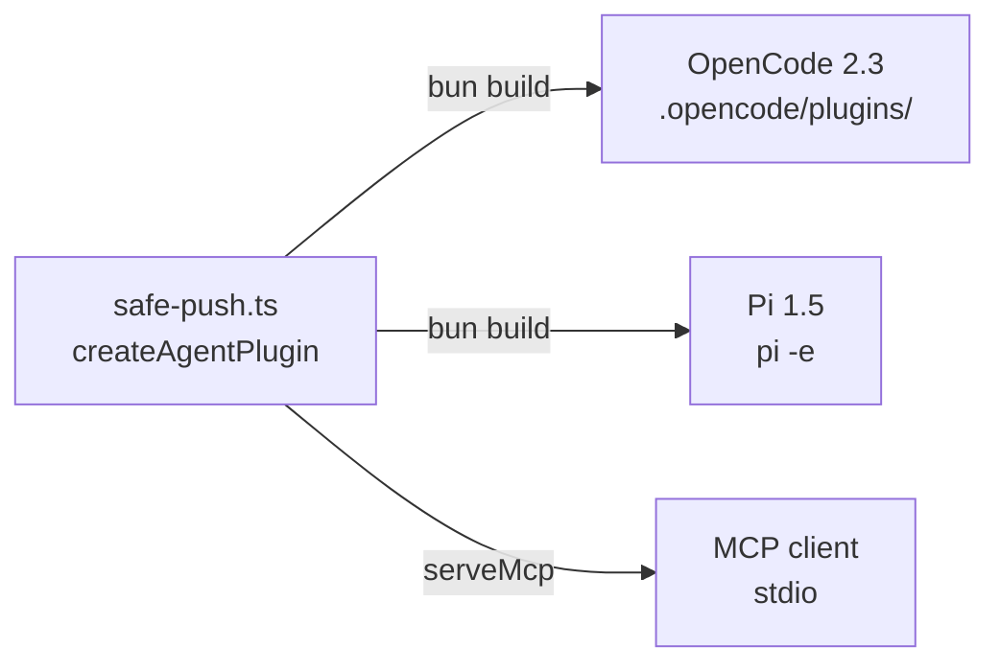
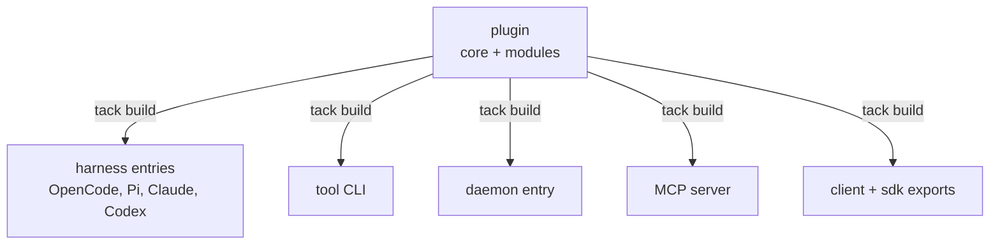
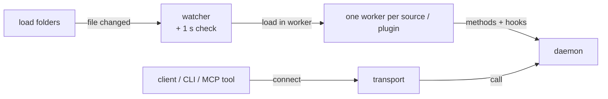

# tack

tack is a universal agent adapter. You write one plugin, a Luau table, and tack
builds it into OpenCode, Pi, Claude Code and Codex. Its compiler builds the
modules the plugin lists: barn, skills, transports, client and sdk. A
plugin guards tool calls, adds text to prompts, watches results, acts on its
session and registers tools. The same tools also reach any MCP client over
stdio.



## Design

A tack plugin is a core of hooks, tools, session actions and UI, plus the
modules it lists. tack decides in-process, so a bridge that forwards events
and applies a daemon's verdicts is one plugin too. One plugin runs in
OpenCode, Pi, Claude Code and Codex; what a harness cannot do for a plugin
is a cell in the fidelity table, never a silent no-op.



A module contributes commands, tools, hooks or an export; a plugin that does
not list a module neither builds nor bundles it. The needs column lists what
each module requires; `tack build` fails when a need is missing.

| Module     | Adds                                                           | Needs       |
| ---------- | -------------------------------------------------------------- | ----------- |
| skills     | `<tool> skills list/get/path`; refuses tool calls until loaded | core        |
| wasm       | Rust crate as WASM with typed bindings, native for `tack-hook` | —           |
| daemon     | a process with a method table, state and health                | a transport |
| transports | HTTP + SSE, Unix socket, stdio; framing written in Rust        | wasm        |
| client     | connects to a daemon; the CLI and MCP tools call through it    | daemon      |
| sdk        | typed `definePlugin` for a tool's own hooks                    | daemon      |

Skills append a required skill through the same session actions and refuse
tool calls until it loads; the rule needs no judge. WASM gives Rust functions
typed bindings in TypeScript with no hand-written port: the crate builds
native for the `tack-hook` runner, and the module has no sockets, files or
clock of its own. The daemon loads sources and plugins from folders,
built-ins first, taking each file's kind from its default export; each runs
in a worker with a memory limit, and a watcher reloads a changed file while
polls in flight finish on the version they started with. Transports keep
framing, auth, request ids, acks and reconnects in Rust, with HTTP and socket
only carrying that framing and stdio driving MCP and the `tack-hook` runner.
The client's methods and types come from the daemon's method table; `connect()`
reads the address and token from the environment and state folder, checks
health and protocol once, and exposes live event subscriptions. The SDK
publishes `definePlugin` at `<tool>/sdk`, and the daemon runs a tool's hook
points in priority order with a time budget and a declared `onError`, using
the same engine as harness hooks.



One tool publishes one package, with `<tool>/client` and `<tool>/sdk` as
subpath exports; each subpath loads only its own modules, and heavy parts
stay optional dependencies. The issues behind these parts are linked under
More.

## Install

tack is not published to npm. Build it from a source checkout pinned to a
commit, with Bun 1.4.4 and Node 26.13.1:

```bash
git clone https://github.com/wrkhse/tack.git ~/tack
cd ~/tack
git checkout 44475633cc07432dd9b12ef23240407b285d6423
bun install --frozen-lockfile
```

The install also pins the agents tack supports: OpenCode 2.3.0 in
`node_modules/.bin/opencode` and Pi 1.5.2 in `node_modules/.bin/pi`.

## Rewrite a push into a dry run

Save this as `~/tack/safe-push.ts`. It imports tack's entry point, the
package's `exports["."]`:

```ts
import { createAgentPlugin } from "./src/index.ts";

const safePush = createAgentPlugin(() => ({
  name: "safe-push",
  priority: 10,

  toolBefore: (call) =>
    call.tool === "shell" && call.input.command.startsWith("git push")
      ? { rewrite: { command: `${call.input.command} --dry-run` } }
      : undefined,
}));

export default safePush.opencode();
```

Bundle it into your project's plugin folder, where OpenCode loads it on
start. Each bundle carries its own copy of tack.

```bash
bun build safe-push.ts --target=node --format=esm \
  --outfile ~/my-app/.opencode/plugins/safe-push/index.js
```

Open the project with the pinned OpenCode; `--standalone` starts a private
server at that version.

```bash
cd ~/my-app
~/tack/node_modules/.bin/opencode --standalone
```

Pick a provider with `/connect` and a model with `/models`. When the model
runs `git push origin main`, the shell runs
`git push origin main --dry-run`.

## Load the plugin in Pi

Replace the last line of `safe-push.ts` with the Pi output, bundle it, and
pass it with `-e`:

```ts
export default safePush.pi();
```

```bash
bun build safe-push.ts --target=node --format=esm --outfile safe-push.pi.js
cd ~/my-app
~/tack/node_modules/.bin/pi -e ~/tack/safe-push.pi.js
```

## Guard a tool call

`toolBefore` sees every call before it runs. Return `{ deny: reason }` to
stop it, `{ rewrite: { command } }` to change a shell command, or
`undefined` to let it pass. `call.tool` is `"shell"` for OpenCode's
`shell` and Pi's `bash` and `powershell`; `call.name` keeps the agent's own
name.

```ts
toolBefore: (call) =>
  call.tool === "shell" && call.input.command.includes("--force")
    ? { deny: "Force pushes need a person." }
    : undefined,
```

Plugins run by `priority`, lowest first. Each rewrite reaches the next
plugin, and the first deny stops the call. A handler that throws or runs past
its `budgetMs` denies the call, unless `onError.toolBefore` is `"allow"`.

## Act on a session

Every hook gets `ctx.session`. `append` adds a message nobody typed, and
`when` says when the agent reads it:

- `"now"`: at the running turn's next step.
- `"next"`: after the turn ends. This is the default.
- `"wake"`: as `"now"`, and starts a turn on an idle session.

```ts
toolAfter: (call, result, ctx) => {
  if (result.isError) {
    void ctx.session.append(`Check the log for ${call.name}.`, { when: "next" });
  }
},
```

The handle also has `compact()`, `interrupt()` and `setModel(model)`. Each
action resolves to an `Outcome` and never throws. The hooks `sessionCreated`,
`sessionEnded`, `responseFinished`, `sessionIdle` and `permissionAsked`
report what the session does.

## Add a tool

List tools in the definition. tack registers each one natively in OpenCode
and Pi, and decodes every call against `input` before `run` sees it. Save
this as `~/tack/monitor.ts`:

```ts
import { createAgentPlugin, tool } from "./src/index.ts";

const monitorCreate = tool<{ key: string }>({
  name: "monitor_create",
  description: "Start watching a Jira issue",
  input: {
    type: "object",
    properties: { key: { type: "string" } },
    required: ["key"],
    additionalProperties: false,
  },
  run: (input) => ({ content: [`watching ${input.key}`] }),
});

export const monitor = createAgentPlugin(() => ({
  name: "monitor",
  tools: { monitor_create: monitorCreate },
}));
```

Export `monitor.opencode()` or `monitor.pi()` from an entry and bundle it as
above. A handler gets 30 seconds by default (`timeoutMs` changes it), and a
result over 256 KiB is refused, never cut.

## Serve tools over MCP

`serveMcp` serves a plugin's tools to any MCP client over stdio. Save an
entry as `~/tack/monitor.mcp.ts`, then bundle it:

```ts
import { serveMcp } from "./src/index.ts";
import { monitor } from "./monitor.ts";

await serveMcp(monitor);
```

```bash
bun build monitor.mcp.ts --target=node --format=esm --outfile monitor.mcp.js
```

Point the client at the bundle, here in your project's `opencode.json`:

```json
{
  "mcp": {
    "servers": {
      "monitor": {
        "type": "local",
        "command": ["node", "/Users/you/tack/monitor.mcp.js"]
      }
    }
  }
}
```

The server runs no hooks and has no session, so a tool with
`needsSession: true` is refused when the server starts.

## Check what an agent supports

`fidelity` holds one table per agent. Each cell says whether a capability is
`native`, `fallback` or `unsupported`, and cites the agent source that
proves it.

```ts
import { capabilities, fidelity } from "./src/index.ts";

for (const capability of capabilities) {
  const cell = fidelity.pi.cells[capability];

  console.log(capability, cell.fidelity, cell.source);
}
```

## Roadmap

The plan is [tack#1](https://github.com/wrkhse/tack/issues/1).

- [x] OpenCode and Pi
- [x] Tools over MCP stdio
- [ ] Claude Code mod ([#28](https://github.com/wrkhse/tack/issues/28))
- [ ] Codex through `tack-hook`
- [ ] Claude Code hook entries
- [ ] UI: status, toast, dialogs, commands
- [ ] UI surfaces

## More

- Design: [plan](https://github.com/wrkhse/tack/issues/1) ·
  [modules](https://github.com/wrkhse/tack/issues/19) ·
  [skills](https://github.com/wrkhse/tack/issues/8) ·
  [WASM](https://github.com/wrkhse/tack/issues/24) ·
  [daemon](https://github.com/wrkhse/tack/issues/20) ·
  [transports](https://github.com/wrkhse/tack/issues/22) ·
  [client](https://github.com/wrkhse/tack/issues/17) ·
  [SDK](https://github.com/wrkhse/tack/issues/23)
- [Plans](docs/plans/README.md)
- [Adapters](src/agents/README.md) · [Hooks](src/hooks/README.md) ·
  [Host](src/host/README.md) · [Session](src/session/README.md)
- [Tools](src/tools/README.md) · [MCP](src/mcp/README.md) ·
  [Fidelity](src/fidelity/README.md)
- [Conformance](conformance/README.md) ·
  [Research](spike/unagent/README.md)
