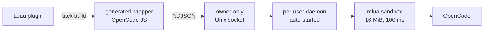

# tack

tack is a Rust CLI and daemon for running one Luau plugin in OpenCode.

Slice 1's design: a plugin is compiled into a generated OpenCode JavaScript
wrapper. The wrapper forwards hooks and tool runs as NDJSON over an owner-only
Unix socket to an auto-started, per-user daemon. The daemon runs the plugin's
Luau in an `mlua` sandbox with a 16 MiB memory limit and a 100 ms deadline per
call.

A plugin is a Luau table. This one denies `git push` and exposes one tool:

```lua
--!strict
local guardStatus = require("./guard-status")

return {
  name = "safe-push",

  toolBefore = function(payload, ctx)
    if ctx.tool == "shell"
      and string.find(payload.command, "^git push") then
      return ctx.deny("push blocked")
    end
  end,

  tools = { guard_status = guardStatus },
}
```

## Design path

Slice 1 builds toward this path:



## Install

### Release candidate (pre-release)

The current build is published as a **pre-release** on the
[releases page](https://github.com/wrkhse/tack/releases). Each release carries
one tarball per target and a single `SHA256SUMS` covering all three. Download
the tarball for your target, verify it, unpack it, and put its three binaries
on your `PATH`:

```bash
TAG=v0.1.0-rc.6
TARGET=x86_64-apple-darwin
base="https://github.com/wrkhse/tack/releases/download/$TAG"

curl -fsSLO "$base/tack-$TAG-$TARGET.tar.gz"
curl -fsSLO "$base/SHA256SUMS"

# Linux (use `shasum -a 256 -c -` on macOS):
grep "tack-$TAG-$TARGET.tar.gz" SHA256SUMS | sha256sum -c -

tar -xzf "tack-$TAG-$TARGET.tar.gz"
export PATH="$PWD:$PATH"
```

Valid targets are `aarch64-apple-darwin`, `x86_64-apple-darwin`, and
`x86_64-unknown-linux-gnu`. The tarball contains three binaries: `tack`,
`tack-daemon` and `tack-hook`. `SHA256SUMS` lists all three tarballs; the
`grep` above checks the one you downloaded.

A Claude mod build sends each guarded Bash call and each tack tool run to
`tack-hook`. This command builds one and prints the paths it emits:

```bash
tack build fixtures/safe-push --out dist --target claude
```

A Pi mod build targets a pinned Pi session:

```bash
tack build fixtures/safe-push --out dist --target pi
```

It emits `dist/pi/extension.js` for the pinned Pi session.

A Codex mod build emits the Codex hook and MCP files under `dist/codex/`:

```bash
tack build fixtures/safe-push --out dist --target codex
```

This is a pre-release for trying the current slice, not a stable release.

### SDK declarations (opt-in)

A plugin listing the `sdk` module in its `needs` gets strict Luau declarations
at `dist/sdk/tack.d.luau`:

```lua
return { name = "guard", needs = { "sdk" }, tools = {} }
```

A plugin that omits it emits no SDK files. The declarations name the contract
major a host must check.

Plugin stalls are supervised by barn, a separate program installed beside
tack's binaries as three binaries: `barn`, `barn-exec` and
`barn-luau-stall`. tack finds `barn` beside its own executable, and
`TACK_BARN_BIN` overrides that path. tack does not search `PATH`. When the
binary is missing, a hook gets the named deny
`tack: plugin unavailable: barn not found`.

### Releases

Each tack release notes the compatible barn release. Install both tarballs
into the same folder and verify each with the `SHA256SUMS` published beside
it:

```bash
TAG=v0.1.0-rc.6
BARN_TAG=v0.1.0
TARGET=aarch64-apple-darwin
tack_base="https://github.com/wrkhse/tack/releases/download/$TAG"
barn_base="https://github.com/wrkhse/barn/releases/download/$BARN_TAG"

curl -fsSLO "$tack_base/tack-$TAG-$TARGET.tar.gz"
curl -fsSL "$tack_base/SHA256SUMS" -o tack.SHA256SUMS
curl -fsSLO "$barn_base/barn-$BARN_TAG-$TARGET.tar.gz"
curl -fsSL "$barn_base/SHA256SUMS" -o barn.SHA256SUMS

grep "tack-$TAG-$TARGET.tar.gz" tack.SHA256SUMS | shasum -a 256 -c -
grep "barn-$BARN_TAG-$TARGET.tar.gz" barn.SHA256SUMS | shasum -a 256 -c -

tar -xzf "tack-$TAG-$TARGET.tar.gz"
tar -xzf "barn-$BARN_TAG-$TARGET.tar.gz"
export PATH="$PWD:$PATH"
```

### Homebrew

`brew install tack` pulls in the barn formula the way `brew install sourcefed`
does. Because a formula may install behind a symlink into its Cellar, set
`TACK_BARN_BIN` to the absolute path of that formula's barn binary. tack does
not search `PATH`.

### Release plan

The release workflow publishes tack and barn separately. tack's release notes
name the barn version the wiring was tested with. tack adds no new production
dependency for this.

### From source

Clone the repository and build the workspace with the pinned toolchain in
`rust-toolchain.toml` (Rust 1.100):

```bash
git clone https://github.com/wrkhse/tack.git
cd tack
cargo build --release
```

Build the example plugin with
`target/release/tack build fixtures/safe-push --out dist`.

## Roadmap

- [Slice 1: one plugin, OpenCode, unsandboxed daemon](docs/plans/slices/slice-1.md) —
  Implemented (v0.1.0-rc.2).
- [Slice 2: one plugin, Claude Code, native hook client](docs/plans/slices/slice-2.md) —
  Implemented (v0.1.0-rc.3).
- [Slice 3: one plugin, Pi, native hook client](docs/plans/slices/slice-3.md) —
  Implemented (v0.1.0-rc.4).
- [Slice 4: one tack plugin as a Codex adapter](docs/plans/slices/slice-4.md) —
  Implemented (v0.1.0-rc.5).
- More harnesses and MCP support — Planned.
