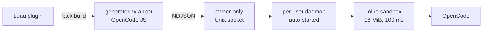

# tack

tack is being rebuilt as a Rust CLI and daemon. One Luau plugin is compiled
into a generated OpenCode JavaScript wrapper. The wrapper forwards hooks and
tool runs as NDJSON over an owner-only Unix socket to an auto-started,
per-user daemon. The daemon runs the plugin's Luau in an `mlua` sandbox with a
16 MiB memory limit and a 100 ms deadline per call.



## Build and test

The workspace is pinned to Rust 1.100 by `rust-toolchain.toml`.

```bash
cargo fmt --all -- --check
cargo clippy --workspace --all-targets -- -D warnings
cargo test --workspace
```

## Plans

- [Architecture plan (tack#1)](https://github.com/wrkhse/tack/issues/1)
- [Slice 1: one plugin, OpenCode, unsandboxed daemon (tack#34)](https://github.com/wrkhse/tack/issues/34)
