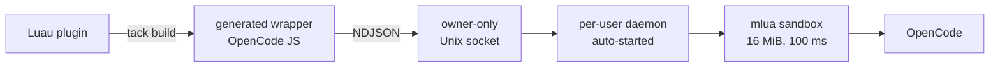

# tack

tack is a Rust CLI and daemon for running one Luau plugin in OpenCode.

Slice 1's design: a plugin is compiled into a generated OpenCode JavaScript
wrapper. The wrapper forwards hooks and tool runs as NDJSON over an owner-only
Unix socket to an auto-started, per-user daemon. The daemon runs the plugin's
Luau in an `mlua` sandbox with a 16 MiB memory limit and a 100 ms deadline per
call.

A plugin is a Luau table. This one denies `git push` and exposes one tool:

```lua
--!strict
local guardStatus = require("./guard-status")

return {
  name = "safe-push",

  toolBefore = function(call, ctx)
    if call.tool == "shell"
      and string.find(call.input.command, "^git push") then
      return ctx.deny("push blocked")
    end
  end,

  tools = { guard_status = guardStatus },
}
```

## Design path

Slice 1 builds toward this path:



## Install

Clone the repository and build the workspace with the pinned toolchain in
`rust-toolchain.toml` (Rust 1.100):

```bash
git clone https://github.com/wrkhse/tack.git
cd tack
cargo build --release
```

The binary is at `target/release/tack`. A command to build a Luau plugin does
not exist yet; that is part of slice 1.

## Roadmap

- Slice 1: one plugin, OpenCode, unsandboxed daemon — In progress
  ([tack#34](https://github.com/wrkhse/tack/issues/34)).
- More harnesses and MCP support — Planned.
