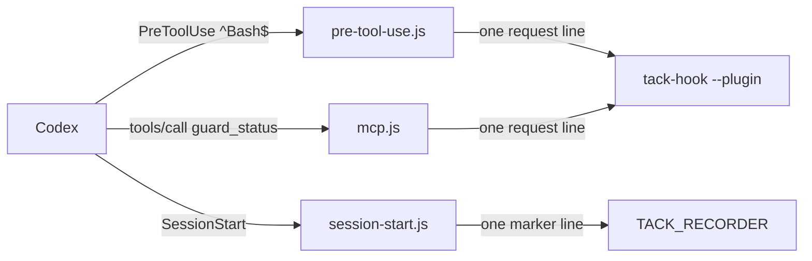

# tack-adapter-codex

Generates the Codex adapter for one tack plugin. Codex runs two command hooks
and one stdio MCP server; each relays to the released `tack-hook` and fails
closed. Plugin code runs only in the daemon.



```sh
CODEX_HOME=/tmp/codex-home tack build fixtures/safe-push --out dist --target codex
# dist/codex/hooks.json  pre-tool-use.js  session-start.js  mcp.js  config.toml
# dist/codex/run-hook.sh
# /tmp/codex-home/hooks.json  /tmp/codex-home/config.toml
```

## Modules

| File               | Responsibility                                                   |
| ------------------ | ---------------------------------------------------------------- |
| `src/lib.rs`       | Fills the templates and lists the two handlers to trust          |
| `src/trust.rs`     | Codex's hook identity hash and state key                         |
| `src/home.rs`      | Resolves the Codex home and merges hooks and trust into it       |
| `client.js`        | Shared prefix: one deadline, one `tack-hook` call, reply checks  |
| `pre-tool-use.js`  | Prints `{}` or `{"decision":"block","reason":"tack: …"}`         |
| `mcp.js`           | JSON-RPC lines: `initialize`, `tools/list`, `tools/call`         |
| `session-start.js` | Appends `{"call":"tack-loaded"}` to `TACK_RECORDER`              |
| `run-hook.sh`      | Runs a hook script; no node, or a failing node, blocks by exit 2 |

Each hook command is `sh '<dir>/run-hook.sh' '<dir>/<script>.js'`. Codex runs
it with `$SHELL -lc` and lets the call run on exit 127 or a crash, so the
wrapper exits 2 with an exact reason on stderr and nothing on stdout:
`tack: node_missing` when there is no `node`, and `tack: node_failed` when
`node` exits nonzero or dies of a signal. An inner `sh` with its stderr
discarded runs and reaps `node`, so a shell's crash notice never reaches the
wrapper's stderr.

The `config.toml` fragment marks the `tack` server `required`, so a server
that fails to start is a named failure, and passes `TACK_RECORDER`,
`TACK_STATE_DIR` and `TACK_DAEMON_BIN` through Codex's reduced MCP
environment with `env_vars`.

## Trust

Codex 0.172.0 runs a user hook only when its `[hooks.state.<key>]` holds a
`trusted_hash` equal to the hash of the normalized hook. The key is
`<CODEX_HOME>/hooks.json:<event>:<group>:<handler>`; the hash is SHA-256 over
compact, sorted JSON of the event label, the matcher and the handler with
`timeout` and `async` explicit.

- `tack build` writes `enabled = true` and `trusted_hash` for tack's two keys
  only, on every build.
- tack's groups keep their index in `hooks.json` on a rebuild, so no other
  hook's key moves; every other table in `config.toml` is copied as it is.
- A `config.toml` it cannot edit line by line (a multi-line string,
  `hooks.state` spelled inline, a tack key outside its header) is refused
  and neither file changes.
- Each file is written beside itself and renamed into place.

Tack keeps a bounded `tack-hashes` file beside config.toml. It records the
hashes its hooks were trusted under, so a later build recognises trust state
from tack hooks no longer in hooks.json. A malformed record refuses the build
with a named reason; config.toml is never modified by this record.

(supervisor, 2026-11-26) Trust state for a hook that no longer exists grants
nothing anyone uses. Dropping it only removes trust, the safe direction: if the
hook comes back, Codex asks again. Tables for hooks that still exist are kept
byte-identical; the only removals are trust state for hooks that no longer exist
(first upgrade) and tables whose hash tack recorded as its own.

## Verification

- `tests/render.rs` and the unit tests: template-only differences, exact
  values, the hook timeout, Codex's known fingerprint value, merges.
- `adapter.test.mjs`: the scripts with injected fakes, from
  `fixture-values.json`; run with `node --test adapters/codex/adapter.test.mjs`.
