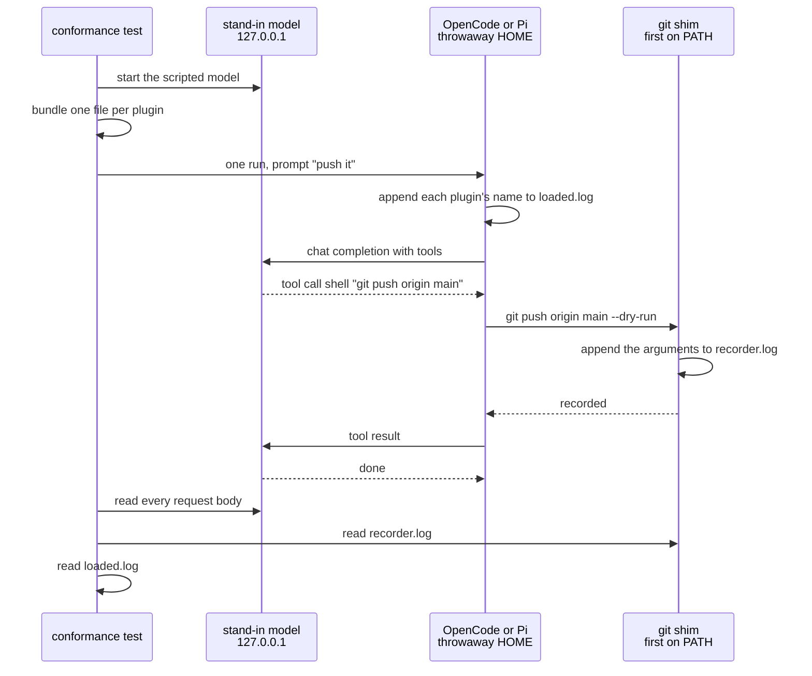
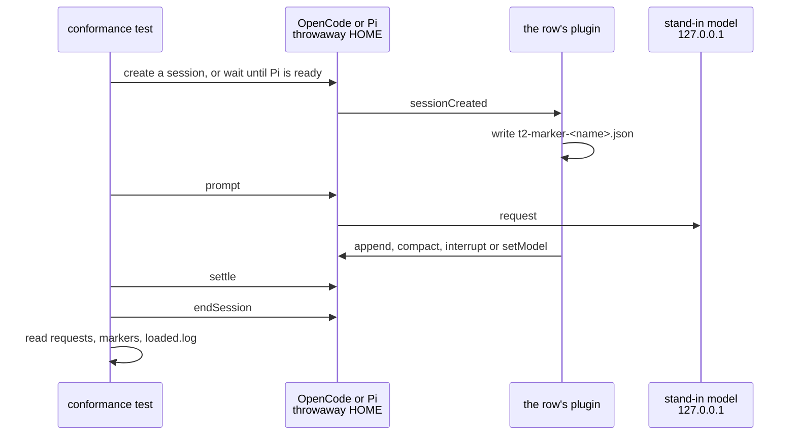

# Conformance

The suite runs the real OpenCode and Pi CLIs and proves that tack's hooks reach
each agent and combine the same way in both. No real model is called: a
scripted server on loopback answers every request, and a `git` shim first on
`PATH` records the commands the agent tried to run, including a tool handler's
own `git tack-tool` call.

A row runs in the mode its steps need. T1's nine rows run one prompt to
completion in a one-shot CLI; T2's fifteen run one long-lived session, because
they need a second turn, an action after startup, or an end the suite controls.
One T2 row runs in OpenCode only, because Pi has no session created before its
extension loaded. T3's eight one-shot rows run one prompt to completion, one of
them in Pi only; its withdrawal row runs long-lived, because it needs a second
request after the tool is removed.

Run it in CI, or in a disposable container. Never on a development machine:
each test starts the agent CLIs, which are that machine's own agents.

## One scenario



The stand-in model answers four ways. A request without tools is a title
request, so it gets the text `title`. A request that carries a tool result gets
`done`, which ends the turn. Every other request gets one tool call, the agent's
own shell tool with `git push origin main`; when a row asks, a request that ends
with the person's prompt gets a call even though the conversation already holds
a result. A marked request answers with the
summary text instead, which is how the compaction row proves its call. A sticky
error answers every tool-bearing request with the SSE error until the run ends,
so a retry cannot rescue the turn; Pi's sandbox disables retries, and the error
row's OpenCode plugin vetoes its retry. Without that veto OpenCode would spend
about 67–101 seconds of retries before reporting the failure.

## The long-lived modes



OpenCode runs through its server session: `opencode serve` on a private
loopback port with a private password, a session created over
`POST /api/session` after the plugin is listed, prompts over
`POST /api/session/{id}/prompt`, and `DELETE /api/session/{id}` to end it. The
driver reads `GET /api/session/{id}` until `outcome` and `time.idle` say the
prompted turn has finished, and keeps a few of the server's own event frames so
a wait that runs out prints them.

Pi runs in RPC mode: `pi --mode rpc --no-session` with each plugin on `-e`. RPC
mode forwards the agent's session events only, so readiness is one `get_state`
answer rather than a `session_start` record. The driver writes `prompt` and
`abort` records on stdin, waits on `agent_settled`, and closes stdin to end the
session, which reports `session_shutdown` reason `quit` to the plugins.

Both drivers expose the same `Driver` to a row: `prompt`, `settle`,
`interrupt`, `rebind`, `endSession`, `waitMarker`, `events`, `trail`, and
the three reads a check's evidence comes from: `requests`, `observations` and
`signals`. Only Pi implements `rebind`, which starts a fresh session and
reports the previous one `replaced`. A row's steps and its check never name a harness event, except
where the table says the two agents report one differently.

## The marker channel

Every long-lived row's plugin writes `t2-marker-<name>.json` in its working
directory, which is the project directory. The file holds a JSON array of observations, one
appended per event, such as `{"event":"finished","reason":"done"}`. Each
append is written to a temporary file and renamed into place, so the suite
never reads half an observation. After a run, the suite reads every marker into
the evidence, beside the requests, the recorder's lines, the loaded names, and
the turn signals each settle saw.

A row waits for the evidence it asserts instead of pausing for it: a request
the stand-in must have received, or an observation a plugin must have written,
is polled every 100 ms for up to 25 seconds. A run too slow to reach it fails
with the request count and the last message, or with the observations, the turn
signals and the stream frames it saw, rather than passing or failing on a fixed
sleep.

The marker is how a row proves what a plugin saw rather than what the harness
returned: the permission row can prove Pi never called the hook, and the idle
row can prove OpenCode stayed silent through an interrupted turn.

Pi's entries also record two signals tack's public hooks do not carry:
`agent_settled.aborted` beside `sessionIdle`, and `model_select` beside the
session's model switch. They append them to the same plugin's marker.

## What it proves

- Each row of the table below runs in both agents, from a fresh `HOME`, against
  the pinned CLI version, unless the table names it OpenCode-only.
- Each plugin is bundled on its own, with its own copy of tack. Two plugins in
  one run therefore prove the host slot works across copies.
- Every plugin a scenario names is proven loaded, not assumed: the run records
  each plugin's name when its module is evaluated, and the scenario asserts the
  two sets are equal.
- A denied call never reaches the command: `recorder.log` is absent, and the
  model receives the reason in the tool result.
- Both load orders rewrite to the same command, so priority decides and the
  agent's own plugin order does not.
- A long-lived row asserts its plugin's marker, so an action it expected to be
  refused cannot pass by never running.

## The load marker

Each entry file under `plugins/entries/` calls `markLoaded` at module scope,
before it exports its plugin, so marking happens the moment the agent evaluates
the module that holds the plugin. `markLoaded` appends the plugin's name to the
file named by `TACK_LOADED`, one name per line, and does nothing when the
variable is unset.

After a run, the suite reads that file and asserts that the set of names is
exactly the scenario's plugins, sorted: not a superset, not a subset. An
assertion about absence, such as `toolAfter` never running in "deny after",
therefore rests on a plugin that provably loaded rather than one that may have
failed silently.

## The pinned install

The suite resolves both CLIs from the repository's `node_modules` and asserts
each `--version` against the pin in `package.json`. `@opencode/cli`'s binary is
linked by its own postinstall, which `package.json` trusts through
`trustedDependencies`.

Never install a CLI out of band: `npm install --ignore-scripts @opencode/cli`
from the registry bypasses the lockfile and the pin. CI fails on a changed
lockfile or manifest, then compares the entry point the suite runs,
`node_modules/.bin/opencode` resolved through its symlink, byte for byte with
the binary of the platform package under `node_modules/@opencode/cli-*/bin`. A
fallback install copies a binary from the registry and leaves the lockfile
alone, but its bytes differ, so the job fails before a scenario runs. If a
binary is missing or differs, fix the trusted install instead.

## Isolation

One `mkdtemp` directory holds everything a run may see, and it is deleted when
the scenario ends. The agent gets only `PATH`, so nothing of the parent
environment survives.

| Variable              | Holds                                  |
| --------------------- | -------------------------------------- |
| `HOME`, `TMPDIR`      | the run's home and temp directory      |
| `XDG_CONFIG_HOME`     | `opencode/opencode.json`               |
| `XDG_DATA_HOME`       | the CLIs' data directory               |
| `XDG_STATE_HOME`      | the CLIs' state directory              |
| `XDG_CACHE_HOME`      | the CLIs' cache directory              |
| `PI_CODING_AGENT_DIR` | Pi's `models.json` and `settings.json` |
| `TACK_RECORDER`       | the file the git shim appends to       |
| `TACK_LOADED`         | the file each plugin's entry marks     |
| `TACK_REAL_GIT`       | the real git, for every other command  |

`PATH` starts with the sandbox `bin` directory, which holds the git shim, and
continues with the parent `PATH` read through Effect `Config`.

## Running it

```sh
bun run conformance:opencode
bun run conformance:pi
```

CI runs the same two scripts as the `conformance (opencode)` and
`conformance (pi)` checks, one job per agent, on every pull request.

A disposable container works when CI is not enough:

```sh
docker run --rm -it -v "$PWD":/work -w /work oven/bun:1 \
  sh -c "bun install --frozen-lockfile && bun run conformance:opencode"
```

## Scenarios

| Scenario                 | Plugins                           | Passes when                                                                   |
| ------------------------ | --------------------------------- | ----------------------------------------------------------------------------- |
| deny                     | `deny-push`                       | nothing recorded; reason returned                                             |
| deny after               | `deny-push`, `observe`            | the same, and `toolAfter` never ran                                           |
| fail closed              | `throws`                          | nothing recorded; error returned                                              |
| opt out                  | `throws-allowed`, `safe-push`     | the failing guard allows; dry run recorded                                    |
| rewrite                  | `safe-push`                       | `push origin main --dry-run`                                                  |
| combine                  | `safe-push`, `signed-push`        | `... --dry-run --signed` recorded                                             |
| combine reversed         | `signed-push`, `safe-push`        | the same, in the other load order                                             |
| append                   | `push-note`                       | the note is in the first prompt                                               |
| after                    | `safe-push`, `observe`            | the observed command and output                                               |
| t2 wake                  | `append-wake`                     | a tool-bearing request carries the text                                       |
| t2 outside hook          | `append-outside`                  | the timer's text lands in a request                                           |
| t2 now                   | `append-now`                      | a later tool-bearing request of the first turn carries it, not the prompt     |
| t2 next                  | `append-next`                     | absent first, present in a later request                                      |
| t2 permission            | `permission-deny`                 | OpenCode denies; Pi never asks                                                |
| t2 permission configured | `permission-deny`                 | a sandbox deny skips the hook; the call is refused                            |
| t2 idle                  | `idle-note`                       | one idle, then Pi's aborted and no more                                       |
| t2 finished done         | `finished-note`                   | every request ends `done`, exactly                                            |
| t2 finished aborted      | `finished-note`                   | the interrupt ends `aborted` last                                             |
| t2 finished error        | `finished-note`, `retry-veto`     | the failure ends `error`; the retry hook vetoes it                            |
| t2 lifecycle             | `lifecycle-note`                  | created; Pi: two starts on rebind, replaced, shutdown; OpenCode: delete ends  |
| t2 lifecycle resumed     | `lifecycle-note`                  | OpenCode only: reports `resumed` for a pre-load session                       |
| t2 interrupt             | `interrupt-action`                | accepted, and the turn settles interrupted                                    |
| t2 model                 | `model-switch`                    | accepted; the stand-in sees `scripted-2`                                      |
| t2 compact               | `compact-action`                  | accepted; Pi asks once, OpenCode twice (its summary-template nudge)           |
| t3 list                  | `tool-create`                     | the first request declares `monitor_create` with its description and schema   |
| t3 call                  | `tool-create`                     | `tack-tool monitor_create PROJ-1` recorded                                    |
| t3 result                | `tool-create`                     | a tool message's content is `watching PROJ-1`                                 |
| t3 bad input             | `tool-create`                     | a tool message names `key`; nothing recorded                                  |
| t3 tool deny             | `tool-deny`, `tool-create`        | the deny reason is returned; nothing recorded                                 |
| t3 tool rewrite          | `tool-rewrite`, `tool-create`     | `tack-tool monitor_create PROJ-2` recorded                                    |
| t3 rewrite rejected      | `tool-rewrite-bad`, `tool-create` | the schema rejects the rewrite; nothing recorded                              |
| t3 pi tool collision     | `tool-collide`, `tool-witness`    | Pi only: the refusal is reported and the next plugin still starts the session |
| t3 withdraw              | `tool-withdraw`                   | the next request omits the tool; a call to it answers an error                |

## Layout

| Path                         | Holds                                              |
| ---------------------------- | -------------------------------------------------- |
| `model/stand-in.ts`          | the scripted model, its requests, and its bounds   |
| `harness/recorder.ts`        | the git shim and the lines it recorded             |
| `harness/sandbox.ts`         | the throwaway tree, both environments, the pins    |
| `harness/bundle.ts`          | one Bun bundle per plugin                          |
| `harness/run.ts`             | one CLI run, bounded output, a 120 second timeout  |
| `harness/duplex.ts`          | a long-lived child, its lines, and its exit        |
| `harness/opencode.ts`        | OpenCode config, arguments, and one one-shot run   |
| `harness/pi.ts`              | Pi's config, arguments, and one one-shot run       |
| `harness/opencode-server.ts` | the server session API one scenario drives         |
| `harness/pi-rpc.ts`          | the JSONL client Pi's RPC mode speaks              |
| `harness/markers.ts`         | the marker files T2's plugins write and read       |
| `harness/driver.ts`          | the `Driver` both long-lived modes expose          |
| `harness/t2-opencode.ts`     | one long-lived OpenCode scenario                   |
| `harness/t2-pi.ts`           | one long-lived Pi scenario                         |
| `plugins/`                   | the tack plugins, entry files, and the load marker |
| `plugins/t2/`                | one plugin per T2 row                              |
| `scenarios.ts`               | the one-shot table, as data and checks             |
| `tool-scenarios.ts`          | T3's tool rows, as data and checks                 |
| `session-scenarios.ts`       | the long-lived table, as data and checks           |
| `suite.ts`                   | the checks both agents' tests share                |
| `opencode.test.ts`           | the version check and every scenario, in OpenCode  |
| `pi.test.ts`                 | the version check and every scenario, in Pi        |
