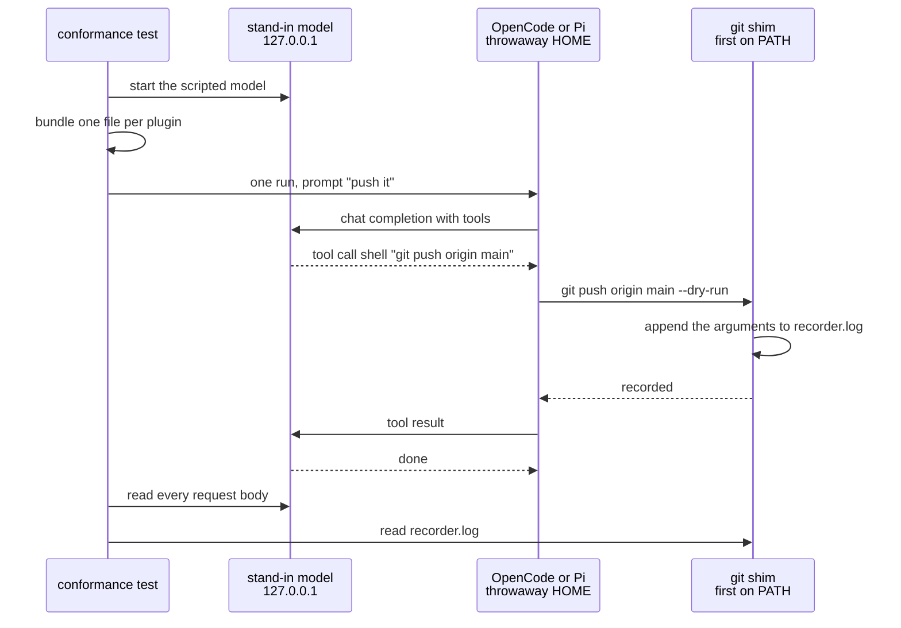

# Conformance

The suite runs the real OpenCode and Pi CLIs once per scenario and proves that
tack's three hooks reach each agent and combine the same way in both. No real
model is called: a scripted server on loopback answers every request, and a
`git` shim first on `PATH` records the commands the agent tried to run.

Run it in CI, or in a disposable container. Never on a development machine:
each test starts the agent CLIs, which are that machine's own agents.

## One scenario



The stand-in model answers three ways. A request without tools is a title
request, so it gets the text `title`. A request that carries a tool result gets
`done`, which ends the turn. Every other request gets one tool call, the agent's
own shell tool with `git push origin main`.

## What it proves

- Each row of the table below runs in both agents, from a fresh `HOME`, against
  the pinned CLI version.
- Each plugin is bundled on its own, with its own copy of tack. Two plugins in
  one run therefore prove the host slot works across copies.
- A denied call never reaches the command: `recorder.log` is absent, and the
  model receives the reason in the tool result.
- Both load orders rewrite to the same command, so priority decides and the
  agent's own plugin order does not.

## The pinned install

The suite resolves both CLIs from the repository's `node_modules` and asserts
each `--version` against the pin in `package.json`. `@opencode/cli`'s binary is
linked by its own postinstall, which `package.json` trusts through
`trustedDependencies`. Never install a CLI out of band: `npm install
--ignore-scripts @opencode/cli` from the registry bypasses the lockfile and the
pin, and CI fails on a changed lockfile or manifest, or on a missing binary,
before a scenario runs. If the binary is missing, fix the trusted install
instead.

## Isolation

One `mkdtemp` directory holds everything a run may see, and it is deleted when
the scenario ends. The agent gets only `PATH`, so nothing of the parent
environment survives.

| Variable              | Holds                                 |
| --------------------- | ------------------------------------- |
| `HOME`, `TMPDIR`      | the run's home and temp directory     |
| `XDG_CONFIG_HOME`     | `opencode/opencode.json`              |
| `XDG_DATA_HOME`       | the CLIs' data directory              |
| `XDG_STATE_HOME`      | the CLIs' state directory             |
| `XDG_CACHE_HOME`      | the CLIs' cache directory             |
| `PI_CODING_AGENT_DIR` | `models.json` for Pi                  |
| `TACK_RECORDER`       | the file the git shim appends to      |
| `TACK_REAL_GIT`       | the real git, for every other command |

`PATH` starts with the sandbox `bin` directory, which holds the git shim, and
continues with the parent `PATH` read through Effect `Config`.

## Running it

```sh
bun run conformance:opencode
bun run conformance:pi
```

CI runs the same two scripts as the `conformance (opencode)` and
`conformance (pi)` checks, one job per agent, on every pull request.

A disposable container works when CI is not enough:

```sh
docker run --rm -it -v "$PWD":/work -w /work oven/bun:1 \
  sh -c "bun install --frozen-lockfile && bun run conformance:opencode"
```

## Scenarios

| Scenario         | Plugins                       | Passes when                                |
| ---------------- | ----------------------------- | ------------------------------------------ |
| deny             | `deny-push`                   | nothing recorded; reason returned          |
| deny after       | `deny-push`, `observe`        | the same, and `toolAfter` never ran        |
| fail closed      | `throws`                      | nothing recorded; error returned           |
| opt out          | `throws-allowed`, `safe-push` | the failing guard allows; dry run recorded |
| rewrite          | `safe-push`                   | `push origin main --dry-run`               |
| combine          | `safe-push`, `signed-push`    | `... --dry-run --signed` recorded          |
| combine reversed | `signed-push`, `safe-push`    | the same, in the other load order          |
| append           | `push-note`                   | the note is in the first prompt            |
| after            | `safe-push`, `observe`        | the observed command and output            |

## Layout

| Path                  | Holds                                             |
| --------------------- | ------------------------------------------------- |
| `model/stand-in.ts`   | the scripted model, its requests, and its bounds  |
| `harness/recorder.ts` | the git shim and the lines it recorded            |
| `harness/sandbox.ts`  | the throwaway tree, both environments, the pins   |
| `harness/bundle.ts`   | one Bun bundle per plugin                         |
| `harness/run.ts`      | one CLI run, bounded output, a 120 second timeout |
| `harness/opencode.ts` | OpenCode config, arguments, and one scenario      |
| `harness/pi.ts`       | Pi `models.json`, arguments, and one scenario     |
| `plugins/`            | the tack plugins and their per-agent entry files  |
| `scenarios.ts`        | the table above, as data and checks               |
| `suite.ts`            | the checks both agents' tests share               |
| `opencode.test.ts`    | the version check and every scenario, in OpenCode |
| `pi.test.ts`          | the version check and every scenario, in Pi       |
