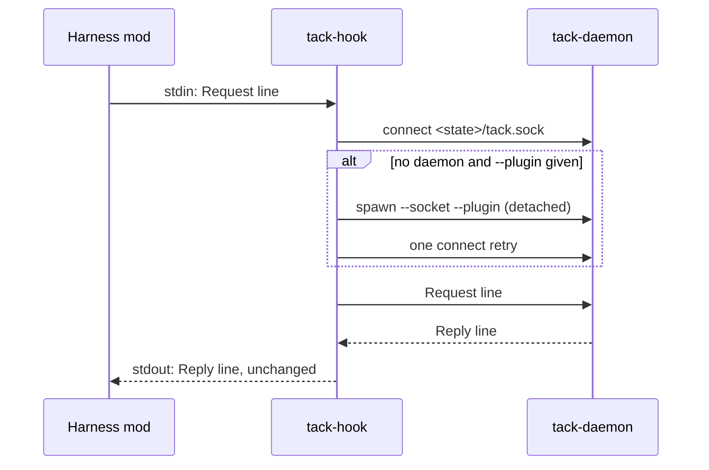

# tack-hook

A thin native client for the per-user tack daemon. A generated harness mod
runs it once per call: one request line in on stdin, one reply line out on
stdout, exit 0. It runs no plugin code; the daemon does.



```sh
echo '{"kind":"hook","id":1,"version":1,"hook":"toolBefore",
  "call":{"tool":"shell","name":"Bash","input":{"command":"git push"}}}' \
  | tack-hook --plugin /plugins/safe-push
# {"kind":"hook","id":1,"version":1,"outcome":{"kind":"deny","reason":"push blocked"}}
```

## Modules

| Module        | Responsibility                                                    |
| ------------- | ----------------------------------------------------------------- |
| `lib.rs`      | `--plugin`, the stdin line, `Call` and `forward`                  |
| `locate.rs`   | State folder, socket and daemon binary                            |
| `start.rs`    | Detached daemon spawn and the bounded wait for its socket         |
| `exchange.rs` | One connect, request and reply; the checks before pass-through    |
| `failure.rs`  | The `Reply::Error` line written when no verdict arrives           |
| `main.rs`     | The composition root: stdin, runtime, stdout                      |

## Locations

- State folder: `TACK_STATE_DIR` as-is, else `XDG_STATE_HOME/tack`, else
  `HOME/.local/state/tack`. The socket is `<state>/tack.sock`.
- Daemon: `TACK_DAEMON_BIN`, else `tack-daemon` beside `tack-hook`, else
  `tack-daemon` on `PATH`. Without `--plugin` it is never started.
- The hook never removes a socket file.

## Bounds

| Bound   | Value                                                       |
| ------- | ----------------------------------------------------------- |
| Line    | 1 MiB with its newline, request and reply                   |
| Total   | 9000 ms from process start to the verdict, every wait inside |
| Start   | 3000 ms at most for a started daemon's socket, within total |
| Retries | One connect after one start, with the time left             |

The retry gets only what the start wait left. When the start wait spends the
budget, the retry still runs once: a missing socket denies `socket_missing`
at once, a silent daemon `timeout`.

## Failing closed

Every failure is a `Reply::Error` line with the request id (0 before it is
known) and a named kind:

| Kind               | When                                                |
| ------------------ | --------------------------------------------------- |
| `socket_missing`   | No socket, or no state folder                       |
| `socket_closed`    | Refused, or closed before a whole reply line        |
| `timeout`          | No request or reply by the total deadline           |
| `malformed_reply`  | Not a reply, over 1 MiB, another id or kind         |
| `protocol_version` | A reply of another protocol version                 |
| `daemon_error`     | The daemon could not be started                     |
| `aborted`          | Reading stdin failed                                |
| `malformed`        | Stdin or the arguments are not a request            |
| `too_large`        | The request line is over 1 MiB                      |

A daemon's own error reply, such as `script` or `limit`, passes through
unchanged.
