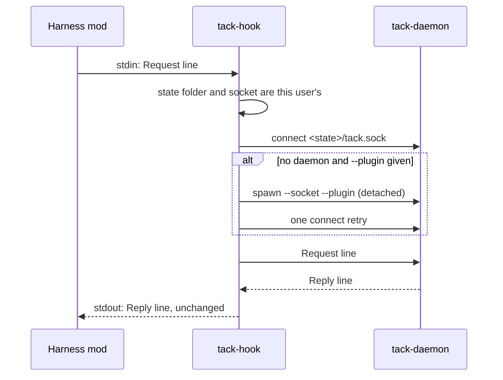

# tack-hook

A thin native client for the per-user tack daemon. A generated harness mod
runs it once per call: one request line in on stdin, one reply line out on
stdout, exit 0. It runs no plugin code; the daemon does.



```sh
echo '{"kind":"hook","id":1,"version":1,"hook":"toolBefore",
  "call":{"tool":"shell","name":"Bash","input":{"command":"git push"}}}' \
  | tack-hook --plugin /plugins/safe-push
# {"kind":"hook","id":1,"version":1,"outcome":{"kind":"deny","reason":"push blocked"}}
```

## Modules

| Module        | Responsibility                                                 |
| ------------- | -------------------------------------------------------------- |
| `lib.rs`      | `--plugin`, the stdin line, `Call` and `forward`               |
| `locate.rs`   | State folder, socket and daemon binary                         |
| `start.rs`    | Detached daemon spawn and the bounded wait for its socket      |
| `trust.rs`    | The owner and mode check on the state folder and socket        |
| `exchange.rs` | One connect, request and reply; the checks before pass-through |
| `failure.rs`  | The `Reply::Error` line written when no verdict arrives        |
| `main.rs`     | The composition root: stdin, runtime, stdout                   |

## Locations

- State folder: `TACK_STATE_DIR` as-is, else `XDG_STATE_HOME/tack`, else
  `HOME/.local/state/tack`. The socket is `<state>/tack.sock`.
- Daemon: `TACK_DAEMON_BIN`, else `tack-daemon` beside `tack-hook`'s own
  executable. Without either, a cold start denies `daemon_error` and starts
  nothing. `PATH` is never searched: the harness's environment would pick
  whichever `tack-daemon` comes first, a binary the user never chose to run
  their plugins. Without `--plugin` the daemon is never started.
- The hook never removes a socket file.

## Trust

Before every connect, the first and the retry, the hook checks the socket's
folder and the socket itself against its effective uid:

| File         | Must be                                                       |
| ------------ | ------------------------------------------------------------- |
| State folder | A directory of the euid, mode 0700 or stricter                |
| Socket       | A socket, not a symlink, of the euid, no group or world write |

A folder only its owner can enter keeps other users from planting or
swapping a socket in it. A missing folder or socket counts as no daemon, so
a cold start may follow; any other failure denies `socket_untrusted` and
starts nothing.

## Bounds

| Bound   | Value                                                        |
| ------- | ------------------------------------------------------------ |
| Line    | 1 MiB with its newline, request and reply                    |
| Total   | 8500 ms from process start to the verdict, every wait inside |
| Start   | 3000 ms at most for a started daemon's socket, within total  |
| Retries | One connect after one start, with the time left              |

The total stays under the harness mod's 9000 ms timeout, so the mod reads
the hook's named verdict before it gives up. The retry gets only what the
start wait left. When the start wait spends the budget, the retry still runs
once: a missing socket denies `socket_missing` at once, a silent daemon
`timeout`.

## Failing closed

Every failure is a `Reply::Error` line with the request id (0 before it is
known) and a named kind:

| Kind               | When                                              |
| ------------------ | ------------------------------------------------- |
| `socket_missing`   | No socket, or no state folder                     |
| `socket_closed`    | Refused, or closed before a whole reply line      |
| `timeout`          | No request or reply by the total deadline         |
| `malformed_reply`  | Not a reply, over 1 MiB, another id or kind       |
| `protocol_version` | A reply of another protocol version               |
| `socket_untrusted` | The state folder or socket is not this user's own |
| `daemon_error`     | The daemon could not be found or started          |
| `aborted`          | Reading stdin failed                              |
| `malformed`        | Stdin or the arguments are not a request          |
| `too_large`        | The request line is over 1 MiB                    |

A daemon's own error reply, such as `script` or `limit`, passes through
unchanged.
