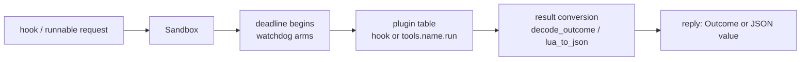

# Sandbox

One mlua VM per plugin, bounded by a memory ceiling and a per-call clock.
A call arms the deadline, runs against the plugin's Luau table, and converts
the result under depth and entry limits.

- `mod.rs`: `Sandbox` and its public API (`new`, `hook`, `run`,
  `manifest`), the runners `run_hook` and `run_runnable`, and the manifest
  readers `read_manifest`, `read_needs` and `read_tools`. Declares the
  modules and re-exports the public types.
- `errors.rs`: `MAX_DEPTH`, `MAX_ENTRIES`, `LimitCause`, `LoadCause`
  and `EngineError`, with their display, error and `mlua::Error` impls.
- `deadline.rs`: `Deadline`, the armed clock the VM interrupt polls on
  each instruction.
- `loading.rs`: `load_plugin`, which runs the loader chunk and requires
  that it returns a table.
- `outcome.rs`: `decode_outcome` turns hook returns into verdicts.
- `values.rs`: `read_tool`, `lua_key`, `json_to_lua`, `lua_to_json`
  and `lua_table_to_json`, the bounded JSON/Lua conversion boundary.
- `call.rs`: `ctx` builds the per-call context with host data, verdict
  helpers, and capabilities.
- `capabilities.rs`: host callbacks attached to the per-call context, with
  bounded value conversion and named errors.
- `tests.rs`: the sandbox test suite, compiled only under `cfg(test)`.
