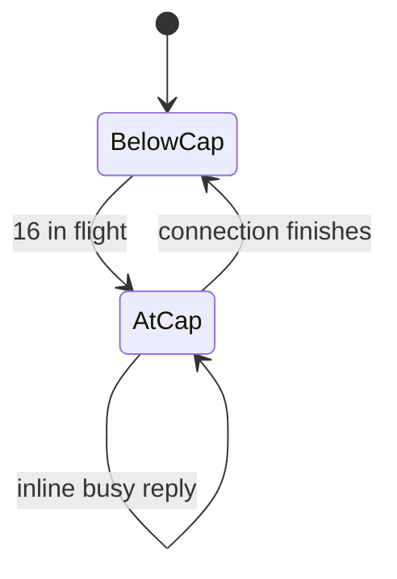
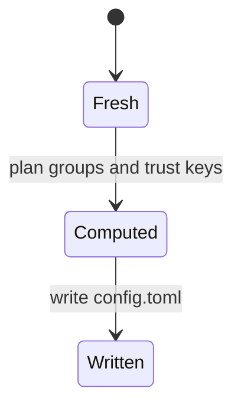
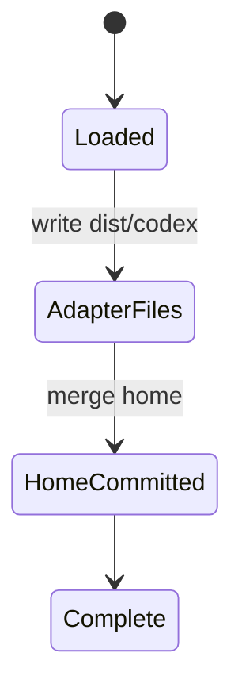
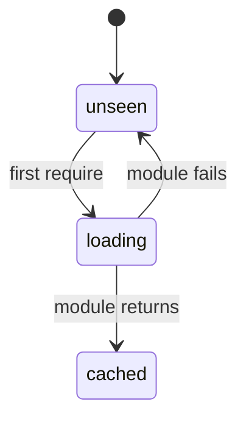

# tack v1 hardening audit

This audit covers the daemon accept loop and protocol framing, hook trust and
reply checking, the Luau sandbox with its `require` and deadline, the CLI build
output and the Codex home trust merge, and all four adapters, at commit
`85ee5b7`. It finds two high, one medium and one low finding, each with a
failing test or a missing proof; tack#73 is fixed in this branch, the rest
stay open.

## Checks

| Check                                                   | Result                                                                                             |
| ------------------------------------------------------- | -------------------------------------------------------------------------------------------------- |
| `cargo fmt --all`                                       | Pass                                                                                               |
| `cargo clippy --workspace --all-targets -- -D warnings` | Pass on this branch (local cargo clippy, CI gate: rust job in [run 45695173612][fix-run])          |
| CI run [45668264928][run-74]                            | `rust` fails: `home::tests::a_rebuild_after_a_user_group_is_inserted_removes_the_stale_tack_state` |
| CI run [45668707100][run-75]                            | `rust` fails: `tests::dispatch_build_codex_refuses_a_bad_home_without_writing_adapter_files`       |
| CI run [45669092449][run-73]                            | `rust` fails: `transport::tests::a_full_connection_budget_does_not_starve_new_requests`            |
| `format`, `deny`, `mutants`, `smoke` on each run        | Pass; see [run 45695173612][fix-run]                                                               |

No mutation pruning was done, so no mutation result is claimed over pruned
tests.

## Findings by severity

| Severity | Machine               | What happens                                                                                | Issue               | Fix       |
| -------- | --------------------- | ------------------------------------------------------------------------------------------- | ------------------- | --------- |
| High     | Daemon accept budget  | 16 held partial-frame peers stall the accept loop and time out a legitimate hook            | [tack#73][t73]      | `cb6f22b` |
| High     | Codex home trust      | A stale enabled tack state table survives a group-index change and disables the user's hook | [tack#74][t74]      | `c185adf` |
| Medium   | CLI build write       | A refused Codex home leaves a finished-looking adapter tree                                 | [tack#75][t75]      | `8f4ad95` |
| Low      | Workhorse format gate | The exit-2 parse or config path is implemented but unproven                                 | [workhorse#69][w69] | Open      |
| Low      | Daemon bounded I/O    | An overflow peer can get EPIPE, and a progressing frame can hit the 750 ms deadline         | [tack#77][t77]      | `9a3515e` |

## Daemon accept budget

The finding was that `serve` parked in `join_next()` once 16 connections were
in flight. A peer sending a partial frame held its slot until the 5 s frame
deadline. Sixteen such peers stalled the loop: a 17th request connected into
the kernel backlog and got no reply before its hook budget ran out.

Evidence: the regression test (now
`an_overflow_connection_gets_a_named_busy_denial`, then named
`a_full_connection_budget_does_not_starve_new_requests`) fails in
[run 45669092449][run-73]. In the same test a control request is answered within
2 s, and the 17th request gets no reply.

Fix direction: keep accepting while bounding slow peers, for example with a
shorter per-connection deadline or reserved capacity. The regression test
lands with the fix.

Fix commit cb6f22b adds a typed `busy` reply. An overflow connection gets one
nonblocking write of that reply before the daemon reads anything from the peer;
the reply uses id 0, which the hook accepts and the adapters render as
`tack: busy`. A connection handles at most four frames; a fifth gets the same
named busy refusal and closes. Each frame's reads and each reply write get
750 ms; handler time is excluded from those bounds and is limited by the
daemon's per-call limits. The regression tests assert the exact busy denial for
stalled and dribbling peers, and cover a later frame, two frames on one
connection, and a peer that stops reading a large reply.

## Codex home trust

Codex keys a hook's trust state by its position. When the user inserts a hook
group ahead of tack's, tack's group moves from index 0 to 1, and the rebuild
drops only the headers of the new keys. The old table at index 0 survives
with `enabled = true` and tack's old hash, which now describes the user's hook,
so Codex refuses to run it. This breaks the invariant that no other hook's
key moves.

Evidence:
`home::tests::a_rebuild_after_a_user_group_is_inserted_removes_the_stale_tack_state`
fails in [run 45668264928][run-74]. As a control, a fresh install writes the
correct tables.

Fix direction: identify tack's tables by a hash of the command, not by
position, and drop every stale tack table for the same source.

Fix commit c185adf hashes tack's own groups in the existing hooks.json before
the rebuild and drops state tables for this source whose trusted hash is one of
those old tack hashes. User-owned tables, tables with no hash, tables under
another hooks.json and non-state tables stay byte-identical.

## CLI build write

Building for Codex writes all six adapter files before the Codex installer can
refuse a `config.toml` it cannot merge. The CLI exits 1 and prints no paths,
but `dist/codex/` looks finished while the home has no tack group or trust.

Evidence:
`tests::dispatch_build_codex_refuses_a_bad_home_without_writing_adapter_files`
fails in [run 45668707100][run-75]. As a control, the existing no-home test
writes nothing.

Fix direction: compute and validate the home merge before writing adapter
files, or stage every file and commit them together.

Fix commit 8f4ad95 plans and validates the Codex home before creating or writing
adapter files, then writes the planned contents from memory. A refused home
leaves no output directory.

## Workhorse format gate

The workhorse `format` job reports tidy's exit 1 (unformatted) and exit 2
(parse or config error) separately and fails on both. Its proof shows only
exit 1, so the exit-2 path has no executed evidence. The severity is low
because the check is implemented; only its proof is missing.

Fix direction: add a bounded CI exercise that gives tidy an invalid config and
asserts exit 2 and the reported error, then cite its run. The gate stays as
strict as it is.

## Daemon bounded I/O

Fix commit 9a3515e restarts the 750 ms read budget whenever bytes arrive, capped
by the absolute I/O lifetime, and drains a refused peer's request before closing
so the busy denial reaches it. A unit test pins that EOF does not restart the
stall budget.

Residual (supervisor, 2026-11-26): a burst past the drain cap, or an overflow
sender slower than the 20 ms drain window, may show `socket_closed` instead of
`busy`; both are named denials, never an allow. The drain runs off the accept
loop, so a longer window would not detour accepts but would hold drain slots
longer.

## Seen, not fixed

| Candidate                                                                        | Reach                    | Reason                                                                        |
| -------------------------------------------------------------------------------- | ------------------------ | ----------------------------------------------------------------------------- |
| Luau C stdlib string patterns ignore the 100 ms interrupt and hold the call lock | Code, slice-1.md:502-504 | Documented accepted risk; no executed repro                                   |
| `require` canonicalizes, then opens: a symlink swap between them                 | Code                     | No deterministic real-path repro                                              |
| A stale `loading` entry after an allocation failure inside module setup          | Code                     | No executed repro                                                             |
| Daemon framing errors carry id 0, and the hook rejects them as malformed         | Code                     | The hook caps frames first, so the normal path never sends one                |
| Socket swap between verify and connect                                           | Code                     | Needs a same-uid attacker                                                     |
| Half-written pid file after a crash between truncate and write                   | Code                     | The lock stays correct                                                        |
| A non-string `deny` is classified as Script                                      | Code                     | No wrong outcome found                                                        |
| Windows drive-relative `require` spec                                            | Code                     | Not reachable on darwin                                                       |
| Codex state source prefix can match another hooks.json                           | Code                     | Low severity, tracked in [tack#80](https://github.com/wrkhse/tack/issues/80). |
| Stale trust tables from older tack hashes survive                                | Code                     | Low severity, tracked in [tack#81](https://github.com/wrkhse/tack/issues/81). |

## Machines

### Daemon connection budget

A peer that stops making progress releases its connection slot within a bounded
read or write wait, and normal request connections never exceed 16; an overflow
connection gets a bounded inline busy reply. In BelowCap an accept spawns a
task; in AtCap it writes the busy reply inline and moves on. The forbidden
transition is a request that connects but is never served, which tack#73 proved
with 16 held partial frames.

### Codex home merge

After Written, every enabled tack state table matches a tack hook at its
current index, and no user hook's key or trust changes. Fresh reads the
user's home, Computed holds the merged groups and keys, Written puts them on
disk. The forbidden state is a stale tack table that survives into Written,
which tack#74 reaches by inserting a user group.

### CLI codex build

Adapter files exist on disk only when the home merge succeeds, so a finished
tree always means an installed hook. Loaded reads the rules, AdapterFiles
writes the six files, HomeCommitted writes the merged home, Complete prints
the paths. The forbidden transition is AdapterFiles to Refused, which tack#75
reaches with a home the merge cannot read.

### Luau require

A module path resolves inside the rules root, runs once, and a second
`require` of a module still loading is a cycle error. unseen starts a load,
loading runs the module under the deadline, cached returns the stored value.
The forbidden states are a `loading` entry left behind after a failure, and a
path that escapes the root after it is checked. Neither has an executed repro;
both are listed under Seen, not fixed.

Fixes land in separate commits with regression tests, in severity order, and
this page changes as each issue closes.

[run-73]: https://github.com/wrkhse/tack/actions/runs/45669092449
[run-74]: https://github.com/wrkhse/tack/actions/runs/45668264928
[run-75]: https://github.com/wrkhse/tack/actions/runs/45668707100
[fix-run]: https://github.com/wrkhse/tack/actions/runs/45695173612
[t73]: https://github.com/wrkhse/tack/issues/73
[t74]: https://github.com/wrkhse/tack/issues/74
[t75]: https://github.com/wrkhse/tack/issues/75
[t77]: https://github.com/wrkhse/tack/issues/77
[w69]: https://github.com/wrkhse/workhorse/issues/69
