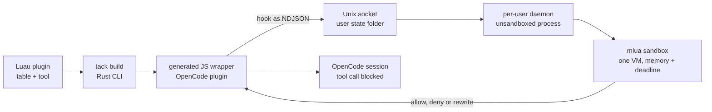

# Slice 1: one plugin, OpenCode, unsandboxed daemon

**Status:** In progress ([tack#34](https://github.com/wrkhse/tack/issues/34)).

You can write one Luau plugin with a `toolBefore` hook and one tool, build it
for OpenCode, and have the hook deny a tool call in a real OpenCode session.

```lua
--!strict
local guardStatus = require("./guard-status")

return {
  name = "safe-push",

  toolBefore = function(call, ctx)
    if call.tool == "shell"
      and string.find(call.input.command, "^git push") then
      return ctx.deny("push blocked")
    end
  end,

  tools = { guard_status = guardStatus },
}
```



## What it builds

- **Build** — `cli/build` reads the plugin table, resolves modules and emits
  `dist/opencode/index.js` plus a tool manifest. Verification: a fixture plugin
  builds; a missing need fails with a named error; the output holds no rule logic.

- **Wrapper** — `wrapper/opencode.js` sends each hook as NDJSON over the socket
  and fails closed. The first call starts the daemon when the socket is missing,
  waits up to its timeout, then fails closed. Verification: missing socket,
  timeout, closed socket and malformed reply each deny with a named reason; a
  cold first call starts the daemon and succeeds.

- **Transport** — `runtime/transport.rs` frames JSON-RPC over the Unix socket in
  the user's state folder with owner-only permissions. A lock file guards
  concurrent starts; a caller that loses the race waits up to its timeout and
  then fails closed. Verification: two starts race and one loses with a named
  error.

- **Daemon and SDK** — `daemon/daemon.rs` and `sdk/` run the plugin's Luau in an
  `mlua` sandbox at 16 MiB and 100 ms per call. Verification: a hook denies the
  call; a runaway loop and a memory hog are denied by the limits.

- **Tool** — the generated wrapper registers `guard_status` natively in
  OpenCode; its run goes to the daemon over the same socket. Verification: the
  model calls the tool and a recorder sees the daemon run it. MCP server: a
  later slice.

## End to end

Two checks run in a real OpenCode session with a scripted, fake model provider,
so no API key is needed, in CI or a container with a throwaway `HOME`:

1. The model runs `git push` through the shell tool; `toolBefore` denies it and
   a recorder sees no execution.

2. The model calls `guard_status`; the tool runs in the daemon and its result
   returns to the session.

A passing build or a unit test alone is not the proof.

## Provenance

Base commit: `663045b8e9a931a188d011484a425144cd2a1885`.

The e2e part re-adds `conformance/model/stand-in.ts` and
`conformance/harness/recorder.ts` from that base as the CI fixture.

## Left open

- The scripted provider is decided: a minimal local OpenAI-compatible SSE
  stand-in ported from `conformance/model/stand-in.ts`, with a git-shim
  recorder, CI-only.
- Whether the recorder trace is kept as a CI artifact is open.
