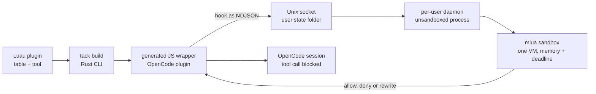

# Slice 1: one plugin, OpenCode, unsandboxed daemon

**Status:** In progress ([tack#34](https://github.com/wrkhse/tack/issues/34)).

You can write one Luau plugin with a `toolBefore` hook and one tool, build it
for OpenCode, and have the hook deny a tool call in a real OpenCode session.

```lua
--!strict
local guardStatus = require("./guard-status")

return {
  name = "safe-push",

  toolBefore = function(call, ctx)
    if call.tool == "shell"
      and string.find(call.input.command, "^git push") then
      return ctx.deny("push blocked")
    end
  end,

  tools = { guard_status = guardStatus },
}
```



## What it builds

- **Build** — `cli/src/lib.rs` is the public API of the build pipeline. It
  checks a plugin's needs, renders the wrapper from `wrapper/opencode.js`,
  and writes the wrapper and a tool manifest into `dist/opencode`.
  `cli/src/main.rs` parses the command line and calls it. Verification: a
  fixture plugin builds; a missing need fails with a named error; the output
  holds no rule logic.

  **Structure.** `build` canonicalizes the plugin folder, checks every need,
  and returns the wrapper and manifest paths it wrote:

```rust
pub fn build(
    plugin_dir: &Path,
    out: &Path,
    options: BuildOptions,
) -> Result<(PathBuf, PathBuf), BuildError>;

pub struct BuildOptions {
    pub call_timeout_ms: u64,
    pub start_timeout_ms: u64,
}
```

  Tests shorten both budgets so a call denies in milliseconds. The defaults
  are 2 s per call and 3 s for the first daemon start:

```rust
impl Default for BuildOptions {}
```

  **BuildError** names the stage that failed. `NeedMissing` carries the
  unsupported need; the other variants wrap that stage's error:

```rust
pub enum BuildError {
    NeedMissing(String),
    Sandbox(EngineError),
    Render(WrapperError),
    Io(std::io::Error),
}

impl fmt::Display for BuildError {}

impl Error for BuildError {}
```

- **Wrapper** — `wrapper/opencode.js` sends each hook as NDJSON over the socket
  and fails closed. The first call starts the daemon when the socket is
  missing, waits up to its timeout, then fails closed. Verification: missing
  socket, timeout, closed socket and malformed reply each deny with a named
  reason; a cold first call starts the daemon and succeeds.

  **Structure.** Every message on the socket is one NDJSON line. Requests are
  internally tagged on `kind` and carry the protocol version:

```rust
pub const PROTOCOL_VERSION: u32 = 1;

pub enum Request {
    Hook { id: u64, version: u32, hook: String, call: ToolCall },
    Tool { id: u64, version: u32, name: String, input: Value },
}
```

  `Request` exposes `id` and `version` so the daemon can reject a mismatched
  version before it runs any plugin code:

```rust
impl Request {
    pub fn id(&self) -> u64;
    pub fn version(&self) -> u32;
}
```

  A hook inspects a `ToolCall`; a reply carries an outcome, tool content or a
  machine-readable error class:

```rust
pub struct ToolCall {
    pub tool: String,
    pub name: String,
    pub input: Value,
    pub session_id: Option<String>,
}

pub enum Outcome {
    Allow,
    Deny { reason: String },
    Rewrite { input: Value },
}

pub enum Reply {
    Hook { id: u64, version: u32, outcome: Outcome },
    Tool { id: u64, version: u32, content: Vec<Content> },
    Error { id: u64, version: u32, error: ReplyError, message: String },
}

pub struct Content {
    pub kind: String,
    pub text: String,
}
```

  `session_id` defaults to `None`. `ReplyError` is the class on the wire; the
  wrapper maps each to a fail-closed deny:

```rust
pub enum ReplyError {
    Malformed,
    TooLarge,
    Limit,
    Script,
    UnsupportedHook,
    UnknownTool,
}
```

  A `DenyReason` is the named reason the wrapper reports when it fails closed
  without a verdict from the daemon. `ALL` is the set handed to the generated
  script. A reason outside that set degrades to `malformed_reply`:

```rust
pub enum DenyReason {
    SocketMissing,
    Timeout,
    SocketClosed,
    MalformedReply,
    ProtocolVersion,
    Limit,
    Script,
    UnknownTool,
    DaemonError,
}

impl DenyReason {
    pub const ALL: [DenyReason; 9];
    pub fn as_str(self) -> &'static str;
}
```

  `WrapperConfig` carries the values the template needs. The daemon stays a
  plain name in the generated script and is resolved from `TACK_DAEMON_BIN`
  or `PATH` at run time:

```rust
pub struct WrapperConfig<'a> {
    pub manifest: &'a PluginManifest,
    pub daemon_bin: &'a str,
    pub plugin_dir: &'a str,
    pub protocol_version: u32,
    pub deny_reasons: &'a [&'a str],
    pub call_timeout_ms: u64,
    pub start_timeout_ms: u64,
}
```

  `render` fills the seven template slots with JSON literals and returns an
  error if a slot is missing, a value carries a `__TACK_` token or a newline,
  or a substitution leaves a token behind:

```rust
pub fn render(config: &WrapperConfig) -> Result<String, WrapperError>;

pub enum WrapperError {
    MissingToken(&'static str),
    UnreplacedToken(&'static str),
    UnsafeValue(&'static str),
    Json(String),
}
```

  `encode_line` and `read_line` frame each value as one newline-terminated
  line under a hard size cap:

```rust
pub fn encode_line<T: Serialize>(value: &T) -> Result<Vec<u8>, WireError>;

pub fn read_line<R: BufRead>(reader: &mut R) -> Result<Option<Vec<u8>>, WireError>;
```

- **Transport** — `runtime/src/transport.rs` frames NDJSON over the Unix socket
  in the user's state folder with owner-only permissions. A lock file guards
  concurrent starts; a caller that loses the race waits up to its timeout and
  then fails closed. Verification: two starts race and one loses with a named
  error.

  **Structure.** `bind` verifies the state folder, takes the start lock and
  binds an owner-only socket; `Server::serve` runs a bounded accept loop:

```rust
pub struct Server {
    listener: UnixListener,
    socket: PathBuf,
    _lock: Lock,
}

pub async fn bind(
    state_dir: &Path,
    socket: &Path,
) -> Result<Server, TransportError>;

impl Server {
    pub async fn serve<F>(self, handle: F) -> Result<(), TransportError>
    where
        F: Fn(Request) -> Reply + Send + Sync + 'static;
}
```

  The held `Lock` keeps the kernel `flock` alive until the daemon exits;
  `Drop for Server` removes the socket:

```rust
impl Drop for Server {}
```

  `TransportError` names each binding and serving failure:

```rust
pub enum TransportError {
    LockBusy,
    LockIo,
    StateNotOwned,
    Bind(String),
    Io,
    Malformed,
}
```

- **Daemon and SDK** — `daemon/src/main.rs` and `sdk/` run the plugin's Luau in
  an `mlua` sandbox at 16 MiB and 100 ms per call. Verification: a hook denies
  the call; a runaway loop and a memory hog are denied by the limits.

  **Structure.** `Sandbox::new` loads the plugin under a memory ceiling and a
  deadline; `hook`, `tool` and `manifest` arm that deadline for each call:

```rust
pub struct Sandbox {
    lua: Lua,
    plugin: Table,
    deadline: Arc<Deadline>,
    call_lock: Mutex<()>,
    default_deadline_ms: u64,
}

impl Sandbox {
    pub fn new(
        folder: &Path,
        memory_bytes: usize,
        deadline_ms: u64,
    ) -> Result<Sandbox, EngineError>;

    pub fn hook(
        &self,
        hook: &str,
        call: &ToolCall,
        deadline_ms: u64,
    ) -> Result<Outcome, EngineError>;

    pub fn tool(
        &self,
        name: &str,
        input: &Value,
        deadline_ms: u64,
    ) -> Result<Vec<Content>, EngineError>;

    pub fn manifest(&self) -> Result<PluginManifest, EngineError>;
}
```

  `EngineError` carries typed causes for limits and loads, so the daemon maps
  each failure to a wire error without reading a message string:

```rust
pub enum LimitCause {
    Deadline,
    Memory,
    TooManyEntries { limit: usize },
    TooDeep { limit: usize },
}

pub enum LoadCause {
    Require(RequireCause),
    Message(String),
}

pub enum EngineError {
    Load(LoadCause),
    Script(String),
    Limit(LimitCause),
    UnknownTool(String),
    InvalidResult(String),
}
```

  Converting an `mlua::Error` downcasts its external cause; a memory error is a
  limit and anything else is a script failure:

```rust
impl From<mlua::Error> for EngineError {}
```

  The daemon's entry points parse the socket and plugin paths, resolve the
  state folder and dispatch each request to the sandbox:

```rust
struct Args {
    socket: PathBuf,
    plugin: PathBuf,
}

fn main();

fn parse_args() -> Result<Args, String>;

fn state_dir() -> Result<PathBuf, String>;

fn state_dir_from(
    tack_state_dir: Option<&str>,
    xdg_state_home: Option<&str>,
    home: Option<&str>,
) -> Result<PathBuf, String>;

fn socket_in_state_dir(state_dir: &Path, socket: &Path) -> bool;

fn dispatch(sandbox: &Sandbox, request: Request) -> Reply;

fn reply_error(id: u64, error: EngineError) -> Reply;

fn version_error(id: u64, version: u32) -> Reply;
```

  `dispatch` refuses a wrong protocol version and any hook other than
  `toolBefore`. `state_dir_from` prefers `TACK_STATE_DIR`, then
  `XDG_STATE_HOME/tack`, then `HOME/.local/state/tack`.

  **SDK.** `sdk/tack.d.luau` declares the table a plugin returns and the
  helpers Rust passes to each hook and tool call:

```lua
export type Plugin = {
    name: string,
    needs: { string }?,
    toolBefore: ((call: ToolCall, ctx: HookCtx) -> ToolBeforeResult)?,
    tools: { [string]: ToolDef }?,
}

export type ToolDef = {
    name: string,
    description: string?,
    input: any?,
    run: (input: any, ctx: HookCtx) -> ToolResult,
}

export type HookCtx = {
    deny: (reason: string) -> DenyResult,
    rewrite: (command: string) -> RewriteResult,
    allow: () -> nil,
}
```

- **Tool** — the generated wrapper registers `guard_status` natively in
  OpenCode; its run goes to the daemon over the same socket. Verification: the
  model calls the tool and a recorder sees the daemon run it. MCP server: a
  later slice.

  **Structure.** A tool is a Luau table in the plugin's `tools` map with a
  `run` function that returns content items. The `guard-status` fixture is the
  reference shape:

```lua
return {
    name = "guard_status",
    description = "Reports whether the tack daemon is running",
    input = {},
    run = function(input, ctx)
        return {
            content = {
                { kind = "text", text = "guard_status: daemon ok" },
            },
        }
    end,
}
```

  `sdk/tack.d.luau` declares that shape under `--!strict`:

```lua
export type Content = { kind: string, text: string }
export type ToolResult = { content: { Content } }
```

## End to end

Two checks run in a real OpenCode session with a scripted, fake model provider,
so no API key is needed, in CI or a container with a throwaway `HOME`:

1. The model runs `git push` through the shell tool; `toolBefore` denies it and
   a recorder sees no execution.

2. The model calls `guard_status`; the tool runs in the daemon and its result
   returns to the session.

A passing build or a unit test alone is not the proof.

The scripted provider is decided: a minimal local OpenAI-compatible SSE
stand-in ported from `conformance/model/stand-in.ts` at base commit
`663045b8e9a931a188d011484a425144cd2a1885`, with a git-shim recorder,
CI-only.

## Provenance

Base commit: `663045b8e9a931a188d011484a425144cd2a1885`.

The e2e part ports ideas from the deleted `conformance/model/stand-in.ts` and
`conformance/harness/recorder.ts` into the CI fixture. Recording of tack-tool
calls from the old suite was dropped in this slice.

## Left open

- Whether the recorder trace is kept as a CI artifact is open.

- Luau string patterns are executed in C and cannot be interrupted by the
  100 ms deadline, so a pathological pattern in a plugin can stall a call.
  Bounding the command text length and discouraging nested or unbounded
  patterns in plugin review is one mitigation.

- `luau-analyze` over `sdk/tack.d.luau` is not yet wired into CI because the
  tool is not installed in the pinned environment.
