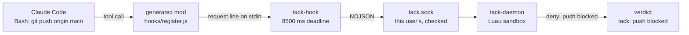

# Slice 2: one plugin, Claude Code, native hook client

**Status:** Implemented (v0.1.0-rc.3).

[Release: v0.1.0-rc.3](https://github.com/wrkhse/tack/releases/tag/v0.1.0-rc.3).

You can build the safe-push plugin from [slice 1](slice-1.md) for Claude Code
and have its `toolBefore` hook deny a push in a real Claude Code session,
while its `guard_status` tool runs in the tack daemon.

```bash
tack build fixtures/safe-push --out dist --target claude
# dist/claude/.claude-plugin/plugin.json
# dist/claude/hooks/hooks.json
# dist/claude/hooks/register.js

claude --plugin-dir dist/claude
```

Asked to "push my branch", the model runs `git push origin main` through Bash.
The session shows `tack: push blocked` and no push reaches the remote. The
model then calls `mcp__tack__guard_status` and reads `guard_status: daemon ok`.



Claude Code calls the mod's `tool.call` hook for each Bash call and each
`mcp__tack__` tool. The mod runs `tack-hook` once per call with one request
line on stdin. `tack-hook` checks the state folder and socket, starts the
daemon when none listens, and passes the request line through. The daemon runs
the plugin's Luau as it does for OpenCode, and its reply line travels back
unchanged to the mod, which turns it into Claude Code's verdict.

## What it builds

### tack-hook

`tack-hook` is a thin native client for the per-user daemon: one request line
in on stdin, one reply line out on stdout, exit 0. It runs no Luau. Before
every connect it checks that the state folder is a directory of its effective
uid (read with `rustix`'s `geteuid`) with mode 0700 or stricter, and that the
socket is a socket, not a symlink, of that uid, writable by neither group nor
world. One 8500 ms deadline, fixed at process start, bounds the whole run:
stdin, a cold start of at most 3000 ms, and every connect, send and read.
Every failure is a `Reply::Error` line with a named kind, so the caller
always reads a verdict.

Files: `crates/hook/src/lib.rs`, `main.rs`, `exchange.rs`, `trust.rs`,
`locate.rs`, `start.rs`, `failure.rs`, and `crates/hook/README.md`.
`crates/protocol/src/wire.rs` carries the transport kinds on the wire.

```sh
request='{"kind":"hook","id":1,"version":1,"hook":"toolBefore",'
request+='"call":{"tool":"shell","name":"Bash",'
request+='"input":{"command":"git push"}}}'

echo "$request" | tack-hook --plugin /plugins/safe-push
# {"kind":"hook","id":1,"version":1,"outcome":{"kind":"deny","reason":"push blocked"}}
```

Without `--plugin` the hook never starts a daemon, so with none running the
same request fails closed:

```text
{"kind":"error","id":1,"version":1,"error":"socket_missing","message":"tack-hook: no tack daemon at /home/u/.local/state/tack/tack.sock"}
```

**Structure.** `Limits` holds the two waits; `Limits::DEFAULT` is 8500 ms
total and 3000 ms for a start, under the mod's 9000 ms. A `Budget` fixes the
deadline once; the start wait is cut to what is left of it:

```rust
pub struct Limits {
    pub total: Duration,
    pub start: Duration,
}

impl Limits {
    pub const DEFAULT: Self;
}

pub struct Budget {
    deadline: Instant,
    limits: Limits,
}

impl Budget {
    pub fn from_now(limits: Limits) -> Self;
    pub const fn deadline(&self) -> Instant;
    pub fn timed_out(&self, waiting_for: &str) -> Failure;
}
```

`plugin_dir` accepts `--plugin <dir>` and nothing else. `read_request` reads
the first stdin line, at most 1 MiB with its newline. `forward` checks trust,
connects, and on a missing or refusing socket runs `start` once and connects
once more with the time left. It returns the reply line only when it is a
reply of this protocol version with the request's id and kind, or an error:

```rust
pub fn plugin_dir(
    args: impl IntoIterator<Item = OsString>,
) -> Result<Option<PathBuf>, Failure>;

pub fn read_request<R: BufRead>(reader: &mut R) -> Result<Vec<u8>, Failure>;

pub struct Call {
    line: Vec<u8>,
    request: Request,
}

impl Call {
    pub fn parse(line: Vec<u8>) -> Result<Self, Failure>;
    pub const fn id(&self) -> u64;
}

pub async fn forward<S>(
    call: &Call,
    socket: &Path,
    start: Option<S>,
    budget: Budget,
) -> Result<Vec<u8>, Failure>
where
    S: FnOnce() -> Result<(), Failure> + Send;
```

The state folder is `TACK_STATE_DIR`, else `XDG_STATE_HOME/tack`, else
`HOME/.local/state/tack`, and the socket is `tack.sock` in it. The daemon is
`TACK_DAEMON_BIN`, else `tack-daemon` beside the hook's own executable;
`PATH` is never searched. `Launch::spawn` creates a missing state folder
owner-only and starts the daemon in its own process group, its output in
`daemon.log`. `cold_start` waits at most `limit` for a socket file that was
not there before:

```rust
pub const SOCKET_NAME: &str = "tack.sock";
pub const DAEMON_NAME: &str = "tack-daemon";
pub const DAEMON_LOG: &str = "daemon.log";

pub fn state_dir() -> Result<PathBuf, Failure>;

pub fn daemon_bin() -> Result<PathBuf, Failure>;

pub fn daemon_bin_from(
    explicit: Option<OsString>,
    exe: Option<&Path>,
    exists: impl Fn(&Path) -> bool,
) -> Result<PathBuf, Failure>;

pub struct Launch {
    pub bin: PathBuf,
    pub socket: PathBuf,
    pub plugin: PathBuf,
    pub state: PathBuf,
}

impl Launch {
    pub fn spawn(&self) -> Result<(), Failure>;
}

pub async fn cold_start<S>(
    socket: &Path,
    start: S,
    limit: Duration,
) -> Result<(), Failure>
where
    S: FnOnce() -> Result<(), Failure> + Send;
```

A `Failure` is the fail-closed verdict. `new` prefixes its message with
`tack-hook: `; `into_line` writes one `Reply::Error` line, and a message too
large to encode still yields a `daemon_error` line:

```rust
pub struct Failure {
    pub kind: ReplyError,
    pub message: String,
}

impl Failure {
    pub fn new(kind: ReplyError, message: impl fmt::Display) -> Self;
    pub fn into_line(self, id: u64) -> Vec<u8>;
}
```

The daemon sends the first seven `ReplyError` classes; the hook writes the
transport kinds itself. `DenyReason::ALL` lists the thirteen reasons a client
may deny with:

```rust
pub enum ReplyError {
    Malformed,
    TooLarge,
    Limit,
    Script,
    UnsupportedHook,
    UnknownTool,
    ProtocolVersion,
    SocketMissing,
    Timeout,
    SocketClosed,
    MalformedReply,
    DaemonError,
    Aborted,
    SocketUntrusted,
    HookMissing,
}
```

**Verification.** `crates/hook/tests/forward.rs` drives `forward` against
stub daemons bound in a temporary folder, with no child process. Hook, tool
and daemon error replies pass through unchanged; a cold start runs once and
the one retry reaches it; a 0750 folder, a 0622 socket, and a file or symlink
in place of the socket each deny `socket_untrusted` with no start and no
connect. A closed socket, a silent daemon, a reply that is not JSON, over
1 MiB, or of another id, kind or version each deny by name. A daemon that
binds after 2 s and never replies denies `timeout` between 8500 and 9000 ms.
Unit tests in `trust.rs` judge type, then owner, then mode; tests in
`main.rs` run whole hook runs in-process.

### Generated mod

`tack build --target claude` loads the plugin in the sandbox, checks its
needs, and renders `adapters/claude/register.js` into a Claude Code plugin
folder of three files. The hooks module follows the rules Claude Code 2.1.328
loads a module by: one top-level `export const register`, no imports, and
every hook and `.catch` handler a function declared at the top of the file.
A hooks module's timers do not run on the mod clock and it has no
`queueMicrotask`, so the first hook routes every timer global through
`$.clock`. Each `tool.call` registration carries a `.catch` that denies
when the hook throws or overruns before the call runs. Each `tack-hook` run
is bounded by a 9000 ms budget inside Claude Code's 10-second hook limit.

Files: `adapters/claude/src/lib.rs`, `adapters/claude/register.js`,
`crates/cli/src/lib.rs` and `crates/cli/src/main.rs`.

```bash
tack build fixtures/safe-push --out dist --target claude
```

`hooks/hooks.json` names the module, and the module registers its hooks:

```json
{
  "modules": [
    "./register.js"
  ]
}
```

```js
export const register = (on, options) => {
  on("session.start", registerTools).catch(logStartFailed);
  on("tool.call", { tool: "Bash" }, guardBash).catch(refuseFailed);

  for (const spec of TOOLS) {
    on("tool.call", { tool: TOOL_PREFIX + spec.name }, serveTool)
      .catch(refuseFailed);
  }
};
```

`session.start` registers each plugin tool as `mcp__tack__<name>`, kept in
the model's list. The mod holds no rule logic; it maps each reply to Claude
Code's answer:

| Reply from `tack-hook`         | The mod answers                           |
| ------------------------------ | ----------------------------------------- |
| `allow`                        | runs the call unchanged                   |
| `deny` with a reason           | `{ deny: "tack: <reason>" }`              |
| `rewrite` of the Bash input    | runs the call with the fields overlaid    |
| tool content                   | `{ result: "<text>" }`                    |
| an error of a named kind       | `{ deny: "tack: <kind>" }`                |
| bad JSON, wrong id or kind     | `{ deny: "tack: malformed_reply" }`       |
| a run that cannot start        | `{ deny: "tack: daemon_error" }`          |
| a run past the budget          | `{ deny: "tack: timeout" }`               |

An error kind outside the deny reasons, such as `malformed`, denies
`daemon_error`.

**Structure.** The adapter names the three files and the budget. The plugin
is named `tack`, so Claude Code calls its tools `mcp__tack__<name>`:

```rust
pub const PLUGIN_NAME: &str = "tack";
pub const BUDGET_MS: u64 = 9000;
pub const PLUGIN_JSON: &str = ".claude-plugin/plugin.json";
pub const HOOKS_JSON: &str = "hooks/hooks.json";
pub const REGISTER_JS: &str = "hooks/register.js";
```

`render` fills the template's seven slots and returns the three files. It
refuses a value holding a `__TACK_` marker or a newline, a tool name outside
1 to 64 letters, digits, `_` and `-`, and an input schema that is not an
object schema; a schema without a `type` becomes `"object"`:

```rust
pub struct ModConfig<'a> {
    pub manifest: &'a PluginManifest,
    pub hook_bin: &'a str,
    pub plugin_dir: &'a str,
    pub protocol_version: u32,
    pub deny_reasons: &'a [&'a str],
    pub version: &'a str,
}

pub struct ModFile {
    pub path: &'static str,
    pub contents: String,
}

pub fn render(config: &ModConfig) -> Result<[ModFile; 3], ModError>;

pub enum ModError {
    MissingToken(&'static str),
    UnreplacedToken(&'static str),
    UnsafeValue(&'static str),
    ToolName(String),
    ToolSchema(String),
    Json(String),
}

impl fmt::Display for ModError {}

impl Error for ModError {}
```

`build_claude` writes the files under `<out>/claude` and returns their paths.
The mod runs `HOOK_BIN` by its plain name with `--plugin` and the canonical
plugin folder, the only host-specific value in the output. The command line
refuses the timeout options with `--target claude`:

```rust
pub const HOOK_BIN: &str = "tack-hook";

pub fn build_claude(
    plugin_dir: &Path,
    out: &Path,
) -> Result<Vec<PathBuf>, BuildError>;

pub enum BuildError {
    NeedMissing(String),
    Sandbox(EngineError),
    Manifest(serde_json::Error),
    Render(WrapperError),
    RenderMod(ModError),
    Io(std::io::Error),
}
```

**Verification.** `adapters/claude/tests/render.rs` pins the rendered module
to the template: equal line counts, byte-identical non-placeholder lines,
exact filled values, whole-string equivalence after substitution, and no
leftover `__TACK_` token. It checks the load rules: one top-level export, no
`import`, `require` or `node:`, `$` only at call sites, every timer global on
`$.clock`, a `.catch` on every `tool.call` registration, every hook and
handler a top-level function, and `tack-hook` run with a 9000 ms budget.
`node adapters/claude/register.test.mjs` runs 47 fail-closed checks on the
module rendered in memory with the same fixture values, under a scripted
`$`, with no process run.
`crates/cli/tests/build_claude.rs` checks the exact folder, the canonical
plugin folder, no `git push` or `push blocked` in the output, and an unknown
need failing as `need_missing:barn` with nothing written.

### CI and release proof

`conformance (claude)` in `.github/workflows/claude.yml` runs the pinned
Claude Code 2.1.328 against the mod with no API key. It installs Claude Code
with every install script off except its own postinstall, checks
`claude --version`, builds tack and the mod, and fails on
`claude plugin validate dist/claude`. It then runs the 47 Node checks and
`node test/claude/run.mjs`.

`run.mjs` gives Claude Code a throwaway `HOME`, `CLAUDE_CONFIG_DIR` and XDG
folders, and points `ANTHROPIC_BASE_URL` at `test/claude/model.mjs`, a
loopback Messages stand-in on 127.0.0.1 that scripts a `git push origin main`
Bash call, then `mcp__tack__guard_status`, then `done`. No run passes
`--bare`, which turns plugin hooks off. Two recorders hold the evidence: the
git shim records every push, and the mod recorder, installed as `tack-hook`
first on `PATH`, records each call the mod makes before it runs the real
`tack-hook`. The run passes when:

- the `system/init` frame loads exactly the `tack` plugin beside Claude
  Code's three built-ins, each matched on its name and source, with no
  `plugin_errors`;
- no output line says the hooks module did not load or a hook was skipped;
- the session shows `tack: push blocked` and `guard_status: daemon ok`;
- `daemon.log` holds `hook toolBefore deny push blocked` and
  `tool guard_status ok`;
- the mod recorder holds a call and the git shim holds no push.

The `smoke` job in `.github/workflows/check.yml` packages `tack`,
`tack-daemon` and `tack-hook` as a release does, and `test/smoke/run.mjs`
sends one hook request over the daemon's socket and one through the packaged
`tack-hook`. The `record-claude` job in `.github/workflows/record.yml`
installs a released tarball, checks it against `SHA256SUMS`, and records
`test/e2e/record-claude.mjs` in Claude Code under Terminal Control.

Files: `.github/workflows/claude.yml`, `.github/workflows/check.yml`,
`.github/workflows/record.yml`, `test/claude/`, `test/smoke/run.mjs`,
`test/e2e/record-claude.mjs` and `test/e2e/video-edit-claude.json`.

In CI or a disposable container, from the repository root:

```sh
cargo build --workspace --bins --locked
export PATH="$PWD/target/debug:$PATH"

tack build fixtures/safe-push --out dist --target claude
claude plugin validate dist/claude

node adapters/claude/register.test.mjs
node test/claude/run.mjs
```

Record an existing tag, including when the release was created by
`GITHUB_TOKEN`:

```sh
gh workflow run record.yml -f tag=v0.1.0-rc.3
```

**Structure.** Each job and what it proves:

| Workflow     | Job                    | Proves                                    |
| ------------ | ---------------------- | ----------------------------------------- |
| `claude.yml` | `conformance (claude)` | the mod denies and runs the tool          |
| `check.yml`  | `smoke`                | the packaged `tack-hook` reaches a daemon |
| `record.yml` | `record-claude`        | the release works in Claude Code          |
| `record.yml` | `record`               | the release works in OpenCode             |

**Verification.** `record-claude` writes `verdict-claude.txt` and fails
unless every line is true, and unless its GIF is under 3 MB and at most
1200 pixels wide:

```text
push_denied=true
guard_status_ran=true
no_push_recorded=true
hook_called=true
```

## End to end

Each gate passes for v0.1.0-rc.3:

- `cargo fmt --all -- --check`,
  `cargo clippy --workspace --all-targets --locked -- -D warnings` and
  `cargo test --workspace --locked`: 166 tests passed.
- `cargo deny check`: passed.
- `cargo mutants --in-diff`: every viable mutant caught.
- `conformance (claude)`: Claude Code 2.1.328 loads the mod, the push is
  denied, `guard_status` runs in the daemon, and no push is recorded.
- `e2e`: the OpenCode session denies the push and runs `guard_status`.
- `smoke`: the packaged binaries answer one hook request directly and
  through `tack-hook`.

The record workflow's dispatch
[run 45340255792](https://github.com/wrkhse/tack/actions/runs/45340255792)
against v0.1.0-rc.3 passes both `record` and `record-claude`, and every line
of `verdict.txt` and `verdict-claude.txt` reads true. The recording is
attached to the release.
