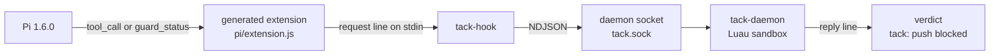

# Slice 3: one plugin, Pi, native hook client

**Status:** Implemented (v0.1.0-rc.4).

[Release: v0.1.0-rc.4](https://github.com/wrkhse/tack/releases/tag/v0.1.0-rc.4).

You can build the safe-push plugin for Pi 1.6.0 and deny a push in a real Pi
session, while its `guard_status` tool runs in the tack daemon.

```bash
tack build fixtures/safe-push --out dist --target pi
# dist/pi/extension.js

pi --no-extensions -e ./dist/pi/extension.js
```

Asked to "push my branch", Pi calls `bash` with `git push origin main`.
The session shows `tack: push blocked` and no push reaches the remote. Pi
then calls `guard_status` and reads `guard_status: daemon ok`.



The recording dispatch [run 45455926939](https://github.com/wrkhse/tack/actions/runs/45455926939)
passes `record`, `record-claude` and `record-pi`; `slice-3-recording.gif` is
attached to the rc.4 release.

## What it builds

### Generated Pi extension

`tack build --target pi` emits one ES module, `pi/extension.js`, with one
top-level `export default function register(pi)`. Pi runs no Luau. The
extension registers a `tool_call` handler for `bash` commands starting with
`git push`, and a `guard_status` tool accepting an empty object. Each call
runs the released `tack-hook` binary from `PATH` with `--plugin` and the
canonical plugin folder. Rule execution stays in the daemon's Luau sandbox.

Files: `adapters/pi/src/lib.rs`, `adapters/pi/register.js`,
`adapters/pi/tests/render.rs` and `adapters/pi/extension.test.mjs`.

```bash
tack build fixtures/safe-push --out dist --target pi
```

On the first `session_start`, the extension calls
`pi.appendEntry('tack-loaded', {})` once. A single 8500 ms total deadline
starts before each hook process spawns and covers its input, output and
exit. On expiry the extension settles with `timeout` without waiting for
the child to close. Request and reply frames are bounded at 1 MiB. Replies
must match the request id, protocol version and kind.

An `allow` runs Bash unchanged. A `deny` returns
`{ block: true, reason: "tack: <reason>" }`; an unsupported outcome fails
closed as `malformed_reply`. A tool reply must contain exactly one text
item, `guard_status: daemon ok`. Invalid tool parameters return
`tack: malformed` without invoking the hook.

With `TACK_RECORDER` set, each successful `tack-hook` call appends one
JSON line: a valid Bash allow or deny records `bash`, and a valid tool
reply records `guard_status`. Transport errors and invalid replies append
nothing. A denied push is a successful hook exchange.

```json
{"call":"bash","id":1}
{"call":"guard_status","id":2}
```

**Structure.** `tack-adapter-pi` renders the template with the canonical
plugin path, protocol version, frame bound, deadline and named deny reasons.
`render` refuses relative or non-UTF-8 paths, control characters and reserved
template markers:

```rust
pub const EXTENSION_JS: &str = "extension.js";

pub fn render(plugin_dir: &Path) -> Result<String, ExtensionError>;

pub enum ExtensionError {
    UnsafePluginDir,
    MissingToken(&'static str),
}

impl fmt::Display for ExtensionError {}

impl Error for ExtensionError {}
```

**Verification.** `adapters/pi/tests/render.rs` checks equal line counts,
byte-identical non-placeholder lines, exact filled values, whole-string
equivalence after substitution, and no leftover `__TACK_` token. It checks
the default export, Node imports, path escaping, fixed budget and protocol
constants. The Node suite renders the template in memory with the same
fixture values and runs that output with injected spawn, file writes and a
clock, with no process or OS signal. It checks the load marker, exact requests
and recorder lines, reply validation, missing hook,
deadline, frame bounds and fail-closed errors.

### CLI build and native hook

The CLI canonicalizes the plugin folder, loads its manifest in the sandbox,
checks its needs, and writes only `<out>/pi/extension.js`. The timeout
options apply only to the OpenCode target. The Pi target uses the native
hook client's socket trust checks and cold start described in
[slice 2](slice-2.md#tack-hook).

Files: `crates/cli/src/lib.rs`, `crates/cli/src/main.rs`,
`crates/protocol/src/wire.rs` and the released `crates/hook/` binary.

```bash
tack build fixtures/safe-push --out dist --target pi
# dist/pi/extension.js
```

**Structure.** `build_pi` returns the emitted path. Rendering errors use
`BuildError::RenderExtension(ExtensionError)`:

```rust
pub fn build_pi(plugin_dir: &Path, out: &Path) -> Result<PathBuf, BuildError>;
```

The wire contract includes `ReplyError::HookMissing` and
`DenyReason::HookMissing`, both serialized as `hook_missing`. The extension
uses that named reason when spawning `tack-hook` fails with `ENOENT`.
Other process and pipe failures deny `daemon_error`.

**Verification.** The CLI's in-process dispatch tests check the exact
output path, equal line counts, byte-identical non-placeholder lines,
exact filled values, whole-string equivalence after substitution, and no
leftover `__TACK_` token. They refuse Pi timeout flags and refuse an
unknown need as `need_missing:barn` with no output written. Protocol tests
pin the named reason's wire spelling. The extension tests check missing-hook
denials for both Bash and tool requests, with no recorder writes.

### CI and packaged proof

`conformance (pi)` installs Pi 1.6.0 from `test/pi/package-lock.json` with
`npm ci --prefix test/pi --ignore-scripts`, then checks `pi --version`.
It builds tack and the extension, runs the Node suite and starts real Pi
sessions against `test/pi/model.mjs`, a loopback Chat Completions stand-in
on 127.0.0.1. No model request leaves the machine.

Files: `.github/workflows/pi.yml`, `test/pi/package.json`,
`test/pi/package-lock.json`, `test/pi/run.mjs`, `test/pi/model.mjs`,
`test/smoke/run.mjs`, `.github/workflows/release.yml` and
`.github/workflows/record.yml`.

In Linux CI or a disposable Linux container, from the repository root:

```sh
npm ci --prefix test/pi --ignore-scripts
export PATH="$PWD/test/pi/node_modules/.bin:$PWD/target/debug:$PATH"

cargo build --workspace --bins --locked
tack build fixtures/safe-push --out dist --target pi

node adapters/pi/extension.test.mjs
node test/pi/run.mjs
```

**Structure.** Each session has a throwaway `HOME`, XDG folders and
`PI_CODING_AGENT_DIR`, an isolated `PATH`, and a loopback model with a dummy
key. Pi starts with `--mode json --no-extensions -e <extension>` so only
the explicit generated extension loads. The runner requires:

- exit 0, complete valid JSONL and a final assistant message exactly `done`;
- exactly one custom `tack-loaded` entry with `{}` data, no extension error
  event and no extension-load error on stderr;
- exactly the scripted tool sequence: `bash`, then `guard_status` for the
  normal case;
- Bash input exactly `{ command: "git push origin main" }` and an error
  result exactly `tack: push blocked`;
- tool input exactly `{}` and a non-error result exactly
  `guard_status: daemon ok`;
- exactly the two recorder lines above and zero git-shim push lines;
- exactly the daemon log lines `tack-daemon: hook toolBefore deny push blocked`
  and `tack-daemon: tool guard_status ok`.

The five failure cases each require zero pushes and no successful-call
recorder lines:

| Case | Exact error result |
| ---- | ------------------ |
| `missing-hook` | `tack: hook_missing` |
| `daemon-crash` | `tack: socket_closed` |
| `timeout` | `tack: timeout` |
| `invalid-reply` | `tack: malformed_reply` |
| `invalid-guard-status` | `tack: malformed` |

The timeout case uses a 15-second hook shim and requires a denial between
8000 and 10000 ms. The invalid-tool case supplies `{ unexpected: true }`
and requires no hook invocation. Failure shims otherwise run exactly once.
The crash case stops the real daemon after the hook connects.

The packaged smoke test unpacks the release tarball, checks its version,
and builds the Pi extension twice into separate output folders. It requires
matching SHA-256 digests, the canonical plugin path, an 8500 ms budget and
the top-level default register export. It also sends a hook request directly
over the daemon socket and through the packaged `tack-hook`.

**Verification.** The conformance runner writes each assertion to
`verdict.txt` and fails on any false result. CI retains failure evidence.
The release workflow runs the packaged smoke test for its target builds.
The recording workflow installs the released tarball, verifies `SHA256SUMS`
and records the real Pi session.

## End to end

Seven checks pass for v0.1.0-rc.4:

- `conformance (pi)`: pinned Pi 1.6.0 loads the extension, denies the push,
  runs `guard_status`, and passes all five failure cases.
- `conformance (claude)`: Claude Code loads the mod, denies the push and
  runs `guard_status` in the daemon.
- `rust`: formatting, Clippy with warnings denied, and workspace tests pass.
- `e2e`: the OpenCode session denies the push and runs `guard_status`.
- `smoke`: packaged binaries build matching Pi extensions and answer hook
  requests directly and through `tack-hook`.
- `deny`: the dependency policy check passes.
- `mutants`: every viable mutant is caught.

The rc.4 release run passes all three target builds and `smoke`. Recording
dispatch [run 45455926939](https://github.com/wrkhse/tack/actions/runs/45455926939)
passes `record`, `record-claude` and `record-pi` against the released binaries.
