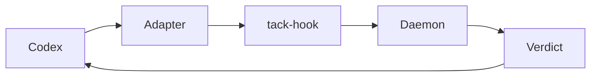

# Slice 4: one tack plugin as a Codex adapter

**Status:** Implemented (v0.1.0-rc.5).

[Release: v0.1.0-rc.5](https://github.com/wrkhse/tack/releases/tag/v0.1.0-rc.5).

## You can

Build a Codex adapter for the safe-push plugin. In a Codex session, the guard
blocks a push and the model calls `guard_status` to check the daemon.

Release
[run 45592615919](https://github.com/wrkhse/tack/actions/runs/45592615919)
records this session; the release carries it as `slice-4-recording.gif`.

## The parts

- **Codex adapter:** a Bash guard and a custom tool that relay to the daemon.
- **tack-hook relay and trust:** build enables and trusts tack's handlers in
  user state, and Codex reaches the daemon only through the released relay.
- **Hook and MCP contract:** one block form for denials, and a minimal stdio
  server that exposes `guard_status`.
- **CI and recording:** a real Codex session runs the released adapter.

## How each is verified

- **Codex adapter:** contract tests cover the block form, trimmed reasons,
  malformed replies and pipe errors. A guard failure blocks before execution.
- **tack-hook relay and trust:** conformance checks that exactly tack's
  handlers are enabled and trusted, after a rebuild too, with one load marker.
  Other hooks' state stays unchanged.
- **Hook and MCP contract:** contract tests cover initialization, discovery
  and calls; an invalid call fails before reaching tack-hook.
- **CI and recording:** Codex conformance checks the exact deny and tool
  results, daemon activity, matching relay records and zero pushes.

## The end-to-end check

Isolated CI runs formatting, lint, tests, dependency and mutation checks,
Codex, Claude and Pi conformance, and the packaged smoke check. The recording
shows the blocked push and the daemon's tool result in two panes.

## Decided

| Decision        | Choice                                                    |
| --------------- | --------------------------------------------------------- |
| Bash forwarding | Every Bash call goes to tack; the plugin decides.         |
| Trust           | Build writes `trusted_hash` for its handlers each time.   |
| Boundary        | Codex relays through tack-hook; no Luau in Codex.         |
| Config proof    | No adapter goldens; an exact assertion pins the config.   |
| Isolation       | Throwaway agent and user state is the only isolation.     |
| CI network      | Loopback only; analytics and update checks are off.       |
| Luau            | barn#23 owns the engine; this slice builds nothing on it. |
