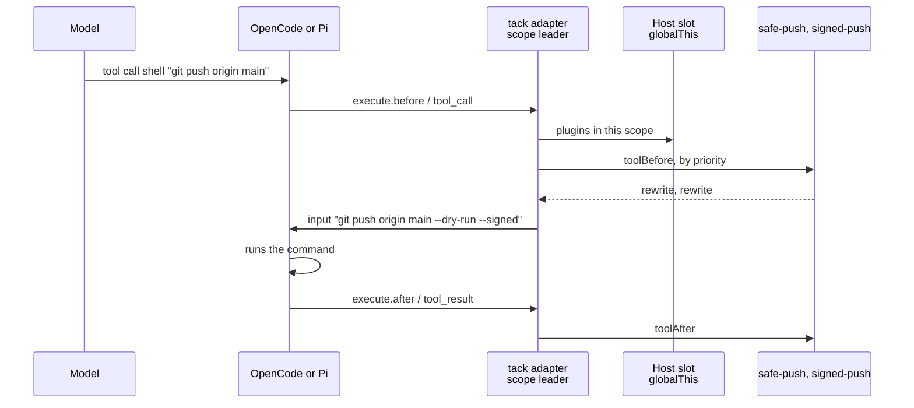

# T1: core, OpenCode, Pi

**Status: In progress.** The toolchain and CI gate are in place; the core, the
OpenCode and Pi adapters, the fidelity table and the conformance suite are not
built yet. Part of [tack v1](https://github.com/wrkhse/tack/issues/1).

## You can

Write one plugin with `toolBefore`, `promptSent` and `toolAfter`, and run it in
OpenCode and Pi. A second plugin on the same hook combines with it by priority,
whichever one the agent loads first.

```ts
import { createAgentPlugin } from "@workhorse/tack";

export const safePush = createAgentPlugin(() => ({
  name: "safe-push",
  priority: 10,

  toolBefore: (call) =>
    call.tool === "shell" && call.input.command.startsWith("git push")
      ? { rewrite: { command: `${call.input.command} --dry-run` } }
      : undefined,
}));
```

`call.tool` is `shell` for every agent's shell tool: OpenCode's `shell`, Pi's
`bash` and Pi's `powershell`. `call.dialect` names the language, `posix` or
`powershell` (`unknown` for OpenCode on Windows, which picks its shell at run
time), so a guard sees every push and a rewrite can respect the dialect.
`call.name` always carries the agent's own name.

Each agent loads its own output of the same plugin:

```ts
// .opencode/plugins/safe-push/index.ts
export default safePush.opencode();
```

```ts
// safe-push.ts, loaded with pi -e safe-push.ts
export default safePush.pi();
```

With `signed-push` (priority 20, appends `--signed`) loaded as well, in either
order, the agent's `git push origin main` runs as
`git push origin main --dry-run --signed`.

## Path



Every tack plugin in an agent process registers its native hooks, and every one
registers its definition in the host slot. Only the scope's leader, the
earliest live registration, runs the combined hooks; the others return at once.
A denied call never reaches the command, so `toolAfter` does not run for it.

## What it builds

### Plugin definition

`createAgentPlugin(factory)` takes a factory `(options, meta) => definition`
and returns a plugin with one output function per agent. The factory runs
once, when the output function is called as the agent loads the module.
The one definition serves every OpenCode location in the process and every Pi
session binding, so state in the factory's closure lasts as long as the module,
across Pi's `/new`, `/resume` and `/fork`.

Files: `src/plugin.ts`, `src/index.ts`.

```ts
const guard = createAgentPlugin((options: { blocked: string }, meta) => ({
  name: "guard",

  toolBefore: (call) =>
    call.tool === "shell" && call.input.command.includes(options.blocked)
      ? { deny: `${options.blocked} is blocked in ${meta.agent}.` }
      : undefined,
}));

export default guard.pi({ blocked: "rm -rf" });
```

A definition is checked when the agent loads it. A name outside `[a-z0-9-]+`,
a `priority` that is not an integer, or a `budgetMs` outside 1 to 60000 fails
the load and names the plugin. `priority` defaults to 100 and `budgetMs` to 5000.

Verification: unit tests for the checks above and for the defaults.

### Hooks

Three hooks, each called with the call or prompt and a context naming the agent
and the session. A handler returns its result directly or as a promise.

Files: `src/hooks/tool-before.ts`, `src/hooks/prompt-sent.ts`,
`src/hooks/tool-after.ts`, `src/hooks/budget.ts`.

```ts
const note = createAgentPlugin(() => ({
  name: "push-note",

  promptSent: () => ({ append: "Never push to main without a dry run." }),

  toolAfter: (call, result) => {
    if (call.tool === "shell" && result.isError) {
      log.push(call.input.command);
    }
  },
}));
```

The shell tool has one normalized input, `{ command }`, in every agent. Every
other tool arrives as `other` with the agent's own name and input. A rewrite
replaces only `command`; the agent's other fields, such as OpenCode's
`background` or Pi's `timeout`, are kept. An OpenCode call with
`background: true` returns at once, so `toolAfter` sees OpenCode's "moved to the
background" text, not the command's output
([shell.ts L118–135, L430–433](https://github.com/anomalyco/opencode/blob/v2.3.0/packages/core/src/tool/plugin/shell.ts#L118-L135)).

| Hook         | Combined across plugins                                                                                                                |
| ------------ | -------------------------------------------------------------------------------------------------------------------------------------- |
| `toolBefore` | In priority order (lower first, ties by name); each plugin sees the input as rewritten so far. The first deny stops the chain and wins |
| `promptSent` | Appends are joined in priority order with a blank line, identical texts once, within 16 KiB                                            |
| `toolAfter`  | Every plugin is called with the final input and the result. One plugin's failure does not affect the others                            |

| A handler that throws or misses its budget | Outcome                                                                  |
| ------------------------------------------ | ------------------------------------------------------------------------ |
| `toolBefore`                               | The plugin's `onError.toolBefore`: `deny` by default, `allow` to opt out |
| `promptSent`                               | Its append is dropped and the failure is logged                          |
| `toolAfter`                                | The failure is logged                                                    |

A `rewrite` on a call that is not `shell` is a handler error. A deny's reason
reaches the model as the tool's error; a failed handler's reason names the
plugin, as in `tack: guard failed: timed out after 5000 ms`.

Verification: unit tests with Effect's test clock: priority order regardless of
registration order, rewrites chaining, the first deny winning, a throw and a
missed budget each denying by default and allowing with `onError`, appends
joined, de-duplicated and capped.

### Host

Tack plugins in one agent process find each other through one slot,
`globalThis[Symbol.for("@workhorse/tack/host")]`. Each plugin is bundled with
its own copy of tack, so the slot holds only plain data and handler functions,
under a protocol version. A plugin built for another protocol version refuses to
load and names both versions.

Files: `src/host/host.ts`.

The slot is divided into scopes: one per OpenCode location (its directory), and
one for the Pi process. A registration is replaced by a later one with the same
plugin name, so a reloaded plugin takes its old place; it is removed when its
instance ends (OpenCode's setup cleanup, Pi's `session_shutdown`).

```ts
const slot = hostSlot();

const registration = slot.register("opencode:/work/app", definition);

if (slot.isLeader(registration)) {
  const decision = await runToolBefore(slot.plugins("opencode:/work/app"), call);
}

registration.dispose();
```

Verification: unit tests: two copies of the host module share one slot; leader
handover when the leader is disposed; replacement by name; a protocol mismatch
refuses with both versions in the message.

### OpenCode adapter

`plugin.opencode(options)` returns an OpenCode 2.3 server plugin,
`{ id: "tack.<name>", setup }`. It needs no runtime import of
`@opencode/plugin`; the package is a development dependency for its types.

Files: `src/agents/opencode.ts`.

| tack                 | OpenCode 2.3.0                                                                                                                                                         |
| -------------------- | ---------------------------------------------------------------------------------------------------------------------------------------------------------------------- |
| `toolBefore` deny    | `ctx.tool.hook("execute.before")` throws the reason; the call fails                                                                                                    |
| `toolBefore` rewrite | assigns `event.input`, keeping its other fields                                                                                                                        |
| `promptSent` append  | `ctx.session.hook("prompt")` appends to `event.prompt.text`                                                                                                            |
| `toolAfter`          | `ctx.tool.hook("execute.after")`                                                                                                                                       |
| scope                | `ctx.location.directory`; the registration ends in the setup cleanup, which OpenCode runs when it unloads, reloads or disables the plugin, before a reload's new setup |

Sources: the cleanup runs when the plugin's scope closes
([adapter.ts L673–677](https://github.com/anomalyco/opencode/blob/v2.3.0/packages/plugin/src/promise/adapter.ts#L673-L677));
a reload closes the old scope before the new setup
([plugin.ts L122–164](https://github.com/anomalyco/opencode/blob/v2.3.0/packages/core/src/plugin.ts#L122-L164)).
Hooks are registered per location
([hooks.ts L66–108](https://github.com/anomalyco/opencode/blob/v2.3.0/packages/core/src/plugin/hooks.ts#L66-L108)),
so one location's hooks do not fire for another's sessions. That last point is
read from the source and unconfirmed in a run: T1's scenarios use one directory.

```jsonc
// opencode.json
{ "plugins": ["./plugins/safe-push", "./plugins/signed-push"] }
```

Verification: unit tests against a context object with the same hook methods,
then the conformance suite in the real CLI.

### Pi adapter

`plugin.pi(options)` returns a Pi 1.5 extension factory, `(pi) => void`.

Files: `src/agents/pi.ts`.

| tack                 | Pi 1.5.2                                                                        |
| -------------------- | ------------------------------------------------------------------------------- |
| `toolBefore` deny    | `tool_call` returns `{ block: true, reason }`                                   |
| `toolBefore` rewrite | sets `event.input.command` in place, as Pi requires                             |
| `promptSent` append  | `input` returns `{ action: "transform", text }`; extension-sent text is skipped |
| `toolAfter`          | `tool_result`                                                                   |
| scope                | one per process; the registration ends at `session_shutdown`                    |

```sh
pi -e safe-push.js -e signed-push.js
```

Verification: unit tests against an object with Pi's `on` method, then the
conformance suite in the real CLI.

### Fidelity table

One table per agent and version range, as data, with a source for every cell.
`Record<Capability, Cell>` makes a missing cell a type error.

Files: `src/fidelity/opencode.ts`, `src/fidelity/pi.ts`, `src/fidelity/index.ts`.

| Capability              | OpenCode 2.3.0                                                                                                                                                             | Pi 1.5.2                                                                                                                                                                                                  |
| ----------------------- | -------------------------------------------------------------------------------------------------------------------------------------------------------------------------- | --------------------------------------------------------------------------------------------------------------------------------------------------------------------------------------------------------- |
| `toolBefore.deny`       | native: throw in `execute.before` (OC `packages/plugin/src/promise/adapter.ts` L688–698)                                                                                   | native: `{ block, reason }` from `tool_call` (PI `dist/core/extensions/types.d.ts` L1109–1119)                                                                                                            |
| `toolBefore.rewrite`    | native: assign `event.input` (OC `packages/core/src/tool.ts` L311–320)                                                                                                     | native: mutate `event.input` (PI `docs/extensions.md` L979–986)                                                                                                                                           |
| `toolBefore.failClosed` | native: a throw fails the call (OC `adapter.ts` L688–698)                                                                                                                  | native: a throw blocks the call (PI `docs/extensions.md` L3250–3256)                                                                                                                                      |
| `promptSent.append`     | native: `session` hook `prompt` (OC `packages/core/src/session/prompt.ts` L40–53)                                                                                          | native: `input` transform (PI `dist/core/agent-session.js` L1656–1669)                                                                                                                                    |
| `toolAfter.observe`     | native: `execute.after` (OC `packages/core/src/tool.ts` L166–181)                                                                                                          | native: `tool_result` (PI `dist/core/extensions/types.d.ts` L1030–1059)                                                                                                                                   |
| `host.sharedRealm`      | one process realm; one plugin instance per location ([REALM-SPIKE](../../../spike/unagent/REALM-SPIKE.md), spike at 2.2.2; unconfirmed at 2.3.0 until the conformance run) | one process realm; the instance is rebound per session, so state lives in the host ([REALM-SPIKE](../../../spike/unagent/REALM-SPIKE.md), spike at 1.4.0; unconfirmed at 1.5.2 until the conformance run) |

OC is `github.com/anomalyco/opencode` at `v2.3.0`; PI is
`@earendil-works/pi-coding-agent@1.5.2`. A cell turns to `unsupported` when its
conformance scenario fails.

Verification: a unit test that every cell has a source; the conformance suite
re-proves each cell in the real CLI.

### Conformance suite

Each scenario runs the real CLI once, in a throwaway `HOME`, against a stand-in
model and a recorder. No real model is called.

Files: `conformance/`.

- **Stand-in model.** A local OpenAI-compatible server (`/v1/chat/completions`,
  streamed). The first request gets a shell tool call, `git push origin main`;
  a request carrying a tool result gets `done`. It keeps every request body.
- **Recorder.** A `git` script first on `PATH` that writes its arguments to a
  file. A denied call leaves the file absent.
- **Plugins.** Each test plugin is bundled on its own, with its own copy of tack,
  so the host is proven across copies.

| Scenario         | Plugins                    | Passes when                                                    |
| ---------------- | -------------------------- | -------------------------------------------------------------- |
| deny             | `deny-push`                | the recorder sees nothing; the next request carries the reason |
| fail closed      | `throws`                   | the recorder sees nothing                                      |
| rewrite          | `safe-push`                | the recorder sees `push origin main --dry-run`                 |
| combine          | `safe-push`, `signed-push` | the recorder sees `push origin main --dry-run --signed`        |
| combine reversed | `signed-push`, `safe-push` | the same                                                       |
| append           | `push-note`                | the first request's user message ends with the note            |
| after            | `safe-push`, `observe`     | `observe` saw the rewritten command and its output             |

```sh
opencode run --standalone -m fake/scripted "push it"
pi -p --no-session --provider fake --model scripted -e deny-push.js "push it"
```

The CLIs start and stop processes, so the suite runs only in CI or a disposable
container, never on a development machine's own agents. Versions are pinned:
`@opencode/cli@2.3.0` and `@earendil-works/pi-coding-agent@1.5.2`, and each run
checks `--version` first.

Verification: the suite itself, in CI on every pull request.

### CI

`.github/workflows/check.yml` runs on every pull request and on `main`; the
conformance jobs join it with the suite.

| Job    | Runs                                                                                                                              |
| ------ | --------------------------------------------------------------------------------------------------------------------------------- |
| `gate` | `bun run check`: format, Oxlint with the vendored anti-slop rules, `tsc`, Effect diagnostics, Vitest, `fallow audit`, `bun audit` |

Every run uses the stand-in model, so T1 needs no secret. The nightly real-model
runs start after T1, as decided in [#1](https://github.com/wrkhse/tack/issues/1)
(Approved so far): OpenCode and Pi both run on OpenCode Go's free model, Hy4
flash Free, at the highest effort each agent offers, with one
`OPENCODE_API_KEY` secret that the owner adds when the nightly job lands. No
paid model is used.

## End to end

- In OpenCode 2.3.0 and Pi 1.5.2, each scenario in the conformance table passes
  in CI, from a fresh `HOME`.
- The combine scenarios pass in both load orders.
- `bun run check` passes with no warnings, and each gate fails on a deliberate
  violation: an unformatted file, an explicit `any`, a type error, a floating
  Effect, a failing test and an unused export.
