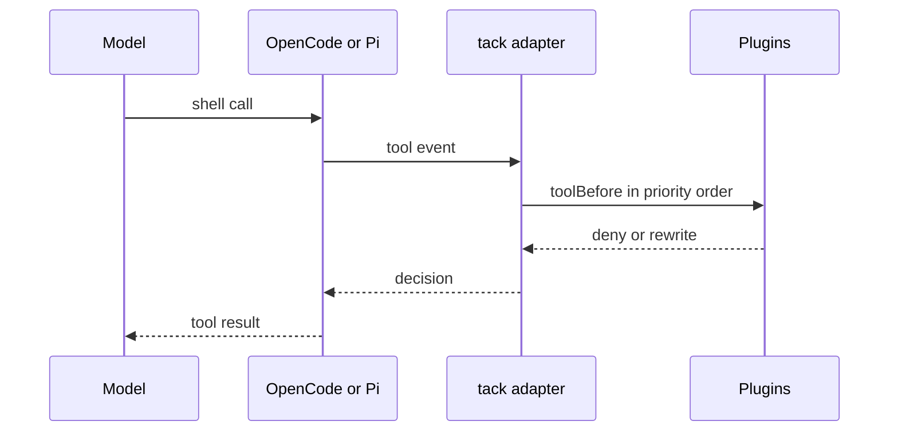

# T1: core, OpenCode, Pi

**Status: Implemented.** One plugin runs in OpenCode 2.3.0 and Pi 1.5.2.
It can deny or rewrite tool calls, append to prompts and observe results.
Part of [tack v1](https://github.com/wrkhse/tack/issues/1).

## You can

Write a plugin once and load its output in either agent:

```ts
import { createAgentPlugin } from "@workhorse/tack";

export const safePush = createAgentPlugin(() => ({
  name: "safe-push",
  priority: 10,

  toolBefore: (call) =>
    call.tool === "shell" && call.input.command.startsWith("git push")
      ? { rewrite: { command: `${call.input.command} --dry-run` } }
      : undefined,
}));
```

Export `safePush.opencode()` from the OpenCode plugin entry, or
`safePush.pi()` from the Pi extension entry. See the
[adapter guide](../../../src/agents/README.md#usage) for the entry paths.



## Integration

`call.tool` normalizes OpenCode's `shell` and Pi's `bash` and `powershell`
to `shell`. `call.name` retains the agent's name; `call.dialect` identifies
`posix`, `powershell` or `unknown`. A shell rewrite preserves the agent's
other input fields.

Plugins run in priority order, with ties by name. Each rewrite reaches the
next plugin; the first denial stops the call. A denied call does not produce
`toolAfter`. A failing or timed-out `toolBefore` denies by default; a plugin
can explicitly opt to allow. `promptSent` appends are deduplicated and share
a 16 KiB limit. See [hooks](../../../src/hooks/README.md) and
[host lifetime and dispatch](../../../src/host/README.md).

## Verification

The [T1 conformance evidence](https://github.com/wrkhse/tack/pull/3) covers
denial, rewrite, prompt append, observation and combining plugins in both
load orders against both real CLIs. The
[conformance guide](../../../conformance/README.md) describes the isolated
runs; the [fidelity guide](../../../src/fidelity/README.md) links each
capability to its source.
