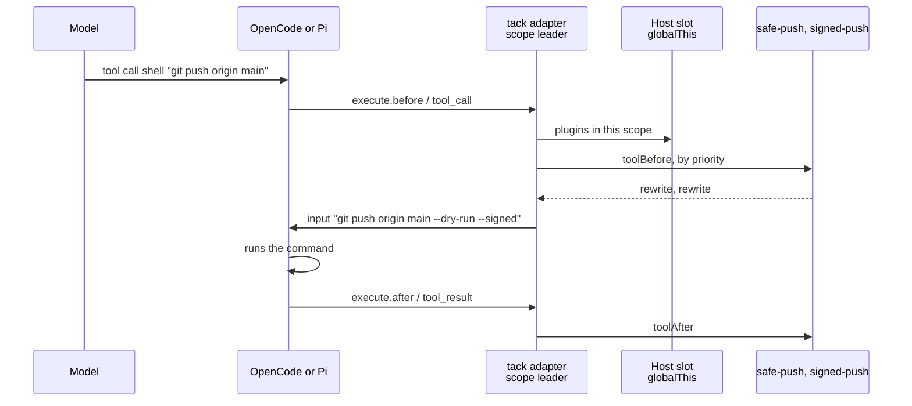

# T1: core, OpenCode, Pi

**Status: Implemented.** OpenCode 2.3.0 and Pi 1.5.2 run the same plugin:
`toolBefore` denies or rewrites, `promptSent` appends, and `toolAfter` observes, with
two plugins combining by priority in either load order. The conformance suite proves
each hook in both CLIs, and each scenario proves every plugin of it loaded. Part of
[tack v1](https://github.com/wrkhse/tack/issues/1).

## You can

Write one plugin with `toolBefore`, `promptSent` and `toolAfter`, and run it in
OpenCode and Pi. A second plugin on the same hook combines with it by priority,
whichever one the agent loads first.

```ts
import { createAgentPlugin } from "@workhorse/tack";

export const safePush = createAgentPlugin(() => ({
  name: "safe-push",
  priority: 10,

  toolBefore: (call) =>
    call.tool === "shell" && call.input.command.startsWith("git push")
      ? { rewrite: { command: `${call.input.command} --dry-run` } }
      : undefined,
}));
```

`call.tool` is `shell` for every agent's shell tool: OpenCode's `shell`, Pi's
`bash` and Pi's `powershell`. `call.dialect` names the language, `posix` or
`powershell` (`unknown` for OpenCode on Windows, which picks its shell at run
time), so a guard sees every push and a rewrite can respect the dialect.
`call.name` always carries the agent's own name.

Each agent loads its own output of the same plugin:

```ts
// .opencode/plugins/safe-push/index.ts
export default safePush.opencode();
```

```ts
// safe-push.ts, loaded with pi -e safe-push.ts
export default safePush.pi();
```

With `signed-push` (priority 20, appends `--signed`) loaded as well, in either
order, the agent's `git push origin main` runs as
`git push origin main --dry-run --signed`.

## Path



Every tack plugin in an agent process registers its native hooks, and every one
registers its definition in the host slot. Only the scope's leader, the
earliest live registration, runs the combined hooks; the others return at once.
A denied call never reaches the command, so `toolAfter` does not run for it.

## What it builds

### Plugin definition

`createAgentPlugin(factory)` takes a factory `(options, meta) => definition`
and returns a plugin with one output function per agent. The factory runs
once, when the output function is called as the agent loads the module.

What a factory's closure holds depends on how often the harness loads the
module, so the closure is not a place for state that must span instances:
OpenCode loads one plugin instance per location, and Pi rebinds the extension
for each session. State that must outlive either boundary lives in the host
slot, not in the closure (see [Host](#host)).

Files: `src/plugin.ts`, `src/create.ts`, `src/index.ts`.

```ts
const guard = createAgentPlugin((options: { blocked: string }, meta) => ({
  name: "guard",

  toolBefore: (call) =>
    call.tool === "shell" && call.input.command.includes(options.blocked)
      ? { deny: `${options.blocked} is blocked in ${meta.agent}.` }
      : undefined,
}));

export default guard.pi({ blocked: "rm -rf" });
```

A definition is checked when the agent loads it. A name outside `[a-z0-9-]+`,
a `priority` that is not an integer, or a `budgetMs` outside 1 to 60000 fails
the load and names the plugin. `priority` defaults to 100 and `budgetMs` to 5000.

#### Structure

A definition is what a plugin author writes; `ResolvedPlugin` is the same data
with the defaults filled in and the error policy flattened, and it is the only
form the host slot and the hook runners accept. Neither is mutable, and a
plugin's identity is its name.

```ts
export interface PluginDefinition {
  readonly name: string;
  readonly priority?: number;
  readonly budgetMs?: number;
  readonly onError?: { readonly toolBefore?: "deny" | "allow" };
  readonly toolBefore?: ToolBefore;
  readonly promptSent?: PromptSent;
  readonly toolAfter?: ToolAfter;
}
```

Every field but the name is optional here, so the type says nothing about a
default. `ResolvedPlugin` shows the result: every field is present, `onError`
has collapsed into one string, and an absent handler is `undefined`.

```ts
export interface ResolvedPlugin {
  readonly name: string;
  readonly priority: number;
  readonly budgetMs: number;
  readonly toolBeforeOnError: "deny" | "allow";
  readonly toolBefore: ToolBefore | undefined;
  readonly promptSent: PromptSent | undefined;
  readonly toolAfter: ToolAfter | undefined;
}
```

Resolution returns an Effect, so the one refusal is a value a caller can match
on. `InvalidPlugin` names the plugin as written and the rule it broke;
`resolvePlugin` is pure and runs at module load, so a bad definition fails the
load, before any hook runs.

```ts
export class InvalidPlugin extends Schema.TaggedError<
  InvalidPlugin,
  { readonly brand: unique symbol }
>()("InvalidPlugin", {
  plugin: Schema.String,
  reason: Schema.String,
}) {
  override get message(): string;
}

export function resolvePlugin(
  definition: PluginDefinition,
): Effect.Effect<ResolvedPlugin, InvalidPlugin>;
```

`Agent` is the closed set of outputs, and `Meta` is everything a factory learns
about the agent loading it: which agent, and nothing else about the harness.

```ts
export type Agent = "opencode" | "pi";

export interface Meta {
  readonly agent: Agent;
}
```

Both outputs take the same options and resolve the definition immediately.
`Options` defaults to `void`, so a plugin without options calls
`plugin.opencode()` with no argument, and a definition tack refuses throws from
that call, at the agent's module load.

```ts
export interface AgentPlugin<Options> {
  readonly opencode: (options: Options) => OpenCodePlugin;
  readonly pi: (options: Options) => PiExtension;
}

export function createAgentPlugin<Options = void>(
  factory: (options: Options, meta: Meta) => PluginDefinition,
): AgentPlugin<Options>;
```

Verification: `test/plugin.test.ts` covers `resolvePlugin`'s defaults and every
refusal; `test/adapters/opencode.test.ts` and `test/adapters/pi.test.ts` cover
the outputs a factory produces.

### Hooks

Three hooks, each called with the call or prompt and a context naming the agent
and the session. A handler returns its result directly or as a promise.

Files: `src/hooks/tool-before.ts`, `src/hooks/prompt-sent.ts`,
`src/hooks/tool-after.ts`, `src/hooks/budget.ts`, `src/hooks/order.ts`.

```ts
const note = createAgentPlugin(() => ({
  name: "push-note",

  promptSent: () => ({ append: "Never push to main without a dry run." }),

  toolAfter: (call, result) => {
    if (call.tool === "shell" && result.isError) {
      log.push(call.input.command);
    }
  },
}));
```

The shell tool has one normalized input, `{ command }`, in every agent. Every
other tool arrives as `other` with the agent's own name and input. A rewrite
replaces only `command`; the agent's other fields, such as OpenCode's
`background` or Pi's `timeout`, are kept. An OpenCode call with
`background: true` returns at once, so `toolAfter` sees OpenCode's "moved to the
background" text, not the command's output
([shell.ts L118–135, L430–433](https://github.com/anomalyco/opencode/blob/v2.3.0/packages/core/src/tool/plugin/shell.ts#L118-L135)).

| Hook         | Combined across plugins                                                                                                                |
| ------------ | -------------------------------------------------------------------------------------------------------------------------------------- |
| `toolBefore` | In priority order (lower first, ties by name); each plugin sees the input as rewritten so far. The first deny stops the chain and wins |
| `promptSent` | Appends are joined in priority order with a blank line, identical texts once, within 16 KiB                                            |
| `toolAfter`  | Every plugin is called with the final input and the result. One plugin's failure does not affect the others                            |

| A handler that throws or misses its budget | Outcome                                                                  |
| ------------------------------------------ | ------------------------------------------------------------------------ |
| `toolBefore`                               | The plugin's `onError.toolBefore`: `deny` by default, `allow` to opt out |
| `promptSent`                               | Its append is dropped and the failure is logged                          |
| `toolAfter`                                | The failure is logged                                                    |

A `rewrite` on a call that is not `shell` is a handler error. A deny's reason
reaches the model as the tool's error; a failed handler's reason names the
plugin, as in `tack: guard failed: timed out after 5000 ms`.

#### Structure

Every hook sees the same context, and a shell call arrives in one shape whatever
the agent calls the tool. `dialect` is `unknown` when the agent picks its shell
at run time, so a handler cannot assume POSIX.

```ts
export interface HookContext {
  readonly agent: Agent;
  readonly sessionId: string;
}

export type ShellDialect = "posix" | "powershell" | "unknown";

export interface ShellInput {
  readonly command: string;
}
```

`ToolCall` is a union of two shapes, so a handler that narrows on `tool` reaches
`input.command` without a cast. The `other` shape keeps the agent's own name and
input untouched, which is why its `input` is `unknown`.

```ts
export type ToolCall =
  | {
      readonly tool: "shell";
      readonly name: string;
      readonly dialect: ShellDialect;
      readonly input: ShellInput;
    }
  | { readonly tool: "other"; readonly name: string; readonly input: unknown };
```

`undefined` accepts the call unchanged. A rewrite carries only the command, the
one field tack normalizes; whether a rewrite is legal depends on the call, not
on the type.

```ts
export type ToolBeforeResult =
  | { readonly deny: string }
  | { readonly rewrite: ShellInput }
  | undefined;

export type ToolBefore = (
  call: ToolCall,
  ctx: HookContext,
) => ToolBeforeResult | Promise<ToolBeforeResult>;
```

`ToolDecision` is a tagged enum, constructed and matched through the value
exported beside the type. `Allow` carries the final call and whether any handler
rewrote it; `Deny` carries the reason the model receives. Every runner sorts
with `byPriority`: lower priority first, ties by name, so load order cannot
change the outcome.

```ts
export type ToolDecision = Data.TaggedEnum<{
  Allow: { readonly call: ToolCall; readonly rewritten: boolean };
  Deny: { readonly reason: string };
}>;

export function byPriority(a: ResolvedPlugin, b: ResolvedPlugin): number;

export function runToolBefore(
  plugins: ReadonlyArray<ResolvedPlugin>,
  call: ToolCall,
  ctx: HookContext,
): Effect.Effect<ToolDecision>;
```

A prompt is the text the agent is about to send, and an append is text tack adds
after it. `APPEND_CAP_BYTES` bounds the combined append for one prompt, so two
plugins share the room.

```ts
export interface Prompt {
  readonly text: string;
}

export type PromptSentResult = { readonly append: string } | undefined;

export type PromptSent = (
  prompt: Prompt,
  ctx: HookContext,
) => PromptSentResult | Promise<PromptSentResult>;

export const APPEND_CAP_BYTES = 16384;
```

`runPromptSent` returns the joined append, or `undefined` when nothing was
added; empty strings and duplicates are dropped before the cap is measured.

```ts
export function runPromptSent(
  plugins: ReadonlyArray<ResolvedPlugin>,
  prompt: Prompt,
  ctx: HookContext,
): Effect.Effect<string | undefined>;
```

`ToolResult` is the text the model saw and whether the tool failed, so `output`
on an error is the agent's message, not a result.

```ts
export interface ToolResult {
  readonly output: string;
  readonly isError: boolean;
}

export type ToolAfter = (
  call: ToolCall,
  result: ToolResult,
  ctx: HookContext,
) => void | Promise<void>;
```

`runToolAfter` returns nothing and never fails: a handler's failure is a log
line, so no plugin changes another's view of the result.

```ts
export function runToolAfter(
  plugins: ReadonlyArray<ResolvedPlugin>,
  call: ToolCall,
  result: ToolResult,
  ctx: HookContext,
): Effect.Effect<void>;
```

`HandlerFailed` is the one error a handler can produce: thrown, rejected, timed
out or undecodable. `hook` is checked against the closed `HookName` union
through a schema the module keeps private, and `callHandler`, which runs a
handler under the plugin's budget, is not exported from the package entry.

```ts
export type HookName = "toolBefore" | "promptSent" | "toolAfter";

export class HandlerFailed extends Schema.TaggedError<
  HandlerFailed,
  { readonly brand: unique symbol }
>()("HandlerFailed", {
  plugin: Schema.String,
  hook: HookNameSchema,
  reason: Schema.String,
}) {
  override get message(): string;
}
```

Verification: `test/tool-before.test.ts` runs on Effect's test clock and covers
priority order regardless of registration order, rewrites chaining, the first
deny winning, and a throw and a missed budget each denying by default and
allowing with `onError`. `test/prompt-sent.test.ts` covers appends joined,
de-duplicated and capped; `test/tool-after.test.ts` covers every handler in
priority order and one failure leaving the others untouched.

### Host

Tack plugins in one agent process find each other through one slot,
`globalThis[Symbol.for("@workhorse/tack/host")]`. Each plugin is bundled with
its own copy of tack, so the slot holds only plain data and handler functions,
under a protocol version. A plugin built for another protocol version refuses to
load and names both versions.

Files: `src/host/host.ts`.

The slot is divided into scopes: one per OpenCode location, and one for the Pi
process. A location is a directory plus a workspace, so two workspaces at one
directory keep separate registrations; the key is the JSON pair, as in
`opencode:["/work/app",null]` or `opencode:["/work/app","wsp_1"]`
([OpenCode adapter](#opencode-adapter)). A scope holds one live registration
per name: a second plugin of that name fails its load with `DuplicatePlugin`,
which names the name, the scope and both sources. A reload disposes the old
registration before it registers again, so one name in one scope holds one
registration. A registration ends when its instance does (OpenCode's setup
cleanup, Pi's `session_shutdown`), and each adapter passes the file it was
loaded from as the source, which under a bundle is the plugin module's own
bundle file.

```ts
const scope = 'opencode:["/work/app",null]'; // the directory, no workspace

const slot = Effect.runSync(hostSlot());

const registration = Effect.runSync(slot.register(scope, plugin, "/plugins/safe-push/index.js"));

if (slot.isLeader(registration)) {
  const decision = Effect.runSync(runToolBefore(slot.plugins(scope), call, ctx));
}

registration.dispose();
```

#### Structure

`HOST_KEY` is the only symbol tack reads on `globalThis`, exported so a test
can reach the slot the module created. A `Registration` is the handle to one
live registration: `dispose` removes it by its token, and removes nothing once
it is gone.

```ts
export const HOST_KEY = Symbol.for("@workhorse/tack/host");

export interface Registration {
  readonly scope: string;
  readonly token: symbol;
  readonly dispose: () => void;
}

export interface HostSlot {
  readonly register: (
    scope: string,
    plugin: ResolvedPlugin,
    source: string,
  ) => Effect.Effect<Registration, DuplicatePlugin>;
  readonly plugins: (scope: string) => ReadonlyArray<ResolvedPlugin>;
  readonly isLeader: (registration: Registration) => boolean;
}
```

The protocol number is private: this copy writes it on the slot it creates,
decodes the one it finds, and refuses a slot at another number. Anything at the
symbol that is not a tack slot fails with `ForeignHostSlot`, and so does a
`globalThis` that cannot hold the slot at all, such as a frozen one.

A copy that creates the slot fixes it non-writable and non-configurable on
`globalThis` and freezes the slot object, so no later copy can replace it,
delete it or give it a fresh `scopes` map, and another copy's registrations
stay attached.

```ts
export class ProtocolMismatch extends Schema.TaggedError<
  ProtocolMismatch,
  { readonly brand: unique symbol }
>()("ProtocolMismatch", {
  found: Schema.Finite,
  expected: Schema.Finite,
}) {
  override get message(): string;
}

export class ForeignHostSlot extends Schema.TaggedError<
  ForeignHostSlot,
  { readonly brand: unique symbol }
>()("ForeignHostSlot", {}) {
  override get message(): string;
}

export class DuplicatePlugin extends Schema.TaggedError<
  DuplicatePlugin,
  { readonly brand: unique symbol }
>()("DuplicatePlugin", {
  name: Schema.String,
  scope: Schema.String,
  existing: Schema.String,
  incoming: Schema.String,
}) {
  override get message(): string;
}

export function hostSlot(): Effect.Effect<HostSlot, ProtocolMismatch | ForeignHostSlot>;
```

`ProtocolMismatch` names both versions, `ForeignHostSlot` the symbol it found,
and `DuplicatePlugin` the name, the scope and both sources. `plugins` returns
each name's definition in the order the names registered, unsorted: ordering
belongs to the hook runners. `isLeader` is true only for the first live
registration in the scope, the leader that runs the combined hooks, so disposing
it hands leadership to the next registration. Those seven names are the module's
whole export list; the slot's data shape and its helpers stay private.

Verification: `test/host.test.ts` accepts a foreign plain slot at the same
protocol; refuses another protocol naming both versions, an object with no
scopes map, a scope whose value is not a map, and a plain value at the symbol;
checks the created slot is fixed against replacement and frozen; and covers a
second registration of one name in a scope failing with `DuplicatePlugin`
naming both sources, two names in one scope, the leader and its handover on
dispose, and an empty scope removed.

### OpenCode adapter

`plugin.opencode(options)` returns an OpenCode 2.3 server plugin,
`{ id: "tack.<name>", setup }`. It needs no runtime import of
`@opencode/plugin`; the package is a development dependency for its types.

Files: `src/agents/opencode.ts`, `src/agents/text.ts`,
`src/agents/chain.ts`, `test/adapters/opencode.test.ts`.

| tack                 | OpenCode 2.3.0                                                                                                                                                                                                          |
| -------------------- | ----------------------------------------------------------------------------------------------------------------------------------------------------------------------------------------------------------------------- |
| `toolBefore` deny    | `ctx.tool.hook("execute.before")` throws the reason; the call fails                                                                                                                                                     |
| `toolBefore` rewrite | assigns `event.input`, keeping its other fields                                                                                                                                                                         |
| `promptSent` append  | `ctx.session.hook("prompt")` appends to `event.prompt.text`                                                                                                                                                             |
| `toolAfter`          | `ctx.tool.hook("execute.after")`                                                                                                                                                                                        |
| scope                | `opencodeScope(ctx.location)`, the directory and workspace as a JSON pair; the registration ends in the setup cleanup, which OpenCode runs when it unloads, reloads or disables the plugin, before a reload's new setup |

Sources: the cleanup runs when the plugin's scope closes
([adapter.ts L673–677](https://github.com/anomalyco/opencode/blob/v2.3.0/packages/plugin/src/promise/adapter.ts#L673-L677));
a reload closes the old scope before the new setup
([plugin.ts L122–164](https://github.com/anomalyco/opencode/blob/v2.3.0/packages/core/src/plugin.ts#L122-L164)).
Hooks are registered per location
([hooks.ts L66–108](https://github.com/anomalyco/opencode/blob/v2.3.0/packages/core/src/plugin/hooks.ts#L66-L108)),
so one location's hooks do not fire for another's sessions. That last point is
read from the source and unconfirmed in a run: T1's scenarios use one directory.

```jsonc
// opencode.json
{ "plugins": ["./plugins/safe-push", "./plugins/signed-push"] }
```

#### Structure

`OpenCodePlugin` restates `@opencode/plugin`'s server-plugin shape, so the
adapter imports that package for types only and a bundled plugin needs no
runtime copy of it. `id` is always `tack.<name>`, and `opencodeScope` builds a
location's scope key.

```ts
export interface OpenCodePlugin {
  readonly id: string;
  readonly setup: (context: oc.Plugin.Context) => Promise<oc.Plugin.Cleanup>;
}

export function opencodeScope(location: oc.Location.Info): string;

export function opencodePlugin(plugin: ResolvedPlugin): OpenCodePlugin;
```

`setup` resolves the slot before it registers anything, so a protocol mismatch
rejects the load. It registers one hook per event and returns OpenCode's
cleanup, which disposes the slot entry and every hook registration. The scope
comes from `opencodeScope(context.location)`: OpenCode keys a location by its
directory and its workspace, so two workspaces open on one directory are two
scopes, and the pair is JSON encoded so no directory and workspace ID can spell
another pair's key. Tool output reaches a handler through `joinTextParts`,
which keeps text parts and drops every other kind.

```ts
export function joinTextParts(
  parts: ReadonlyArray<{ readonly type: string; readonly text?: string }>,
): string;
```

Verification: `test/adapters/opencode.test.ts` runs the adapter against a context
object with the same hook methods, checks `opencodeScope`'s key for two
workspaces at one directory, then the conformance suite in the real CLI. The
leader rule and the decision match live in `src/agents/chain.ts`, once for both
adapters.

### Pi adapter

`plugin.pi(options)` returns a Pi 1.5 extension factory, `(pi) => void`.

Files: `src/agents/pi.ts`, `src/agents/text.ts`, `src/agents/chain.ts`,
`test/adapters/pi.test.ts`.

| tack                 | Pi 1.5.2                                                                        |
| -------------------- | ------------------------------------------------------------------------------- |
| `toolBefore` deny    | `tool_call` returns `{ block: true, reason }`                                   |
| `toolBefore` rewrite | sets `event.input.command` in place, as Pi requires                             |
| `promptSent` append  | `input` returns `{ action: "transform", text }`; extension-sent text is skipped |
| `toolAfter`          | `tool_result`                                                                   |
| scope                | one per process; the registration ends at `session_shutdown`                    |

```sh
pi -e safe-push.js -e signed-push.js
```

#### Structure

`PiExtension` is the factory Pi calls with its API. The body is synchronous, so
the slot lookup runs with `Effect.runSync` and a protocol mismatch throws from
the extension's load, not from a later hook.

```ts
export type PiExtension = (pi: ExtensionAPI) => void;

export function piExtension(plugin: ResolvedPlugin): PiExtension;
```

Every extension in one process registers in the scope `pi`, a constant the
module keeps private. The three handlers are unsubscribed and the slot entry
disposed at `session_shutdown`; an `input` event whose source is `extension` is
ignored, so text tack appended is never transformed again. Tool output is
joined by `joinTextParts`.

Verification: `test/adapters/pi.test.ts` runs the adapter against an object with
Pi's `on` method, then the conformance suite in the real CLI. The leader rule
and the decision match live in `src/agents/chain.ts`, once for both adapters.

### Fidelity table

One table per agent and version range, as data, with a source for every cell.
`Record<Capability, Cell>` makes a missing cell a type error.

Files: `src/fidelity/opencode.ts`, `src/fidelity/pi.ts`, `src/fidelity/index.ts`.

| Capability              | OpenCode 2.3.0                                                                                                                                                                                                                                                                                       | Pi 1.5.2                                                                                                                                                                                                                                                                                                                        |
| ----------------------- | ---------------------------------------------------------------------------------------------------------------------------------------------------------------------------------------------------------------------------------------------------------------------------------------------------- | ------------------------------------------------------------------------------------------------------------------------------------------------------------------------------------------------------------------------------------------------------------------------------------------------------------------------------- |
| `toolBefore.deny`       | native: throw in `execute.before` (OC `packages/plugin/src/promise/adapter.ts` L688–698)                                                                                                                                                                                                             | native: `{ block, reason }` from `tool_call` (PI `dist/core/extensions/types.d.ts` L1109–1119)                                                                                                                                                                                                                                  |
| `toolBefore.rewrite`    | native: assign `event.input` (OC `packages/core/src/tool.ts` L311–320)                                                                                                                                                                                                                               | native: mutate `event.input` (PI `docs/extensions.md` L979–986)                                                                                                                                                                                                                                                                 |
| `toolBefore.failClosed` | native: a throw fails the call (OC `adapter.ts` L688–698)                                                                                                                                                                                                                                            | native: a throw blocks the call (PI `docs/extensions.md` L3250–3256)                                                                                                                                                                                                                                                            |
| `promptSent.append`     | native: `session` hook `prompt` (OC `packages/core/src/session/prompt.ts` L40–53)                                                                                                                                                                                                                    | native: `input` transform (PI `dist/core/agent-session.js` L1656–1669)                                                                                                                                                                                                                                                          |
| `toolAfter.observe`     | native: `execute.after` (OC `packages/core/src/tool.ts` L166–181)                                                                                                                                                                                                                                    | native: `tool_result` (PI `dist/core/extensions/types.d.ts` L1030–1059)                                                                                                                                                                                                                                                         |
| `host.sharedRealm`      | evidence for the state model in [Plugin definition](#plugin-definition): one process realm; per-location scopes unconfirmed in a run ([REALM-SPIKE](../../../spike/unagent/REALM-SPIKE.md), spike at 2.2.2); two separately bundled copies combine in one process (T1 conformance, combine at 2.3.0) | evidence for the state model in [Plugin definition](#plugin-definition): one process realm; the instance is rebound per session, so state lives in the host ([REALM-SPIKE](../../../spike/unagent/REALM-SPIKE.md), spike at 1.4.0); two separately bundled extensions combine in one process (T1 conformance, combine at 1.5.2) |

Every native cell above is re-proven at these versions by T1's conformance suite:
deny, fail closed, rewrite, append and after each run in both CLIs
(see [Conformance suite](#conformance-suite)).

OC is `github.com/anomalyco/opencode` at `v2.3.0`; PI is
`@earendil-works/pi-coding-agent@1.5.2`. A cell turns to `unsupported` when its
conformance scenario fails.

#### Structure

`capabilities` is the runtime list of rows, and `Capability` is read from it, so
the mapped type makes a missing cell in either table a type error.

```ts
export const capabilities = [
  "toolBefore.deny",
  "toolBefore.rewrite",
  "toolBefore.failClosed",
  "promptSent.append",
  "toolAfter.observe",
  "host.sharedRealm",
] as const;

export type Capability = (typeof capabilities)[number];
```

A cell says how the agent supports one capability and where that was read.
`source` is a URL or a path in this repository, and the unit test refuses one
it cannot cite.

```ts
export interface Cell {
  readonly fidelity: "native" | "fallback" | "unsupported";
  readonly how: string;
  readonly source: string;
}
```

`Fidelity` pairs one agent with its version range and its cells. `verifiedWith`
and `verifiedAt` name the build the cells were read from, so a range is not a
claim that every release inside it was run.

```ts
export interface Fidelity {
  readonly agent: Agent;
  readonly versions: string;
  readonly verifiedWith: string;
  readonly verifiedAt: string;
  readonly cells: { readonly [K in Capability]: Cell };
}
```

`fidelity` is the data the package publishes, keyed by agent; each agent's table
is built in its own module and stays internal there.

```ts
export interface FidelityTable {
  readonly opencode: Fidelity;
  readonly pi: Fidelity;
}

export const fidelity: FidelityTable = {
  opencode: opencodeFidelity,
  pi: piFidelity,
};
```

Verification: `test/fidelity.test.ts` checks that every cell has a citable source;
the conformance suite re-proves each cell in the real CLI.

### Conformance suite

Each scenario runs the real CLI once, in a throwaway `HOME`, against a stand-in
model and a recorder. No real model is called.

Files: `conformance/scenarios.ts` (the table and its checks),
`conformance/suite.ts` (the check bodies both agents' test files share),
`conformance/opencode.test.ts`, `conformance/pi.test.ts`, and
`conformance/plugins/`, one file per test plugin such as `throws-allowed`.

- **Stand-in model.** A local OpenAI-compatible server (`/v1/chat/completions`,
  streamed). The first request gets a shell tool call, `git push origin main`;
  a request carrying a tool result gets `done`. It keeps every request body.
- **Recorder.** A `git` script first on `PATH` that writes its arguments to a
  file. A denied call leaves the file absent.
- **Plugins.** Each test plugin is bundled on its own, with its own copy of tack,
  so the host is proven across copies.

| Scenario         | Plugins                       | Passes when                                                                                                          |
| ---------------- | ----------------------------- | -------------------------------------------------------------------------------------------------------------------- |
| deny             | `deny-push`                   | the recorder sees nothing; the next request carries the reason                                                       |
| deny after       | `deny-push`, `observe`        | the call is denied as in `deny`, and `toolAfter` never runs: no observed file                                        |
| fail closed      | `throws`                      | the recorder sees nothing                                                                                            |
| opt out          | `throws-allowed`, `safe-push` | a guard whose `onError.toolBefore` is `allow` lets the next plugin's rewrite reach git: `push origin main --dry-run` |
| rewrite          | `safe-push`                   | the recorder sees `push origin main --dry-run`                                                                       |
| combine          | `safe-push`, `signed-push`    | the recorder sees `push origin main --dry-run --signed`                                                              |
| combine reversed | `signed-push`, `safe-push`    | the same                                                                                                             |
| append           | `push-note`                   | the first request's user message ends with the note                                                                  |
| after            | `safe-push`, `observe`        | `observe` saw the rewritten command and its output                                                                   |

```sh
opencode run --standalone -m fake/scripted "push it"
pi -p --no-session --provider fake --model scripted -e deny-push.js "push it"
```

The CLIs start and stop processes, so the suite runs only in CI or a disposable
container, never on a development machine's own agents. Versions are pinned:
`@opencode/cli@2.3.0` and `@earendil-works/pi-coding-agent@1.5.2`, and each run
checks `--version` first.

Verification: the suite itself, in CI on every pull request. Every scenario
also asserts that the run loaded exactly its plugin list:
`conformance/plugins/loaded.ts` appends each plugin's name to the file
`TACK_LOADED` names as it is evaluated, and the check compares that set with the
scenario's list, so a plugin that never loaded fails the run.

### CI

`.github/workflows/check.yml` runs on every pull request and on `main`. A run
on `main` is never cancelled: a superseded run waits for the one running.

| Job                      | Runs                                                                                                                                                                                                          |
| ------------------------ | ------------------------------------------------------------------------------------------------------------------------------------------------------------------------------------------------------------- |
| `gate`                   | `bun run check`: format, Oxlint with the vendored anti-slop rules, `tsc`, Effect diagnostics, the anti-slop and unit Vitest projects, `fallow audit`, `bun audit` (one advisory ignored: GHSA-fc5q-39xc-vjpf) |
| `conformance (opencode)` | the conformance suite against OpenCode 2.3.0                                                                                                                                                                  |
| `conformance (pi)`       | the conformance suite against Pi 1.5.2                                                                                                                                                                        |

Both conformance jobs install the pinned CLIs, then run
`bun run conformance:opencode` or `bun run conformance:pi`, one agent per job.
Before the run each job compares the installed CLI with its platform package's
binary byte for byte, so the suite never tests a copy the install fetched for
itself.

Every run uses the stand-in model, so T1 needs no secret. The nightly real-model
runs start after T1, as decided in [#1](https://github.com/wrkhse/tack/issues/1)
(Approved so far): OpenCode and Pi both run on OpenCode Go's free model, Hy4
flash Free, at the highest effort each agent offers, with one
`OPENCODE_API_KEY` secret that the owner adds when the nightly job lands. No
paid model is used.

## End to end

- `bun run check` exits 0 with no warnings: format, Oxlint with the vendored
  anti-slop rules, `tsc`, Effect diagnostics, the anti-slop and unit Vitest
  projects, `fallow audit` and `bun audit`. `bun audit` ignores exactly one
  advisory, GHSA-fc5q-39xc-vjpf: picomatch 4.0.7 has a ReDoS with no patched
  release, it arrives only through dev chains, `bun audit --production` is
  clean, and tack globs only its own patterns. The ignore goes when picomatch
  4.0.8 or later ships, and every dependency bump re-checks it.
- Each gate fails on a deliberate violation: an unformatted file, an explicit
  `any`, a type error, a floating Effect, a failing test and an unused export.
- In OpenCode 2.3.0 and Pi 1.5.2, every scenario in the conformance table passes
  from a fresh `HOME`, and the combine scenarios pass in both load orders. The
  suite starts real agent processes, so it runs in CI or in a disposable
  container, never on the machine's own agents. One read-only mount, a copy
  inside the container, and the host's `node_modules` removed before install:

```sh
docker run --rm -v "$PWD":/work:ro node:26-bookworm sh -ec '
  mkdir -p /app
  cp -a /work/. /app
  cd /app
  rm -rf node_modules
  npm i -g bun@1.4.4
  bun install --frozen-lockfile
  bun run conformance:opencode
  bun run conformance:pi'
```
