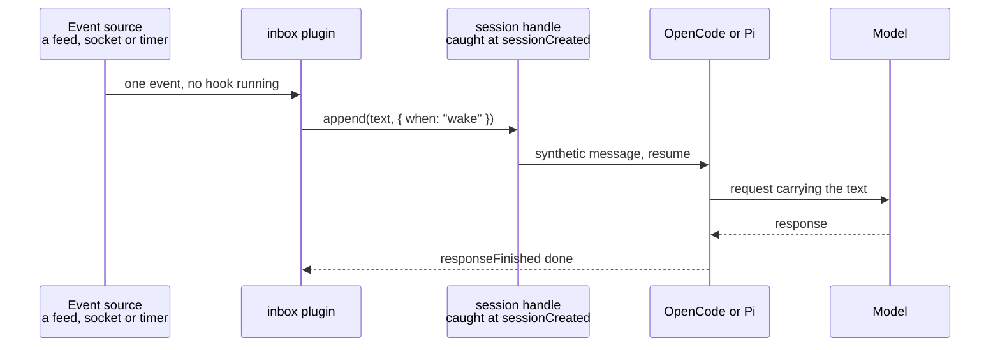

# T2: session actions and events

**Status: In progress.** Handles, actions, hooks and fidelity rows are in
place: one session handle acts on an OpenCode 2.3.0 or Pi 1.5.2 session at any
time, four actions reach it, and five hooks report its events. The conformance
rows for the long-lived modes are being wired, and the page turns to
Implemented when those jobs are green on the final head. It unblocks Chauffeur
slice 8. Part of [tack v1](https://github.com/wrkhse/tack/issues/1).

## You can

Hold a session handle and act on it at any time, not only inside a hook: an
idle OpenCode or Pi session starts a turn when the plugin appends with
`when: "wake"`. An append is a synthetic message, never a user prompt, so
nothing looks typed by the person at the keyboard.

```ts
import { createAgentPlugin } from "@workhorse/tack";

export const inbox = createAgentPlugin(() => ({
  name: "inbox",

  sessionCreated: ({ session }) => {
    // A feed, a socket or a timer: anything that fires outside a hook.
    watch(async (event) => {
      const outcome = await session.append(event.text, { when: "wake" });

      if (outcome.status === "refused") {
        console.warn("inbox:", outcome.reason);
      }
    });
  },

  permissionAsked: (request) =>
    request.resources.some((resource) => resource.startsWith("/infra/"))
      ? { deny: "/infra/ is read-only for this plugin." }
      : undefined,
}));
```

`session.append(text, { when })` adds a synthetic message, never a user
prompt. `when` says when it lands: `now` steers at the next step boundary of a
running turn, `next` waits for the turn to end, and `wake` starts a turn on an
idle session; `when` defaults to `next`. `now` and `next` never wake a
session; `wake` on a busy session steers. Every action returns
`Promise<Outcome>`, where `Outcome` is `{ status: "accepted" }`,
`{ status: "unsupported" }`, `{ status: "refused", reason }` or
`{ status: "ended" }`.

`session.compact()`, `session.interrupt()` and `session.setModel(...)` are
the other actions. A model switch is a real call:

```ts
const outcome = await session.setModel({
  providerID: "anthropic",
  id: "claude-sonnet-5-5",
});
```

`setModel` resolves `refused` with the harness's reason when the model is
unknown or the provider has no credentials. A plugin asks the fidelity table
when it needs to know what its agent supports:

```ts
import { fidelity } from "@workhorse/tack";

const cell = fidelity.pi.cells["event.permissionAsked"];

if (cell.fidelity === "unsupported") {
  console.log("Pi:", cell.how);
}
```

## Path



The handle is live from `sessionCreated` to `sessionEnded`, and each action
on it reaches the agent directly, with no hook in between.

## What it builds

### Session handle

Inside every hook, `ctx.session` is the handle; `sessionCreated` receives the
same handle in its event object. Four actions act on the session, and each maps
to one native call on each agent (see [Fidelity
table](#fidelity-table)).

An append is a synthetic message, never a user prompt: OpenCode's
`session.synthetic` and Pi's `sendMessage` both add extension-authored text, so
nothing looks typed by the person at the keyboard. `when` chooses the delivery:
`now` steers at the next step boundary of a running turn, `next` waits for the
turn to end, and `wake` starts a turn on an idle session. `now` and `next`
never wake a session: on Pi they leave `triggerTurn` out, so an idle session
stores the message without starting a run, and `wake` sets it to `true`.

Every action resolves to an `Outcome`: `accepted`, `unsupported`, `refused`
with a reason, or `ended`. An action after `sessionEnded`, or on a Pi session
whose extension instance was replaced, resolves `ended` and never throws.
OpenCode's 404- and 409-shaped failures, and Pi's `setModel` returning false or
finding no model, resolve `refused` with the harness's reason.

An action is a direct agent call, not a hook, so actions from several plugins
are not combined: each is carried out in the order it was made. On Pi,
`sendMessage` adds a custom message, which does not run Pi's `input` hook; the
adapter also skips a source of `extension`, as `promptSent` already does.
OpenCode's `prompt` hook does not run for a synthetic message, so `promptSent`
never sees tack's own appends. Pi's `compact` aborts the running turn first,
while OpenCode's `compact` waits for a step boundary; the table records that
difference.

Files: `src/session.ts` (the handle), `src/hooks/tool-before.ts` (the hook
context carries it), `src/plugin.ts` (the definition's new fields),
`src/hooks/budget.ts` (the handler names), `src/agents/opencode.ts` and
`src/agents/pi.ts` (the native calls).

```ts
const note = createAgentPlugin(() => ({
  name: "retry-note",

  responseFinished: async (response, ctx) => {
    if (response.reason !== "error") return;

    const outcome = await ctx.session.append("The last turn failed.", {
      when: "next",
    });

    if (outcome.status === "refused") {
      console.warn("retry-note:", outcome.reason);
    }
  },
}));
```

#### Structure

A handle names one session and offers the four actions; each returns a promise
that settles on an `Outcome` rather than a rejection. The options object makes
`when` optional and says nothing about what absent means: it defaults to
`"next"`, so an append with no options waits for the running turn to end.

```ts
export type AppendWhen = "now" | "next" | "wake";

export type Outcome =
  | { readonly status: "accepted" }
  | { readonly status: "unsupported" }
  | { readonly status: "refused"; readonly reason: string }
  | { readonly status: "ended" };
```

`refused` and `unsupported` are logged once, naming the session and the
action, so a caller that ignores a result still sees the failure. `ended` is
not a failure: an action after `sessionEnded`, or on a Pi session whose
extension instance was replaced, resolves `ended` with no log line.

```ts
export interface ModelRef {
  readonly providerID: string;
  readonly id: string;
}

export interface Session {
  readonly id: string;

  append(text: string, options?: { readonly when?: AppendWhen }): Promise<Outcome>;
  compact(): Promise<Outcome>;
  interrupt(): Promise<Outcome>;
  setModel(model: ModelRef): Promise<Outcome>;
}
```

`SessionPort` is what an agent adapter supplies, and the only place the four
actions meet a harness. `sessionHandle` closes over the port and the session's
id, so no call site restates either.

```ts
export interface SessionPort {
  readonly append: (input: {
    readonly sessionID: string;
    readonly text: string;
    readonly when: AppendWhen;
  }) => Promise<Outcome>;
  readonly compact: (sessionID: string) => Promise<Outcome>;
  readonly interrupt: (sessionID: string) => Promise<Outcome>;
  readonly setModel: (input: {
    readonly sessionID: string;
    readonly model: ModelRef;
  }) => Promise<Outcome>;
}

export function sessionHandle(port: SessionPort, sessionID: string): Session;
```

The port promises an `Outcome`, but the handle does not trust it to keep that
promise: a port call that throws or rejects becomes `refused` carrying the
thrown message, so an action never throws.

Verification: `test/session.test.ts` runs each action on a fake context,
checks the native call, the delivery for `now`, `next` and `wake`, the
provider and model ids `setModel` passes, and each outcome: `accepted`,
`unsupported`, `refused` and `ended`.

### Events and hooks

Five hooks join T1's three. `sessionCreated({ session, resumed }, ctx)` and
`sessionEnded({ session, reason }, ctx)` report the session and its handle.
`resumed` says whether tack found the session already open; `reason` is
agent-neutral: `closed`, `shutdown` or `replaced`. OpenCode's
`session.deleted` and `session.archived` report `closed` for the events it can
attribute to this scope; Pi's `quit` reports
`shutdown`, and `reload`, `new`, `resume` and `fork` report `replaced`,
because the session was replaced, not ended by the person.
`responseFinished(response, ctx)` reports one model request with
`reason: "done" | "aborted" | "error"`. `sessionIdle(session, ctx)` reports a
session with no pending input; on OpenCode the adapter falls back to the
deprecated `session.idle` event when the experimental idle hook is absent at
load.
`permissionAsked(request, ctx)` returns `{ allow: true }`,
`{ deny: reason }` or `undefined` to leave the request to the agent.

`responseFinished` is one model request. On OpenCode, `done` is a
`session.step.ended`; `aborted` is a `session.step.failed` carrying the
`aborted` step error; `error` is a `session.step.failed` with the harness's
error. On Pi, `turn_end.outcome` is the reason directly: `completed`,
`aborted` or `error`.

`permissionAsked` combines like `toolBefore`: the first deny in priority order
wins and supplies the reason, every plugin allowing allows the request, and
otherwise the agent's own rules decide. `onError.permissionAsked` defaults to
`leave`, so a failing handler leaves the decision to the agent's own rule.

`request.effect` is the harness's current effect, `allow` or `ask`, and
OpenCode runs the hook for both; a configured `deny` skips it. `resources`
holds the absolute paths or actions the request covers. `{ allow: true }`
skips the person's configured ask, so the action proceeds without a prompt;
return `undefined` to let the ask happen.

Observing hooks (`sessionCreated`, `sessionEnded`, `responseFinished`,
`sessionIdle`) call every plugin in priority order, and one plugin's failure
is logged without affecting the others.

On OpenCode, `sessionCreated` reads `session.created` through
`ctx.event.subscribe` and filters by `event.location`, because the event stream
is not location-scoped. An event that carries no `location` is ignored, with
one warning per process, because another location's session must never reach
this scope's plugins. The adapter subscribes at load; a session already open
when the plugin loaded gets no `session.created`, so its first event reports
`sessionCreated` with `resumed: true`, then the event. `sessionEnded` reads
`session.deleted` and `session.archived` and reports `closed` when the event
names a location; a session persists after the client stops working with it, so
only deletion or archival ends the handle. OpenCode publishes a delete with
only `{ sessionID }`, and the route carries no session-location middleware, so
the event has no location and a deleted session reports no end in 2.3.0. On Pi,
`session_start` and
`session_shutdown` carry the reasons in the signature, and `resumed` is true
for `session_start` reason `resume` or `fork`.

Files: `src/hooks/lifecycle.ts`, `src/hooks/response-finished.ts`,
`src/hooks/session-idle.ts`, `src/hooks/permission-asked.ts`,
`src/hooks/order.ts`, `src/agents/opencode.ts`, `src/agents/pi.ts`.

```ts
const gate = createAgentPlugin(() => ({
  name: "gate",

  permissionAsked: (request) =>
    request.resources.some((resource) => resource.startsWith("/infra/"))
      ? { deny: "/infra/ is off limits." }
      : undefined,
}));
```

#### Structure

A definition names each hook a plugin implements; all of them are optional.

```ts
export interface PluginDefinition {
  readonly name: string;
  readonly priority?: number;
  readonly budgetMs?: number;
  readonly onError?: {
    readonly toolBefore?: "deny" | "allow";
    readonly permissionAsked?: "deny" | "leave";
  };
  readonly toolBefore?: ToolBefore;
  readonly promptSent?: PromptSent;
  readonly toolAfter?: ToolAfter;
  readonly sessionCreated?: SessionCreated;
  readonly sessionEnded?: SessionEnded;
  readonly responseFinished?: ResponseFinished;
  readonly sessionIdle?: SessionIdle;
  readonly permissionAsked?: PermissionAsked;
}
```

The definition does not show the defaults: `priority` is 100, `budgetMs` is
5000, `onError.toolBefore` is `deny` and `onError.permissionAsked` is `leave`.
`ResolvedPlugin` is the definition with those filled in, the nested `onError`
flattened into `toolBeforeOnError` and `permissionAskedOnError`, and the
handlers present or `undefined`; it is the form the runners accept (see
[T1](t1.md#plugin-definition)).

A lifecycle event carries the handle, which a handler keeps to act later.
`resumed` says that tack found the session already open, so no plugin saw it
start, and `reason` is `replaced` when the agent bound a new extension
instance to the session instead of ending it.

```ts
export interface SessionCreatedEvent {
  readonly session: Session;
  readonly resumed: boolean;
}

export type SessionCreated = (event: SessionCreatedEvent, ctx: HookContext) => void | Promise<void>;

export interface SessionEndedEvent {
  readonly session: Session;
  readonly reason: "closed" | "shutdown" | "replaced";
}

export type SessionEnded = (event: SessionEndedEvent, ctx: HookContext) => void | Promise<void>;
```

`responseFinished` reports one model request once it has settled: `done` is a
request that finished normally, `aborted` one stopped on purpose, and `error`
one the harness failed. `sessionIdle` is a state rather than an outcome, so it
carries only the handle, and a handler's return value is ignored.

```ts
export type ResponseReason = "done" | "aborted" | "error";

export interface ResponseFinishedEvent {
  readonly session: Session;
  readonly reason: ResponseReason;
}

export type ResponseFinished = (
  event: ResponseFinishedEvent,
  ctx: HookContext,
) => void | Promise<void>;

export interface SessionIdleEvent {
  readonly session: Session;
}

export type SessionIdle = (event: SessionIdleEvent, ctx: HookContext) => void | Promise<void>;
```

`effect` is the harness's current effect: `ask` means the person would be
prompted, and a configured `deny` never reaches a handler. `resources` names
the paths or actions the request covers. `{ allow: true }` skips the person's
prompt, `{ deny }` refuses with the reason, and `undefined` leaves the decision
to the agent. The first deny wins and supplies the reason; the result is
`{ allow: true }` only when every handler that answered allowed, and
`undefined` otherwise.

```ts
export interface PermissionRequest {
  readonly sessionId: string;
  readonly action: string;
  readonly resources: ReadonlyArray<string>;
  readonly effect: "allow" | "ask";
  readonly message?: string;
}

export type PermissionAskedResult =
  | { readonly allow: true }
  | { readonly deny: string }
  | undefined;

export type PermissionAsked = (
  request: PermissionRequest,
  ctx: HookContext,
) => PermissionAskedResult | Promise<PermissionAskedResult>;
```

A failing `permissionAsked` handler follows `onError.permissionAsked`, which
defaults to `leave`: the failure is logged, no later plugin is asked, and the
agent's own rule decides. `deny` refuses with the failure's message instead.

The four observing runners walk the plugins in priority order and log a
handler's failure without affecting the next plugin. `runPermissionAsked`
folds the answers into one decision, so it is the only runner that can refuse
a request.

```ts
export function runSessionCreated(
  plugins: ReadonlyArray<ResolvedPlugin>,
  event: SessionCreatedEvent,
  ctx: HookContext,
): Effect.Effect<void>;

export function runSessionEnded(
  plugins: ReadonlyArray<ResolvedPlugin>,
  event: SessionEndedEvent,
  ctx: HookContext,
): Effect.Effect<void>;

export function runResponseFinished(
  plugins: ReadonlyArray<ResolvedPlugin>,
  event: ResponseFinishedEvent,
  ctx: HookContext,
): Effect.Effect<void>;

export function runSessionIdle(
  plugins: ReadonlyArray<ResolvedPlugin>,
  event: SessionIdleEvent,
  ctx: HookContext,
): Effect.Effect<void>;

export function runPermissionAsked(
  plugins: ReadonlyArray<ResolvedPlugin>,
  request: PermissionRequest,
  ctx: HookContext,
): Effect.Effect<PermissionAskedResult>;
```

Verification: `test/lifecycle.test.ts` covers both hooks in priority order
and a throwing handler; `test/response-finished.test.ts` covers each reason
and the mapping; `test/session-idle.test.ts` covers one call per idle session
and the `session.idle` fallback; `test/permission-asked.test.ts` covers the
first deny winning, every plugin allowing, `undefined`,
`onError.permissionAsked` leaving, and a configured deny skipping the hook.

### Fidelity table

Twelve rows join T1's six, and `Cell`, `Fidelity` and `FidelityTable` keep
their shape. `capabilities` is the runtime list, so a missing cell in either
table is a type error. The published `fidelity` is keyed by agent, and a plugin
reads the row for the agent it runs on.

Files: `src/fidelity/index.ts`, `src/fidelity/opencode.ts`,
`src/fidelity/pi.ts`, `test/fidelity.test.ts`.

```ts
import { fidelity } from "@workhorse/tack";

for (const agent of ["opencode", "pi"] as const) {
  const cell = fidelity[agent].cells["session.append.wake"];

  console.log(agent, cell.fidelity, cell.how);
}
```

| Capability               | OpenCode 2.3.0                                                                                                                                                                                                                                                                                                                                                                                                                                                                                                                                                                                                                                                                                                                               | Pi 1.5.2                                                                                                                                                                                                                                                                                                                                                                                                                                                                                                                                               |
| ------------------------ | -------------------------------------------------------------------------------------------------------------------------------------------------------------------------------------------------------------------------------------------------------------------------------------------------------------------------------------------------------------------------------------------------------------------------------------------------------------------------------------------------------------------------------------------------------------------------------------------------------------------------------------------------------------------------------------------------------------------------------------------- | ------------------------------------------------------------------------------------------------------------------------------------------------------------------------------------------------------------------------------------------------------------------------------------------------------------------------------------------------------------------------------------------------------------------------------------------------------------------------------------------------------------------------------------------------------ |
| `session.append.now`     | native: `ctx.session.synthetic({ sessionID, text, delivery: "steer", resume: false })`; a message admitted mid-turn should steer at the next step boundary. Unconfirmed in a run: that `resume: false` with `delivery: "steer"` lands mid-turn (`packages/client/src/promise/generated/types.ts` L3497–3506; API → Session → `session.synthetic`)                                                                                                                                                                                                                                                                                                                                                                                            | native: `pi.sendMessage({ customType, content, display: false }, { deliverAs: "steer" })` while streaming; no `triggerTurn`, delivered after the turn's tool calls, before the next model call; idle, it is stored without starting a run (`dist/core/extensions/types.d.ts` L1303–1316; `docs/extensions.md` L1644–1649; `dist/core/agent-session.js` L1946–1983)                                                                                                                                                                                     |
| `session.append.next`    | native: `ctx.session.synthetic({ sessionID, text, delivery: "queue", resume: false })`; parked until the running turn ends (`packages/schema/src/session-inbox.ts` L11–12; `packages/client/src/promise/generated/types.ts` L3497–3506; API → Session → `session.synthetic`)                                                                                                                                                                                                                                                                                                                                                                                                                                                                 | native: `pi.sendMessage(..., { deliverAs: "followUp" })`, delivered when the agent has no more tool calls; no `triggerTurn`, so an idle session stores it without starting a run (`dist/core/extensions/types.d.ts` L1303–1316; `docs/extensions.md` L1646; `dist/core/agent-session.js` L1946–1983)                                                                                                                                                                                                                                                   |
| `session.append.wake`    | native: the same `synthetic` call with `resume: true`, so an idle session schedules a turn; on a busy session it steers. The docs say a message is admitted and execution scheduled unless `resume` is false (`packages/client/src/promise/generated/types.ts` L3497–3506; API → Session → `session.synthetic`)                                                                                                                                                                                                                                                                                                                                                                                                                              | native: `pi.sendMessage(..., { deliverAs: "steer", triggerTurn: true })`; idle, it starts a turn immediately, and while streaming it steers. Without `triggerTurn`, an idle session only stores the message (`dist/core/extensions/types.d.ts` L1303–1316; `docs/extensions.md` L1648; `dist/core/agent-session.js` L1966–1983)                                                                                                                                                                                                                        |
| `session.compact`        | native: `ctx.session.compact({ sessionID, delivery? })` returns `Promise<SessionInboxCompaction>`; compaction runs at the next step boundary by default (`packages/client/src/promise/generated/types.ts` L3517–3522; API → Session → `session.compact`)                                                                                                                                                                                                                                                                                                                                                                                                                                                                                     | native, but it differs: `ctx.compact({ customInstructions?, onComplete?, onError? })` aborts the running turn first, where OpenCode waits for a step boundary (`dist/core/extensions/types.d.ts` L224–270; `dist/core/agent-session.js` L2326–2327; `docs/extensions.md` L1288–1303)                                                                                                                                                                                                                                                                   |
| `session.interrupt`      | native: `ctx.session.interrupt({ sessionID, resume? })` returns `Promise<{ interrupted: boolean }>`, and the harness emits `session.execution.interrupted` with reason `user` (`packages/client/src/promise/generated/types.ts` L3574; `packages/schema/src/session-event.ts` L258–262)                                                                                                                                                                                                                                                                                                                                                                                                                                                      | native: `ctx.abort()`; the run settles with `agent_settled.aborted: true` (`dist/core/extensions/types.d.ts` L263, L821–825)                                                                                                                                                                                                                                                                                                                                                                                                                           |
| `session.model`          | native: `ctx.session.switchModel({ sessionID, model: { providerID, id, variant? } })` (`packages/client/src/promise/generated/types.ts` L3408–3411)                                                                                                                                                                                                                                                                                                                                                                                                                                                                                                                                                                                          | native: `pi.setModel(model)` with the model from `ctx.modelRegistry.find(provider, id)`; it returns false when the provider has no credentials, and an unknown model yields no model (`dist/core/extensions/types.d.ts` L1343–1344, L245; `dist/core/model-registry.d.ts` L29)                                                                                                                                                                                                                                                                         |
| `event.responseFinished` | native: `session.step.ended` per model request carries `{ sessionID, assistantMessageID, finish, cost, tokens }`, and `session.step.failed` carries `error`. `done` is `step.ended`; `aborted` is `step.failed` with the `aborted` step error; `error` is `step.failed` with the harness error. Both arrive through `ctx.event.subscribe({ types })` (`packages/schema/src/session-event.ts` L371–404; `packages/plugin/src/promise/event.ts` L1–8; `packages/core/src/session/runner/step.ts` L280, L303–313)                                                                                                                                                                                                                               | native: `turn_end` extends `BoundaryState`, and `outcome` is `completed`, `aborted` or `error`; tack maps `done`, `aborted` and `error` straight across (`dist/core/extensions/types.d.ts` L772, L806–811, L848–855)                                                                                                                                                                                                                                                                                                                                   |
| `event.sessionCreated`   | native: `session.created` through `ctx.event.subscribe`, filtered by `event.location` because the event stream is not location-scoped; an event with no location is ignored. The adapter subscribes at load, and a session already open when the plugin loaded gets no `session.created`, so its first event reports `sessionCreated` with `resumed: true`, then the event (`packages/schema/src/session-event.ts` L39–57; `packages/plugin/src/promise/event.ts` L1–8; Server plugins → Lifecycle → Context)                                                                                                                                                                                                                                | native: `session_start` with reason `startup`, `reload`, `new`, `resume` or `fork`; `resumed` is true for `resume` and `fork` (`dist/core/extensions/types.d.ts` L595–601)                                                                                                                                                                                                                                                                                                                                                                             |
| `event.sessionEnded`     | unsupported: `session.deleted` and `session.archived` arrive through `ctx.event.subscribe`, and the adapter reports `closed` for either after filtering on `event.location`, because the stream is not location-scoped. OpenCode publishes the delete from `Session.remove` with only `{ sessionID }`: the route carries no session-location middleware, where `session.prompt` does (API → Session → `session.remove`), and an event takes a location only from the ambient one. A delete therefore has no location, tack ignores it, and a session ended with `DELETE /api/session/{id}` reports no end. A disconnect never ends the handle (`packages/schema/src/session-event.ts` L133–137; `packages/plugin/src/promise/event.ts` L1–8) | native: `session_shutdown` reports `quit` as `shutdown`; `reload`, `new`, `resume` and `fork` report `replaced`, because the session was replaced, not ended by the person (`dist/core/extensions/types.d.ts` L657–662)                                                                                                                                                                                                                                                                                                                                |
| `event.sessionIdle`      | native: through the experimental `ctx.session.hook("experimental.idle", cb)` with `{ sessionID, background }`; it runs when a session finishes model work with no pending input and skips interrupted, failed and control-only work. The adapter falls back to the deprecated `session.idle` event when the hook is absent at load (`packages/plugin/src/promise/session.ts` L184–198, L216; `packages/schema/src/session-status-event.ts` L45–52)                                                                                                                                                                                                                                                                                           | native: `agent_settled` is the only final-idle signal and is notification-only; it fires with `aborted: true` when the run was aborted, where OpenCode's idle hook stays silent. `ctx.isIdle()` reads the current state (`dist/core/extensions/types.d.ts` L821–825, L257)                                                                                                                                                                                                                                                                             |
| `event.permissionAsked`  | native: `ctx.permission.hook("evaluate", cb)` with `{ sessionID, agent?, action, resources[], metadata?, source?, effect, message? }`; `request.effect` is `allow` or `ask`, and the hook runs for both. A configured `deny` skips it, and `{ allow: true }` skips the person's configured ask (`packages/plugin/src/promise/permission.ts` L8–19; `packages/schema/src/permission.ts` L56; Server plugins → Permissions)                                                                                                                                                                                                                                                                                                                    | unsupported: Pi has no permission layer: no event, no callback and no config setting. `docs/security.md` L3 says it "does not ask for approval before every tool call", the extension event union has no permission member, and the settings schema has no permission field. An extension's own `tool_call` handler asking with `ctx.ui.select/confirm` is T1's `toolBefore` guard, not a permission layer (`dist/core/extensions/types.d.ts` L1101; `docs/security.md` L3; `docs/extensions.md` L22; `examples/extensions/permission-gate.ts` L13–31) |
| `session.actOutsideHook` | native: `ctx.session.*` are client-equivalent action methods, callable at any time with a session id captured in a hook: "Its read and action methods use the same inputs and responses as the client" (Server plugins → Lifecycle → Context; `packages/plugin/src/promise/session.ts` L219–239). The docs show no setup-time prompt, so that pattern is unconfirmed in a run                                                                                                                                                                                                                                                                                                                                                                | native: from `session_start` on; the factory's action methods throw "Extension runtime not initialized..." during loading; background work is deferred to `session_start` and closed at `session_shutdown`, as the file-trigger example does. A captured `pi` or ctx must not be used after a session is replaced (`dist/core/extensions/loader.js` L112–113; `docs/extensions.md` L252–256; `examples/extensions/file-trigger.ts` L13–45; `dist/core/extensions/runner.js` L482–486)                                                                  |

OC is `github.com/anomalyco/opencode` at `v2.3.0`; PI is
`@earendil-works/pi-coding-agent@1.5.2`. A path in the table is inside that
repository or package, and a `docs/` or `examples/` path is the package's own.
Pi's `ExtensionContext` spans `dist/core/extensions/types.d.ts` L233–274.
OpenCode docs are named by page and section, such as
[Server plugins](https://opencode.ai/docs/build/plugins/server) → Hooks →
Sessions → Prompt admission. Every cell is read from the installed package, the
repository at the tag, and those docs at these versions; the conformance suite
re-proves each cell in the real CLI when the slice lands. A cell turns
`unsupported` when its scenario fails.

`event.permissionAsked` is the acceptance row: Pi's cell reads
`unsupported` and OpenCode's reads `native`.

#### Structure

`capabilities` is the runtime list of rows and `Capability` is read from it, so
a plugin can iterate every capability the package claims and either table's
missing cell is a type error.

```ts
export const capabilities = [
  "toolBefore.deny",
  "toolBefore.rewrite",
  "toolBefore.failClosed",
  "promptSent.append",
  "toolAfter.observe",
  "host.sharedRealm",
  "session.append.now",
  "session.append.next",
  "session.append.wake",
  "session.compact",
  "session.interrupt",
  "session.model",
  "event.responseFinished",
  "event.sessionCreated",
  "event.sessionEnded",
  "event.sessionIdle",
  "event.permissionAsked",
  "session.actOutsideHook",
] as const;

export type Capability = (typeof capabilities)[number];
```

A cell keeps the claim, how the agent supports it, and where that was read.
`source` is a URL, a path with a line anchor, or the spike file, and the unit
test refuses a cell it cannot cite.

```ts
export interface Cell {
  readonly fidelity: "native" | "fallback" | "unsupported";
  readonly how: string;
  readonly source: string;
}
```

`Fidelity` pairs one agent with the version range its cells cover and the
build they were read from, so a range is not a claim that every release inside
it was run.

```ts
export interface Fidelity {
  readonly agent: Agent;
  readonly versions: string;
  readonly verifiedWith: string;
  readonly verifiedAt: string;
  readonly cells: { readonly [K in Capability]: Cell };
}
```

`FidelityTable` keys one table per agent, and `fidelity` is the data the
package publishes, so a plugin reads an agent's row without importing that
agent's module.

```ts
export interface FidelityTable {
  readonly opencode: Fidelity;
  readonly pi: Fidelity;
}

export const fidelity: FidelityTable = {
  opencode: opencodeFidelity,
  pi: piFidelity,
};
```

Verification: `test/fidelity.test.ts` checks that each of the twelve rows has
a citable source in both tables; the conformance suite re-proves each cell in
the real CLI.

### Conformance suite

T1's suite runs one prompt to completion in a one-shot CLI. T2's scenarios need
a second turn, an action after startup, and an end the suite controls, so each
agent runs long enough to take them.

Pi runs in RPC mode for every scenario that needs a second turn or an action
after startup.

The process is `pi --mode rpc --no-session`, with each plugin loaded by `-e`.
The suite sends a `prompt` record on stdin, reads events and the plugin's
markers, sends a second prompt or waits for the action, then closes stdin and
waits for exit. `session_shutdown` with reason `quit` is the end marker.

OpenCode runs through its server/API session: the sandbox starts OpenCode with
a private server and a free port, and the suite drives `/api/session`: create
a session with `POST /api/session`, prompt with
`POST /api/session/{id}/prompt`, read the session with
`GET /api/session/{id}` until its `outcome` and `time.idle` show the prompted
turn finished, and delete with `DELETE /api/session/{id}` to end it. The event
stream is read beside it as a witness, so a wait that runs out prints the
frames the server sent. A one-shot `opencode run --standalone` answers one
prompt, so the wake and out-of-hook scenarios use the server session API
against the stand-in model.

The stand-in scripts a tool call that keeps a turn open for `now`, an error
response for one `responseFinished` run, a compaction summary, and a second
model name for `setModel`. The compact row prompts twice: Pi's manual
compaction summarizes the entries before the newest user-message span and
refuses when there is none, so the row's second, large prompt leaves the first
turn to be summarized. Both agents run with automatic compaction off, so
the only compaction request a row sees is the one its plugin asked for. Each
run keeps T1's throwaway `HOME`, the scripted model on loopback, the git
recorder, and the load marker.

Files: `conformance/scenarios.ts`, `conformance/suite.ts`,
`conformance/harness/opencode.ts`, `conformance/harness/pi.ts`,
`conformance/opencode.test.ts`, `conformance/pi.test.ts`, and one plugin per
scenario under `conformance/plugins/`.

| Scenario     | Passes when                                                                                                                                                                                                                                                                                                                                                                                                                                                                                                                                                    |
| ------------ | -------------------------------------------------------------------------------------------------------------------------------------------------------------------------------------------------------------------------------------------------------------------------------------------------------------------------------------------------------------------------------------------------------------------------------------------------------------------------------------------------------------------------------------------------------------- |
| wake         | the plugin appends with `when: "wake"` after the first turn, and the model's second request carries the text                                                                                                                                                                                                                                                                                                                                                                                                                                                   |
| outside hook | the plugin captures the session at `sessionCreated` and appends from a timer after startup, and the model's next request carries the text                                                                                                                                                                                                                                                                                                                                                                                                                      |
| now          | a running turn's next step carries the text, proven by which request carries it; the scripted tool call keeps the turn open while tack appends                                                                                                                                                                                                                                                                                                                                                                                                                 |
| next         | the text arrives in the request after the turn's last step, proven the same way                                                                                                                                                                                                                                                                                                                                                                                                                                                                                |
| permission   | OpenCode: `permissionAsked` denies the shell call and the recorder stays empty, and a configured deny leaves the handler uncalled. Pi: the handler is defined and the plugin loads, and the handler's call marker stays empty                                                                                                                                                                                                                                                                                                                                  |
| idle         | each agent reports one `sessionIdle` after a completed turn; Pi's `agent_settled` event also carries `aborted: true`, and OpenCode reports none for it                                                                                                                                                                                                                                                                                                                                                                                                         |
| finished     | three runs: `done` after a normal response, `aborted` after an interrupt, and `error` when the stand-in returns an error response; the plugin's marker names the reason                                                                                                                                                                                                                                                                                                                                                                                        |
| lifecycle    | OpenCode: `sessionCreated` fires with `resumed: false` for a session created after load, and `DELETE /api/session/{id}` publishes `session.deleted` with no `location`, which the adapter ignores, so `sessionEnded` stays silent; a session created before the plugin loads reports `sessionCreated` with `resumed: true` at its first event. Pi: `sessionCreated` fires on `session_start` with `resumed: true` for `resume` and `fork`; `sessionEnded` fires with `shutdown` when stdin closes, and with `replaced` for `reload`, `new`, `resume` or `fork` |
| interrupt    | OpenCode's session reports the turn `interrupted`; Pi leaves `agent_settled.aborted`                                                                                                                                                                                                                                                                                                                                                                                                                                                                           |
| model        | OpenCode's session reports the second model; Pi leaves `model_select`                                                                                                                                                                                                                                                                                                                                                                                                                                                                                          |
| compact      | the plugin's `session.compact()` is accepted and the model receives a request marked as a compaction, after a first turn the second turn's compaction has to summarize                                                                                                                                                                                                                                                                                                                                                                                         |

Verification: the suite itself, in CI on every pull request. Each scenario also
asserts that the run loaded exactly its plugin list, as T1 does, and the Pi
permission run asserts the handler loaded and was never called.

## End to end

- `bun run check` exits 0 with no warnings: format, Oxlint with the vendored
  anti-slop rules, `tsc`, Effect diagnostics, the anti-slop and unit Vitest
  projects, `fallow audit` and `bun audit`.
- In OpenCode 2.3.0 and Pi 1.5.2, every T1 and T2 scenario passes from a fresh
  `HOME`, and every run loads exactly the plugins its scenario names.
- The `permission` scenario asserts both cells: Pi `unsupported`, OpenCode
  `native`.
- The suite starts real agent processes, so it runs in CI or in a disposable
  container, never on the machine's own agents:

```sh
bun run check
bun run conformance:opencode
bun run conformance:pi
```

The container recipe is [T1's](t1.md#end-to-end).

## Left open

- The nightly real-model runs come after T1: OpenCode and Pi on OpenCode Go's
  Hy4 flash Free, at the highest effort each offers, with one
  `OPENCODE_API_KEY` the owner adds. Until then every T2 run uses the
  stand-in model.
- Pi rebinds the extension for each session. That is a spike claim read at
  1.4.0 ([REALM-SPIKE](../../../spike/unagent/REALM-SPIKE.md)); T2's per-session
  handle rests on it, and the Pi run checks it at 1.5.2.
- Unconfirmed until the conformance run: that OpenCode's `resume: false` with
  `delivery: "steer"` lands mid-turn; and `session.actOutsideHook` on OpenCode
  for an action at setup time, because its docs show only a session id captured
  in a hook.
- An OpenCode delete publishes `session.deleted` with no `location`, so
  `sessionEnded` cannot fire for it. The adapter could take a locationless
  event for a session this scope already reported, since no other location can
  hold that session; until it does, the cell is `unsupported` and the lifecycle
  row proves the delete the server sent instead of an end.
