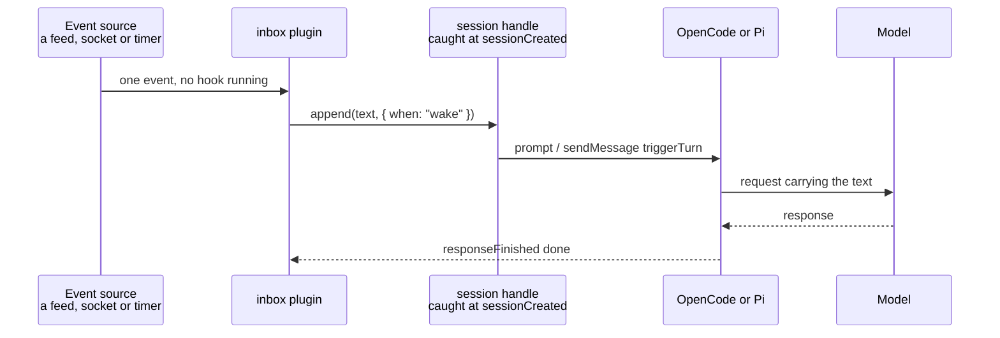

# T2: session actions and events

**Status: Planned.** Ready to build after T1, which is implemented: one session
handle acts on an OpenCode 2.3.0 or Pi 1.5.2 session at any time, and five
hooks report its events. It unblocks Chauffeur slice 8. Part of
[tack v1](https://github.com/wrkhse/tack/issues/1).

## You can

Hold a session handle and act on it at any time, not only inside a hook: an
idle OpenCode or Pi session starts a turn when the plugin appends with
`when: "wake"`. That is sourcefed's shape: subscribe at `sessionCreated` and
append when an event arrives.

```ts
import { createAgentPlugin } from "@workhorse/tack";

export const inbox = createAgentPlugin(() => ({
  name: "inbox",

  sessionCreated: (session) => {
    // A feed, a socket or a timer: anything that fires outside a hook.
    watch((event) => {
      session.append(event.text, { when: "wake" });
    });
  },

  permissionAsked: (request) =>
    request.resources.includes("infra/")
      ? { deny: "infra/ is read-only for this plugin." }
      : undefined,
}));
```

`when` says when the text arrives: `now` steers at the next step boundary of
a running turn, `next` waits for the turn to end, and `wake` starts a turn on
an idle session. `session.compact()`, `session.interrupt()` and
`session.setModel({ providerID, id })` are the other actions. A plugin asks
the fidelity table when it needs to know what its agent supports:

```ts
import { fidelity } from "@workhorse/tack";

const cell = fidelity.pi.cells["event.permissionAsked"];

if (cell.fidelity === "unsupported") {
  console.log(`Pi: ${cell.how}`);
}
```

## Path



The handle is live from `sessionCreated` to `sessionEnded`, and each action
on it reaches the agent directly, with no hook in between.

## What it builds

### Session handle

Inside every hook, `ctx.session` is the handle; `sessionCreated` receives the
same handle as its first argument. Four actions act on the session, and
each maps to one native call on each agent (see [Fidelity
table](#fidelity-table)).

Files: `src/session.ts` (the handle), `src/hooks/tool-before.ts` (the hook
context carries it), `src/plugin.ts` (the definition's new fields),
`src/hooks/budget.ts` (the handler names), `src/agents/opencode.ts` and
`src/agents/pi.ts` (the native calls).

```ts
const note = createAgentPlugin(() => ({
  name: "retry-note",

  responseFinished: (response, ctx) => {
    if (response.reason === "error") {
      ctx.session.append("The last turn failed; check the log.", {
        when: "next",
      });
    }
  },
}));
```

An action is a direct agent call, not a hook, so actions from several plugins
are not combined: each is carried out in the order it was made. On Pi,
`sendUserMessage` runs Pi's own `input` hook with source `extension`; the
adapter skips it, as `promptSent` already does. Pi's `compact` aborts the
current run first, a behavioural difference the table records.

Verification: `test/session.test.ts` runs each action on a fake context,
checks the native call, the delivery for `now`, `next` and `wake`, and the
provider and model ids `setModel` passes.

### Events and hooks

Five hooks join T1's three. `sessionCreated(session, ctx)` and
`sessionEnded(session, ctx)` report the session and its handle;
`responseFinished(response, ctx)` reports one response with
`reason: "done" | "aborted" | "error"`; `sessionIdle(session, ctx)` reports a
session with no pending input; `permissionAsked(request, ctx)` returns
`{ allow: true }`, `{ deny: reason }` or `undefined` to leave the request to
the agent.

Files: `src/hooks/lifecycle.ts`, `src/hooks/response-finished.ts`,
`src/hooks/session-idle.ts`, `src/hooks/permission-asked.ts`,
`src/hooks/order.ts`, `src/agents/opencode.ts`, `src/agents/pi.ts`.

```ts
const gate = createAgentPlugin(() => ({
  name: "gate",

  permissionAsked: (request) =>
    request.resources.some((resource) => resource.startsWith("infra/"))
      ? { deny: "infra/ is off limits." }
      : undefined,
}));
```

Observing hooks (`sessionCreated`, `sessionEnded`, `responseFinished`,
`sessionIdle`) call every plugin in priority order, and one plugin's failure
is logged without affecting the others. `permissionAsked` combines like
`toolBefore`: a deny from any plugin wins, every plugin allowing allows the
request, and otherwise the agent's own rules decide. On OpenCode the hook runs
for `allow` and `ask`, and a configured `deny` skips it; the observable
`permission.asked` event is not a decision point. Pi's row reads `unsupported`,
so tack never calls the hook there.

Verification: `test/lifecycle.test.ts` covers both hooks in priority order
and a throwing handler; `test/response-finished.test.ts` covers each reason;
`test/session-idle.test.ts` covers one call per idle session;
`test/permission-asked.test.ts` covers any deny winning, every plugin
allowing, `undefined`, and a configured deny skipping the hook.

### Fidelity table

Ten rows join T1's six, and `Cell`, `Fidelity` and `FidelityTable` keep their
shape. `capabilities` is the runtime list, so a missing cell in either table
is a type error. The published `fidelity` is keyed by agent, and a plugin
reads the row for the agent it runs on.

Files: `src/fidelity/index.ts`, `src/fidelity/opencode.ts`,
`src/fidelity/pi.ts`, `test/fidelity.test.ts`.

```ts
import { fidelity } from "@workhorse/tack";

for (const agent of ["opencode", "pi"] as const) {
  const cell = fidelity[agent].cells["session.append.wake"];

  console.log(agent, cell.fidelity, cell.how);
}
```

| Capability               | OpenCode 2.3.0                                                                                                                                                                                                                                                                                                                                                                                                                                                                                                                               | Pi 1.5.2                                                                                                                                                                                                                                                                                                                                                                                                                                                                                                                                                                                 |
| ------------------------ | -------------------------------------------------------------------------------------------------------------------------------------------------------------------------------------------------------------------------------------------------------------------------------------------------------------------------------------------------------------------------------------------------------------------------------------------------------------------------------------------------------------------------------------------- | ---------------------------------------------------------------------------------------------------------------------------------------------------------------------------------------------------------------------------------------------------------------------------------------------------------------------------------------------------------------------------------------------------------------------------------------------------------------------------------------------------------------------------------------------------------------------------------------- |
| `session.append.now`     | native: `ctx.session.prompt({ sessionID, text, delivery: "steer" })`; steer runs at the running turn's next step boundary (`@opencode/client` `dist/promise/generated/types.d.ts` L4283–4330; [docs](https://opencode.ai/docs/build/plugins/server), API → Sessions)                                                                                                                                                                                                                                                                         | native: `pi.sendUserMessage(text, { deliverAs: "steer" })` while streaming; idle, it starts a turn, and a streaming call without `deliverAs` rejects "Agent is already processing..." (`@earendil-works/pi-coding-agent` `dist/core/extensions/types.d.ts` L1303–1316; `docs/extensions.md` L1679)                                                                                                                                                                                                                                                                                       |
| `session.append.next`    | native: the same call with `delivery: "queue"`, parked until the current turn ends; the interrupt docs say queued prompts remain parked (`@opencode/client` `dist/promise/generated/types.d.ts` L4283–4330; [docs](https://opencode.ai/docs/api), `session.prompt` and `session.interrupt`)                                                                                                                                                                                                                                                  | native: `pi.sendMessage({ customType, content, display: false, details }, { deliverAs: "followUp" })` while streaming; idle, `deliverAs: "nextTurn"` queues it for the next user prompt without starting a turn (`@earendil-works/pi-coding-agent` `dist/core/extensions/types.d.ts` L1303–1316; `dist/core/agent-session.js` L1946–1984; `docs/extensions.md` L1644–1649)                                                                                                                                                                                                               |
| `session.append.wake`    | native: the same prompt on an idle session, which "durably admits one session input and schedules agent-loop execution unless `resume` is false"; a notice admitted with `resume: false` "waits for the next wake" ([docs](https://opencode.ai/docs/api), `session.prompt`; `@opencode/plugin` `dist/promise/session.d.ts` L178–180)                                                                                                                                                                                                         | native: `pi.sendMessage(…, { triggerTurn: true })` on an idle session, which triggers an LLM response immediately; while streaming it steers by default (`@earendil-works/pi-coding-agent` `docs/extensions.md` L1644–1649)                                                                                                                                                                                                                                                                                                                                                              |
| `session.compact`        | native: `ctx.session.compact({ sessionID, delivery? })` returns `Promise<SessionInboxCompaction>` (`@opencode/client` `dist/promise/generated/types.d.ts` L4387–4395)                                                                                                                                                                                                                                                                                                                                                                        | native: `ctx.compact({ customInstructions?, onComplete?, onError? })`, which aborts the current run first (`@earendil-works/pi-coding-agent` `dist/core/extensions/types.d.ts` L214–218, L270; `dist/core/agent-session.d.ts` L744–750)                                                                                                                                                                                                                                                                                                                                                  |
| `session.interrupt`      | native: `ctx.session.interrupt({ sessionID, resume? })` returns `Promise<{ interrupted: boolean }>` (`@opencode/client` `dist/promise/generated/types.d.ts` L4448–4451)                                                                                                                                                                                                                                                                                                                                                                      | native: `ctx.abort()` (`@earendil-works/pi-coding-agent` `dist/core/extensions/types.d.ts` L262)                                                                                                                                                                                                                                                                                                                                                                                                                                                                                         |
| `session.model`          | native: `ctx.session.switchModel({ sessionID, model: { id, providerID, variant? } })` (`@opencode/client` `dist/promise/generated/types.d.ts` L4254–4263; `@opencode/schema` `dist/model.d.ts` L77–101)                                                                                                                                                                                                                                                                                                                                      | native: `pi.setModel(model)`, with the model from `ctx.modelRegistry.find(provider, id)` (`@earendil-works/pi-coding-agent` `dist/core/extensions/types.d.ts` L1343, L245; `dist/core/model-registry.d.ts` L29)                                                                                                                                                                                                                                                                                                                                                                          |
| `event.responseFinished` | native: the harness's own `session.step.ended` per assistant message carries `{ sessionID, assistantMessageID, finish, cost, tokens }` with `finish` such as `"stop"`, `"tool-calls"`, `"length"` or `"error"`, and `session.execution.succeeded`, `failed` or `interrupted` per turn carries `{ sessionID }` (interrupted adds `reason`), both arrive through `ctx.event.subscribe({ types })` rather than a hook (`@opencode/protocol` `dist/groups/event.d.ts` L7434–7475, L6833–6850; `@opencode/plugin` `dist/promise/event.d.ts` L1–6) | native: `turn_end` per turn carries `{ turnIndex, message, toolResults, … }`, `agent_end` closes a run, and `agent_settled` carries `aborted`. The docs name no error event, so reason `error` is unconfirmed (`@earendil-works/pi-coding-agent` `dist/core/extensions/types.d.ts` L848–856, L768–771, L821–825; `docs/extensions.md` L336, L665)                                                                                                                                                                                                                                        |
| `event.sessionIdle`      | native: the experimental `ctx.session.hook("experimental.idle", cb)` with `{ sessionID, background }` runs when a session finishes model work with no pending input, just before it goes idle; the ephemeral `session.idle` event carries `{ data: { sessionID } }`. The hook is absent from the published hook reference (`@opencode/plugin` `dist/promise/session.d.ts` L172–186, L204; `@opencode/schema` `dist/session-status-event.d.ts` L126–153)                                                                                      | native: `agent_settled` is the only final-idle signal and is notification-only; `ctx.isIdle()` polls (`@earendil-works/pi-coding-agent` `dist/core/extensions/types.d.ts` L821–825, L256; `docs/extensions.md` L665)                                                                                                                                                                                                                                                                                                                                                                     |
| `event.permissionAsked`  | native: `ctx.permission.hook("evaluate", cb)` with `{ sessionID, agent?, action, resources[], metadata?, source?, effect, message? }`; it runs for `allow` and `ask`, a configured `deny` skips it, and the hook may set any effect. The observable `permission.asked` event is not a decision point (`@opencode/plugin` `dist/promise/permission.d.ts` L7–19; [docs](https://opencode.ai/docs/build/plugins), Hooks → Permissions; `@opencode/schema` `dist/permission.d.ts` L40–90)                                                        | unsupported: Pi has no permission layer: no event, no callback and no config setting. `docs/security.md` L3 says it "does not ask for approval before every tool call", the extension event union has no permission member, and the settings schema has no permission field. An extension's own `tool_call` handler asking with `ctx.ui.select/confirm` is T1's `toolBefore` guard, not a permission layer (`@earendil-works/pi-coding-agent` `dist/core/extensions/types.d.ts` L1101; `docs/security.md` L3; `docs/extensions.md` L22; `examples/extensions/permission-gate.ts` L11–27) |
| `session.actOutsideHook` | native: `ctx.session.*` are client-equivalent action methods, callable at any time with a session id captured in a hook: "Its read and action methods use the same inputs and responses as the client" ([docs](https://opencode.ai/docs/build/plugins), Lifecycle → Context; `@opencode/plugin` `dist/promise/session.d.ts`, `dist/promise/event.d.ts`). The docs show no setup-time prompt, so that pattern is unconfirmed in a run                                                                                                         | native: from `session_start` on; the factory's action methods throw "Extension runtime not initialized..." during loading; background work is deferred to `session_start` and closed at `session_shutdown`, as the file-trigger example does. A captured `pi` or ctx must not be used after a session is replaced (`@earendil-works/pi-coding-agent` `dist/core/extensions/loader.js` L112–113; `docs/extensions.md` L252–256; `examples/extensions/file-trigger.ts` L13–45; `dist/core/runner.js` L482–486)                                                                             |

OC is `@opencode/client`, `@opencode/plugin`, `@opencode/protocol` and
`@opencode/schema` at 2.3.0; PI is
`@earendil-works/pi-coding-agent@1.5.2`. A path in the table is inside that
package, and a `docs/` or `examples/` path is the package's own. Every cell is
read from the installed package and the official docs at these versions; the
conformance suite re-proves each cell in the real CLI when the slice lands. A
cell turns `unsupported` when its scenario fails.

`event.permissionAsked` is the acceptance row: Pi's cell reads
`unsupported` and OpenCode's reads `native`.

Verification: `test/fidelity.test.ts` checks that each of the ten rows has a
citable source in both tables; the conformance suite re-proves each cell in
the real CLI.

### Conformance suite

T2 adds six scenarios to T1's suite. Each runs the real CLI once, in a
throwaway `HOME`, against the stand-in model and the recorder, and checks the
load markers T1 introduced. The stand-in model is scripted for these turns; no
real model is called.

Files: `conformance/scenarios.ts`, `conformance/suite.ts`,
`conformance/opencode.test.ts`, `conformance/pi.test.ts`, and one plugin per
scenario under `conformance/plugins/`.

| Scenario     | Passes when                                                                                                                               |
| ------------ | ----------------------------------------------------------------------------------------------------------------------------------------- |
| wake         | the plugin appends with `when: "wake"` after the first turn, and the model's second request carries the text                              |
| outside hook | the plugin captures the session at `sessionCreated` and appends from a timer after startup, and the model's next request carries the text |
| now          | a running turn's next step carries the text, proven by which request carries it                                                           |
| next         | the text arrives in the request after the turn's last step, proven the same way                                                           |
| actions      | `compact`, `interrupt` and `setModel` each leave a marker the harness writes, and the check reads it                                      |
| permission   | the plugin reports its own agent's `event.permissionAsked` cell, and the suite asserts Pi `unsupported` and OpenCode `native`             |

Verification: the suite itself, in CI on every pull request. Each scenario
also asserts that the run loaded exactly its plugin list, as T1 does.

## End to end

- `bun run check` exits 0 with no warnings: format, Oxlint with the vendored
  anti-slop rules, `tsc`, Effect diagnostics, the anti-slop and unit Vitest
  projects, `fallow audit` and `bun audit`.
- In OpenCode 2.3.0 and Pi 1.5.2, every T1 and T2 scenario passes from a fresh
  `HOME`, and every run loads exactly the plugins its scenario names.
- The `permission` scenario asserts both cells: Pi `unsupported`, OpenCode
  `native`.
- The suite starts real agent processes, so it runs in CI or in a disposable
  container, never on the machine's own agents:

```sh
bun run check
bun run conformance:opencode
bun run conformance:pi
```

The container recipe is [T1's](t1.md#end-to-end).

## Left open

- The nightly real-model runs come after T1: OpenCode and Pi on OpenCode Go's
  Hy4 flash Free, at the highest effort each offers, with one
  `OPENCODE_API_KEY` the owner adds. Until then every T2 run uses the
  stand-in model.
- Pi rebinds the extension for each session. That is a spike claim read at
  1.4.0 ([REALM-SPIKE](../../../spike/unagent/REALM-SPIKE.md)); T2's per-session
  handle rests on it, and the Pi run checks it at 1.5.2.
- Unconfirmed until the conformance run: `event.responseFinished` reason
  `error` on Pi, because its docs name no error event; and
  `session.actOutsideHook` on OpenCode for an action at setup time, because
  its docs show only a session id captured in a hook. The OpenCode
  `event.sessionIdle` row rests on the experimental, unpublished
  `experimental.idle` hook; the `session.idle` event is its alternate path.
