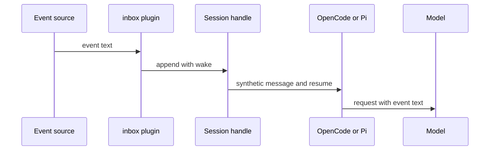

# T2: session actions and events

**Status: Implemented.** A plugin can hold a session handle and act on an
OpenCode 2.3.0 or Pi 1.5.2 session outside a hook. Part of
[tack v1](https://github.com/wrkhse/tack/issues/1).

## You can

Capture the handle when a session starts and use it when an event arrives:

```ts
import { createAgentPlugin } from "@workhorse/tack";

export const inbox = createAgentPlugin(() => ({
  name: "inbox",

  sessionCreated: ({ session }) => {
    watch(async (event) => {
      const outcome = await session.append(event.text, { when: "wake" });

      if (outcome.status === "refused") {
        console.warn("inbox:", outcome.reason);
      }
    });
  },
}));
```

Here `watch` represents the plugin's event source. The handle is also
available as `ctx.session` inside hooks.



## Delivery and limits

An append is a synthetic message, not a user prompt. `when: "now"` steers
at a running turn's next step boundary; `"next"`, the default, waits for
the turn to end. Neither starts an idle session. `"wake"` starts an idle
session or steers a busy one. Appends do not trigger `promptSent`.

The handle also offers `compact()`, `interrupt()` and `setModel()`.
Every action resolves to `accepted`, `unsupported`, `refused` with a
reason, or `ended`; it does not reject. An ended or replaced session's
handle reports `ended`. Pi compaction aborts a running turn first;
OpenCode waits for a step boundary. See the
[session guide](../../../src/session/README.md).

`sessionCreated`, `sessionEnded`, `responseFinished` and `sessionIdle`
report lifecycle events. `permissionAsked` can deny, allow, or leave the
decision to the agent. A denial wins in priority order; an allow requires
every handler to allow. Pi has no permission layer, so this hook is
unsupported there. See [hooks](../../../src/hooks/README.md) and
[fidelity](../../../src/fidelity/README.md).

## Verification

[T2 conformance](https://github.com/wrkhse/tack/pull/5) exercises delivery,
actions and events in both real CLIs, including an out-of-hook append and
Pi's unsupported permission hook. The
[conformance guide](../../../conformance/README.md) describes the isolated
runs and their evidence.
