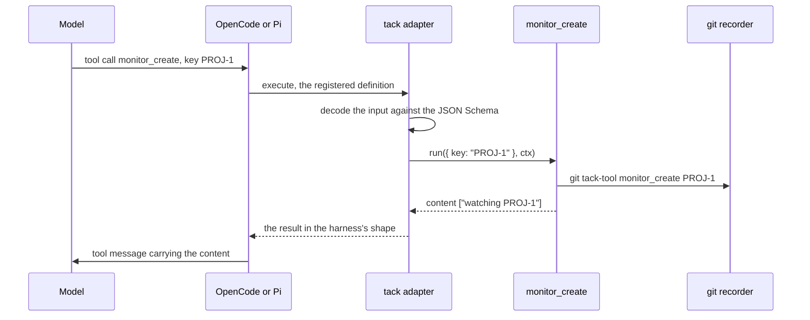

# T3: tools

**Status: Planned.** One tool definition serves every harness tack adapts:
OpenCode and Pi register it in process, and a stdio MCP server serves the same
definitions to a harness with no in-process tool API. The conformance suite
proves it in both CLIs: the model calls the tool, the recorder shows the handler
ran, the returned content arrives in the next request, and a removed tool is
gone from the model's list. It unblocks Chauffeur slices 8 to 10 and
`ask_chauffeur`. Part of [tack v1](https://github.com/wrkhse/tack/issues/1).

## You can

Register one tool, and every agent tack builds calls it. `tool()` takes a name, a
description, a plain JSON Schema header and a handler; a plugin lists its tools
in the definition it already returns.

```ts
import { createAgentPlugin, tool } from "@workhorse/tack";

const monitorCreate = tool<{ key: string }>({
  name: "monitor_create",
  description: "Start watching a Jira issue",
  input: {
    type: "object",
    properties: { key: { type: "string" } },
    required: ["key"],
  },
  run: (input) => ({
    content: [`watching ${input.key}`],
    details: { id: "m-1" },
  }),
});

export default createAgentPlugin(() => ({
  name: "monitor",
  tools: { monitor_create: monitorCreate },
}));
```

The generic names the handler's input type, and `input` is the wire contract, so
OpenCode, Pi and the MCP server describe and validate the same object. Tack
decodes the input before `run`, and a missing or mistyped field becomes an error
result naming the tool and the field. A handler that throws becomes an error
result too, so a failing handler still leaves the model a result to read.

A tool's result reaches the model as a tool message, and a plugin also observes
the call and its result through T1's `toolAfter`, like any other tool. `run`
receives a `ctx` beside its input: the call's id, the abort signal when the
transport supplies one, and the registry the plugin's tools live in. The
same definition runs in each agent: `plugin.opencode()` adds it in process,
`plugin.pi()` registers it, and the build's MCP entry serves it to a harness with
no in-process tool API. The Claude Code mod is T4's.

A plugin withdraws a tool through the registry every context carries, and the
tool is gone from the next model request:

```ts
responseFinished: async (_response, ctx) => {
  ctx.tools.remove("monitor_create");
},
```

## Path



The harness owns the call: it invokes the definition tack registered in its own
process, and the model's next request carries the result. The MCP entry runs the
same handler in a server process; that is the whole difference for a harness with
no in-process tools.

## What it builds

### Tool definition

`tool()` builds one definition: a name, a description, a JSON Schema header, and a
handler that returns `{ content, details?, isError? }`. `content` is what the model
reads, one entry per message; `details` is data for the plugin and the harness
UI, never the model.

The contract is language-neutral: a JSON Schema header plus a handler tack calls,
so a later core in another language serves the same definitions.

The header is read as JSON Schema draft 2020-12 and compiled once at load into an
Effect schema: `JsonSchema.fromSchemaDraft2020_12`, then
`SchemaRepresentation.fromJsonSchemaDocument` (`effect` `dist/JsonSchema.d.ts`
L290, `dist/SchemaRepresentation.d.ts` L2402). A header the importer refuses
fails the load, naming the tool. Each call decodes its input with that schema, so
a harness's own coercion cannot widen what a handler receives.

A definition carries a failure as a value:

```ts
const searchDocs = tool<{ query: string; limit?: number }>({
  name: "search_docs",
  description: "Search the documentation",
  input: {
    type: "object",
    properties: {
      query: { type: "string" },
      limit: { type: "integer" },
    },
    required: ["query"],
  },
  run: async (input) => {
    const found = await index.search(input.query, input.limit ?? 10);

    return found.ok
      ? { content: found.titles }
      : { content: [`search failed: ${found.reason}`], isError: true };
  },
});
```

A load check keeps the three transports spelling a tool the same way: the name
matches `[a-z][a-z0-9_]*`, the map key in `tools` equals the tool's own `name`, and
a name already live in the scope fails the load, as a duplicate plugin name does.
A tool added after load goes through the same check.

`ctx.tools.add(tool)` registers a tool after load and returns a handle whose
`dispose()` withdraws it; `ctx.tools.remove(name)` is the same by name.

Files: `src/tools/tool.ts` (the definition and its load check),
`src/tools/registry.ts` (add and remove), `src/plugin.ts` (the definition's
`tools` field), `src/index.ts` (the exports), `test/tools.test.ts`.

Verification: `test/tools.test.ts` covers the load refusals, a header the importer
cannot compile, an input the schema rejects with its field named, a valid input,
`details` and `isError`, a handler that throws, and `add` and `remove` through a
fake context.

### OpenCode

`plugin.opencode(options)` registers the plugin's tools in one transform during
setup. The transform carries tack's `name`, `description` and `input` unchanged,
with an `execute` that maps tack's result.

| tack     | OpenCode 2.3.0                                                                                                                                  |
| -------- | ----------------------------------------------------------------------------------------------------------------------------------------------- |
| register | `ctx.tool.transform((editor) => editor.add({ name, description, input, execute }))`, synchronous, during `setup`                                |
| input    | the JSON Schema object unchanged: `Tool.ValueSchema` accepts an Effect schema, any Standard Schema, or `JsonSchema.JsonSchema`                  |
| result   | each `content` string becomes a text part, `details` becomes `metadata`; `isError` throws `Tool.Error`, because `Tool.Result` has no error flag |
| withdraw | the adding registration's `dispose()`, or `editor.remove(id)` in a later transform; either way the next snapshot omits the tool                 |
| timing   | a model request captures its tool snapshot when it is built, so an add or a removal lands on the next request                                   |

Sources: the editor's `add`, `remove` and `transform` are in `@opencode/plugin`
at `dist/promise/tool.d.ts` L22–34 and L59–67, and a registration's `dispose` at
`dist/promise/registration.d.ts` L1–3. `Tool.ValueSchema` is `@opencode/schema`
`dist/tool.d.ts` L49, and `Tool.Result` L83–87. The docs' Tools section shows the
plain JSON Schema header, the snapshot per request, and disposal
([Server plugins](https://opencode.ai/docs/build/plugins/server) → API → Tools).

```jsonc
// opencode.json
{ "plugins": ["./plugins/monitor"] }
```

Files: `src/agents/opencode.ts`, `test/adapters/opencode.test.ts`.

Verification: `test/adapters/opencode.test.ts` runs the adapter against an editor
with the same methods and checks the added info, the result mapping, a throw and
a disposal; the conformance suite proves it in the real CLI.

### Pi

`plugin.pi(options)` registers each tool with `pi.registerTool`. Pi requires a
`label` for display, so tack passes the tool's name.

| tack     | Pi 1.5.2                                                                                                                                            |
| -------- | --------------------------------------------------------------------------------------------------------------------------------------------------- |
| register | `pi.registerTool({ name, label: name, description, parameters, execute })`                                                                          |
| input    | `parameters` is the JSON Schema object unchanged; Pi validates arguments as JSON Schema with `@earendil-works/pi-schema`, whatever built the schema |
| result   | each `content` string becomes a text block, `details` is `details`, `isError` is `isError`                                                          |
| withdraw | no unregister: re-register the same name with `exposure: "hidden"`, which leaves it registered and unreachable                                      |
| timing   | a tool registered in the factory is active on the first request; one registered later appears on the next                                           |

Sources: `registerTool` is `dist/core/extensions/types.d.ts` L1271, the definition
and `execute` L473–534, and `setActiveTools` L1336. The package docs cover
registration during load and after startup, activation and the next request
(`docs/extensions.md` L1582–1592), withdrawal through `exposure: "hidden"`
(L2766), and JSON Schema arguments (L174–184).

```sh
pi -e monitor.js
```

Files: `src/agents/pi.ts`, `test/adapters/pi.test.ts`.

Verification: `test/adapters/pi.test.ts` runs the adapter against a fake `pi` with
`registerTool` and `on`, checks the registered definition and the result mapping,
and checks that a withdrawal re-registers the same name as hidden; the
conformance suite proves it in the real CLI.

### Tools over MCP

A harness with no in-process tool API, such as Codex, reaches the same
definitions through MCP. The build writes one stdio entry beside the plugin's
agent entries; it serves `tools/list` and `tools/call` from the definitions the
agents register, so a tool is described and validated the same way on every path.

```ts
// plugins/monitor/mcp.js, written by the build
import monitor from "./index.ts";
import { serveMcp } from "@workhorse/tack";

await serveMcp(monitor, {});
```

```sh
bun ./plugins/monitor/mcp.js
```

`tools/list` answers with each tool's name, description and `inputSchema`, which is
the `input` object unchanged. `tools/call` decodes `arguments` against that schema
and answers with one text block per `content` entry and `isError` when the
handler failed. `details` stays local: MCP carries structured output as
`structuredContent` only for a tool that declares an `outputSchema`, and a tack
tool declares none. The two methods and their fields are MCP's
([Specification 2025-06-18](https://modelcontextprotocol.io/specification/2025-06-18/server/tools)
→ Server → Tools).

The factory runs once for the MCP entry with `meta.agent` of `"mcp"`, so a plugin
that reads `meta` knows no agent loaded it.

Files: `src/mcp/serve.ts` (the two methods over one transport), `src/index.ts`
(the `serveMcp` export), `test/mcp.test.ts`.

Verification: `test/mcp.test.ts` speaks JSON-RPC over an in-memory transport with
the SDK's client: `initialize`, `tools/list` with the header, `tools/call` with
content, an argument the schema rejects, and a handler that throws.

### Fidelity table

Six rows join T1's six and T2's twelve. `Cell`, `Fidelity` and `FidelityTable`
keep their shape, and `capabilities` is the runtime list, so a missing cell in
either table is a type error.

Files: `src/fidelity/index.ts`, `src/fidelity/opencode.ts`,
`src/fidelity/pi.ts`, `test/fidelity.test.ts`.

```ts
import { fidelity } from "@workhorse/tack";

const cell = fidelity.pi.cells["tool.remove"];

if (cell.fidelity === "fallback") {
  console.log("Pi:", cell.how);
}
```

| Capability      | OpenCode 2.3.0                                                                                                                                                                                                                                                                                    | Pi 1.5.2                                                                                                                                                                                                                                                          |
| --------------- | ------------------------------------------------------------------------------------------------------------------------------------------------------------------------------------------------------------------------------------------------------------------------------------------------- | ----------------------------------------------------------------------------------------------------------------------------------------------------------------------------------------------------------------------------------------------------------------- |
| `tool.register` | native: `ctx.tool.transform((editor) => editor.add(tool))` registers a definition for the next request's snapshot; a transform is synchronous and may run in `setup` (`@opencode/plugin` `dist/promise/tool.d.ts` L22–34, L59–67; Server plugins → API → Tools)                                   | native: `pi.registerTool({ name, label, description, parameters, execute })` works during load and after startup; the tool is active and declared on the next request (`dist/core/extensions/types.d.ts` L1271; `docs/extensions.md` L1582–1592)                  |
| `tool.remove`   | native: `editor.remove(id)` in a later transform, or the adding registration's `dispose()`; disposal replays the remaining transforms, so the tool is absent from the next request (`dist/promise/tool.d.ts` L22–34, L59–67; `dist/promise/registration.d.ts` L1–3; Server plugins → API → Tools) | fallback: there is no unregister. Re-register the same name with `exposure: "hidden"`, which leaves it registered and unreachable, or drop it from `setActiveTools` (`dist/core/extensions/types.d.ts` L1271, L1336; `docs/extensions.md` L2766)                  |
| `tool.call`     | native: `execute(input, context)` runs with the input `input` declares, and `context.signal` aborts a stopped call (`@opencode/plugin` `dist/promise/tool.d.ts` L19–21; `@opencode/schema` `dist/tool.d.ts` L88–96; Server plugins → API → Tools)                                                 | native: `execute(toolCallId, params, signal, onUpdate, ctx)` returns the result (`dist/core/extensions/types.d.ts` L534)                                                                                                                                          |
| `tool.result`   | native: `Tool.Result` carries `content` as a string or content parts and `metadata`; a thrown `Tool.Error` carries the message the model reads (`@opencode/schema` `dist/tool.d.ts` L83–87; `@opencode/plugin` `dist/promise/tool.d.ts` L19–21)                                                   | native: `AgentToolResult` carries `content` blocks, `details`, `structuredContent?`, `isError?` and `terminate?`; `isError` reports a failure the model sees (`@earendil-works/pi-agent-core` `dist/types.d.ts` L370–393; `dist/core/extensions/types.d.ts` L534) |
| `tool.schema`   | native: `ValueSchema` is an Effect schema, any Standard Schema, or `JsonSchema.JsonSchema`, so a plain JSON Schema object is accepted (`@opencode/schema` `dist/tool.d.ts` L49)                                                                                                                   | native: Pi validates arguments as JSON Schema with `@earendil-works/pi-schema`, whatever built the schema, so a plain object is accepted (`docs/extensions.md` L174–184)                                                                                          |
| `tool.mcp`      | fallback: the harness is an MCP client, so a generated server could serve it, but the plugin registers in process and OpenCode needs no server ([MCP servers](https://opencode.ai/docs/mcp-servers); Server plugins → API → Tools)                                                                | fallback: `pi mcp add` connects a stdio server, so the generated entry reaches it too; the in-process registration is the path tack uses (`docs/mcp.md` L3; `docs/extensions.md` L1582–1592)                                                                      |

OC is `github.com/anomalyco/opencode` at `v2.3.0`; PI is
`@earendil-works/pi-coding-agent@1.5.2`. A path in the table is inside that
repository or package, and a `docs/` path is the package's own. Every cell is
read from the installed package, the repository at the tag, and those docs at
these versions. The conformance suite re-proves every cell but `tool.mcp` in the
real CLI; `test/mcp.test.ts` exercises that row on the server side, and each
harness's client support is read from its docs. A cell turns `unsupported` when
its scenario fails.

`tool.call` is the acceptance row: both cells read `native`.

Verification: `test/fidelity.test.ts` checks that each of the six rows has a
citable source in both tables; the conformance suite proves the rows it can
reach in the real CLI.

### Conformance suite

The acceptance is one scenario set, run in both CLIs against the stand-in model
and T1's git recorder. The tool's handler runs `git tack-tool monitor_create
<key>`, so the recorder's line proves the handler ran in the harness, after the
model's call, and the stand-in keeps every request body.

T1's one-shot runs are enough for the list, call, result and error rows: one
prompt, one scripted call, one result. The withdrawal row needs a second request
after the removal, so it runs under T2's long-lived driver: OpenCode's server
session with a second prompt, and Pi in RPC mode with a second prompt.

Files: `conformance/tool-scenarios.ts` (the rows and their checks),
`conformance/suite.ts`, `conformance/harness/opencode.ts`,
`conformance/harness/pi.ts`, and one plugin per row under
`conformance/plugins/`, such as `tool-create.ts` and `tool-withdraw.ts`.

| Scenario | Passes when                                                                                           |
| -------- | ----------------------------------------------------------------------------------------------------- |
| list     | the first request the model receives declares `monitor_create` with its description and `inputSchema` |
| call     | the scripted call reaches the handler, and the recorder holds `tack-tool monitor_create PROJ-1`       |
| result   | the next request carries a tool message whose content is `watching PROJ-1`                            |
| error    | a handler that throws reaches the model as an error result, and the recorder shows it ran             |
| withdraw | after the plugin removes the tool, the next request declares no `monitor_create`                      |

Verification: the suite itself, in CI on every pull request. Each scenario also
asserts that the run loaded exactly its plugin list, as T1 does.

## End to end

- `bun run check` exits 0 with no warnings: format, Oxlint with the vendored
  anti-slop rules, `tsc`, Effect diagnostics, the anti-slop and unit Vitest
  projects, `fallow audit` and `bun audit`. `bun audit` ignores exactly one
  advisory, GHSA-fc5q-39xc-vjpf: picomatch 4.0.7 has a ReDoS with no patched
  release, it arrives only through dev chains, `bun audit --production` is
  clean, and tack globs only its own patterns. The ignore goes when picomatch
  4.0.8 or later ships, and every dependency bump re-checks it.
- In OpenCode 2.3.0 and Pi 1.5.2, every T1, T2 and T3 scenario passes from a
  fresh `HOME`, and every run loads exactly the plugins its scenario names.
- The `withdraw` scenario asserts both cells: Pi `fallback`, OpenCode `native`.
- `test/mcp.test.ts` answers `tools/list` and `tools/call` over an in-memory
  transport, and runs inside `bun run check`.
- The suite starts real agent processes, so it runs in CI or in a disposable
  container, never on the machine's own agents:

```sh
bun run check
bun run conformance:opencode
bun run conformance:pi
```

The container recipe is [T1's](t1.md#end-to-end).

## Left open

- T4 owns the Claude Code mod, and T5 owns the runner that brings the MCP entry
  to Codex. T3 ships the definitions and the server both consume.
- The MCP SDK is the approved dependency for T3; its version is pinned at build
  time, when the first server is written.
- Pi's `tool.remove` is a fallback. Re-registering the same name as hidden is a
  docs claim, and the withdraw row is the first run that proves it.
- Whether a request's tool list names a plugin tool exactly `monitor_create` is
  read from OpenCode's docs, where the editor keys tools by an effective name;
  the list row proves it at 2.3.0.
