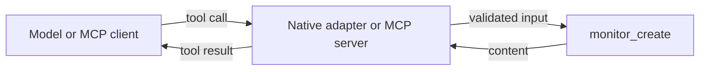

# T3: tools

**Status: Building.** OpenCode and Pi register tools natively, and an MCP
stdio server serves the same definitions. T3 remains Building until the
Claude Code mod and Codex call a T3 tool, as specified in
[tack v1](https://github.com/wrkhse/tack/issues/1).

## You can

Define a tool once for OpenCode, Pi and an MCP client:

```ts
import { createAgentPlugin, tool } from "@workhorse/tack";

const monitorCreate = tool<{ key: string }>({
  name: "monitor_create",
  description: "Start watching a Jira issue",
  input: {
    type: "object",
    properties: { key: { type: "string" } },
    required: ["key"],
  },
  run: (input) => ({ content: [`watching ${input.key}`] }),
});

export default createAgentPlugin(() => ({
  name: "monitor",
  tools: { monitor_create: monitorCreate },
}));
```

The agent entries export the plugin's `.opencode()` or `.pi()` output.
An MCP stdio entry imports the plugin and starts its server:

```ts
import monitor from "./index.ts";
import { serveMcp } from "@workhorse/tack";

await serveMcp(monitor, { timeoutMs: 30_000 });
```

The MCP client starts that entry as a child process and communicates over
stdin and stdout. The [conformance entry][entry] is bundled for the stdio
test.

[entry]: ../../../conformance/plugins/entries/mcp-monitor.ts



## Integration and limits

Tack validates each call against the tool's JSON Schema. Invalid input and
handler failures become error results. Tool calls have a 30-second default
timeout and a 262,144-byte content limit; handlers doing slow work should
listen to their abort signal. See [tools](../../../src/tools/README.md) for
the contract, dynamic registration and withdrawal.

The MCP server has no agent session and does not run `toolBefore`. Put any
guard needed on this path inside the handler. A tool declaring
`needsSession: true` is refused at server startup. See
[MCP over stdio](../../../src/mcp/README.md) for protocol versions,
cancellation and live tool-list changes, and
[fidelity](../../../src/fidelity/README.md) for agent support.

## Verification

[OpenCode tool conformance](https://github.com/wrkhse/tack/pull/12),
[Pi and withdrawal conformance](https://github.com/wrkhse/tack/pull/13),
and [MCP stdio conformance](https://github.com/wrkhse/tack/pull/14) cover
native calls and an MCP client listing and calling the bundled server.
The [conformance guide](../../../conformance/README.md) describes the
isolated runs.
