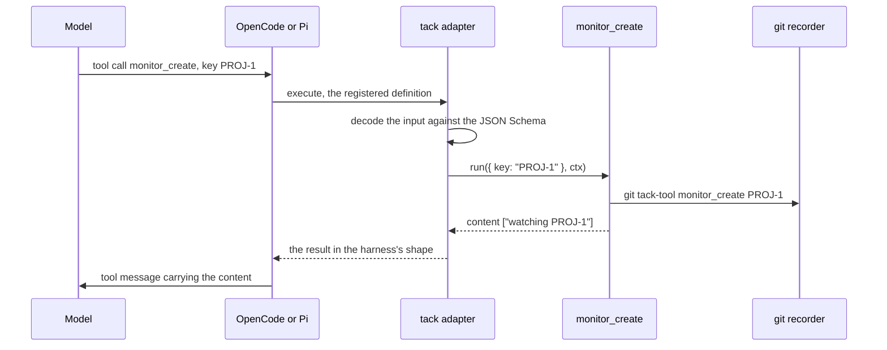

# T3: tools

**Status: Planned.** One tool definition serves every harness tack adapts:
OpenCode and Pi register it in process, and a generated MCP server for Codex
serves the same definitions to a harness with no in-process tool API. The
conformance suite proves it in both CLIs: the model calls the tool, the recorder
shows the handler ran, the returned content arrives in the next request, and a
removed tool is gone from the model's list and refuses a scripted call. A stdio
scenario starts the generated entry as its own process and proves the same call
over MCP. T3 stays open until T4 proves the Claude Code mod and T5 proves Codex
calling a T3 tool; the pending rows below say so. It unblocks Chauffeur slices 8
to 10 and `ask_chauffeur`. Part of
[tack v1](https://github.com/wrkhse/tack/issues/1).

## You can

Register one tool, and every agent tack builds calls it. `tool()` takes a name, a
description, a plain JSON Schema header and a handler; a plugin lists its tools
in the definition it already returns.

```ts
import { createAgentPlugin, tool } from "@workhorse/tack";

const monitorCreate = tool<{ key: string }>({
  name: "monitor_create",
  description: "Start watching a Jira issue",
  input: {
    type: "object",
    properties: { key: { type: "string" } },
    required: ["key"],
  },
  run: (input) => ({
    content: [`watching ${input.key}`],
    details: { id: "m-1" },
  }),
});

export default createAgentPlugin(() => ({
  name: "monitor",
  tools: { monitor_create: monitorCreate },
}));
```

The generic names the handler's input type, and `input` is the wire contract, so
OpenCode, Pi and the MCP server describe and validate the same object. Tack
decodes the input before `run`, and a missing or mistyped field becomes an error
result naming the tool and the field. A handler that throws becomes an error
result too, so a failing handler still leaves the model a result to read.

A tool's result reaches the model as a tool message, and a plugin also observes
the call and its result through T1's `toolAfter`, like any other tool. `run`
receives a `ctx` beside its input: the call's id, an abort signal that fires
when the transport stops the call or the tool's timeout passes (a
`TimeoutError` naming the tool and the limit), and the registry the plugin's
tools live in. The
same definition runs in each agent: `plugin.opencode()` adds it in process,
`plugin.pi()` registers it, and the build's MCP entry serves it to a harness with
no in-process tool API. A handler that needs the agent's session declares
`needsSession: true`; the in-process agents give it the session, and the MCP
entry refuses to serve it. The Claude Code mod is T4's.

A plugin withdraws a tool through the registry every context carries, and the
tool is gone from the next model request. A call to a withdrawn name answers an
error result, never a stale success:

```ts
responseFinished: async (_response, ctx) => {
  ctx.tools.remove("monitor_create");
},
```

## Path



The harness owns the call: it invokes the definition tack registered in its own
process, and the model's next request carries the result. The generated MCP
server for Codex runs the same handler in a server process; that is the whole
difference for a harness with no in-process tools.

## What it builds

### Tool definition

`tool()` builds one definition: a name, a description, a JSON Schema header, and a
handler that returns `{ content, details?, isError? }`. `content` is what the model
reads, one entry per message; `details` is data for the plugin and the harness
UI, never the model.

The contract is language-neutral: a JSON Schema header plus a handler tack calls,
so a later core in another language serves the same definitions.

The header is read as JSON Schema draft 2020-12 and compiled once at load into an
Effect schema: `JsonSchema.fromSchemaDraft2020_12`, then
`SchemaRepresentation.fromJsonSchemaDocument` (`effect` `dist/JsonSchema.d.ts`
L290, `dist/SchemaRepresentation.d.ts` L2402). A header the importer refuses
fails the load, naming the tool. Each call decodes its input with that schema, so
a harness's own coercion cannot widen what a handler receives.

A definition carries a failure as a value:

```ts
const searchDocs = tool<{ query: string; limit?: number }>({
  name: "search_docs",
  description: "Search the documentation",
  input: {
    type: "object",
    properties: {
      query: { type: "string" },
      limit: { type: "integer" },
    },
    required: ["query"],
  },
  run: async (input) => {
    const found = await index.search(input.query, input.limit ?? 10);

    return found.ok
      ? { content: found.titles }
      : { content: [`search failed: ${found.reason}`], isError: true };
  },
});
```

A load check keeps the three transports spelling a tool the same way: the name
matches `[a-z][a-z0-9_]*`, the map key in `tools` equals the tool's own `name`, and
a name already live in the scope fails the load with `DuplicateTool`, as a
duplicate plugin name does with `DuplicatePlugin`. The scope is the agent's tool
namespace: its built-in tools (`read`, `edit`, the shell tool and the rest) and
every tool another plugin in the scope registered. `DuplicateTool` names the
tool, the scope and both sources. The check runs before any `registerTool`:
Pi's `registerTool` replaces a definition already registered under the same name
without an error, so a collision that reached it would silently change which
handler the model calls. A tool added after load goes through the same check.

That check sees the names live when the plugin's registry is built: the agent's
tool list read once at setup, the host slot's declared tools, and every tool the
registry has added since. A tool another plugin adds after load is therefore
outside the snapshot, and a later `add` in this plugin cannot see it. Sharing
that set across plugins would mean the host slot holding post-load additions,
which is a host-protocol change; until a slice makes one, the duplicate check is
a load-time rule.

Tack's own tools are ordinary tools in the harness's registry, so they pass
through `toolBefore` too: a call to `monitor_create` arrives as `other` with its
name and input. On OpenCode and Pi, a deny stops the call before the handler.

A rewrite is a union: `{ rewrite: { command } }` for the shell tool and
`{ rewrite: { input } }` for a tool tack defines. Each form is refused on the
wrong kind of call, naming the tool. T1's `ToolBeforeResult` gains the
whole-input member. A whole-input rewrite of a built-in tool is refused, because
tack only rewrites calls whose definitions it owns; a whole input needs a schema
tack owns. The shell's `command` form is the one rewrite a built-in keeps.

OpenCode applies a whole-input rewrite by assigning the call's `execute.before`
input; Pi mutates the `tool_call` event's input in place, as its API requires.
The rewritten input is decoded against the tool's schema before `run`; a
rewrite that leaves the schema is an error result and the handler never runs.
The MCP server does not run `toolBefore`: it has no agent session to build a
`HookContext` from and no channel to one, so a plugin that needs its tool
guarded on the Codex path guards inside the handler. The conformance suite
proves the deny, the rewrite and a rewrite the schema rejects in both CLIs.

```ts
toolBefore: (call) =>
  call.name === "monitor_create"
    ? { rewrite: { input: { key: "PROJ-2" } } }
    : undefined,
```

`ctx.tools.add(tool)` registers a tool after load and returns a handle whose
`dispose()` withdraws it; `ctx.tools.remove(name)` is the same by name.

Files: `src/tools/tool.ts` (the definition and its load check),
`src/tools/registry.ts` (add and remove), `src/hooks/tool-before.ts` (the
rewrite union), `docs/plans/slices/t1.md` (the contract it records), `src/plugin.ts`
(the definition's `tools` field), `src/index.ts` (the exports),
`test/tools.test.ts`.

Verification: `test/tools.test.ts` covers the load refusals, a header the importer
cannot compile, an input the schema rejects with its field named, a valid input,
`details` and `isError`, a handler that throws, the abort signal on tack's
timeout and on the transport's stop, a name colliding with a built-in
or another plugin's tool, the union forms refused on the wrong call kind, a
whole-input rewrite decoded before `run`, a rewrite the schema rejects, a
whole-input rewrite of a built-in refused, and `add` and `remove` through a
fake context.

### OpenCode

`plugin.opencode(options)` registers the plugin's tools in one transform during
setup. The transform carries tack's `name`, `description` and `input` unchanged,
with an `execute` that maps tack's result, and `options: { codemode: false }`.

| tack     | OpenCode 2.3.0                                                                                                                                  |
| -------- | ----------------------------------------------------------------------------------------------------------------------------------------------- |
| register | `ctx.tool.transform((editor) => editor.add({ name, description, input, options: { codemode: false }, execute }))`, synchronous, during `setup`  |
| input    | the JSON Schema object unchanged: `Tool.ValueSchema` accepts an Effect schema, any Standard Schema, or `JsonSchema.JsonSchema`                  |
| result   | each `content` string becomes a text part, `details` becomes `metadata`; `isError` throws `Tool.Error`, because `Tool.Result` has no error flag |
| withdraw | the adding registration's `dispose()`, or `editor.remove(id)` in a later transform; either way the next snapshot omits the tool                 |
| timing   | a model request captures its tool snapshot when it is built, so an add or a removal lands on the next request                                   |

`codemode: false` is what makes the tool direct. OpenCode turns Code Mode on
for an agent by default, and its tool snapshot puts only a tool whose
`options.codemode` is `false` in the model's list; every other tool lives in
Code Mode's catalog, where a plain call to its name answers `No tool named "…" is
currently available`. Its built-in tools register the same way.

Sources: the editor's `add`, `remove` and `transform` are in `@opencode/plugin`
at `dist/promise/tool.d.ts` L22–34 and L59–67, and a registration's `dispose` at
`dist/promise/registration.d.ts` L1–3. `Tool.ValueSchema` is `@opencode/schema`
`dist/tool.d.ts` L49, `Tool.Result` L83–87, and `Options` L42–47. The docs' Tools
section shows the plain JSON Schema header, the snapshot per request, and
disposal ([Server plugins](https://opencode.ai/docs/build/plugins/server) →
API → Tools).

OpenCode also validates a call's arguments against the same header before it
calls `execute`, so a scripted call with bad arguments reaches the model as
OpenCode's `Invalid arguments for tool "monitor_create"` list, naming the field
and never running the handler. Tack's own decode still guards every transport
that validates nothing.

```jsonc
// opencode.json
{ "plugins": ["./plugins/monitor"] }
```

Files: `src/agents/opencode.ts`, `test/adapters/opencode.test.ts`.

Verification: `test/adapters/opencode.test.ts` runs the adapter against an editor
with the same methods and checks the added info, including the code-mode
opt-out, the result mapping, a throw and a disposal; the conformance suite
proves it in the real CLI.

### Pi

`plugin.pi(options)` registers each tool with `pi.registerTool`. Pi requires a
`label` for display, so tack passes the tool's name.

| tack     | Pi 1.5.2                                                                                                                                            |
| -------- | --------------------------------------------------------------------------------------------------------------------------------------------------- |
| register | `pi.registerTool({ name, label: name, description, parameters, execute })`                                                                          |
| input    | `parameters` is the JSON Schema object unchanged; Pi validates arguments as JSON Schema with `@earendil-works/pi-schema`, whatever built the schema |
| result   | each `content` string becomes a text block, `details` is `details`, `isError` is `isError`                                                          |
| withdraw | no unregister: re-register the same name with `exposure: "hidden"`, which leaves it registered and named, not runnable                              |
| timing   | a tool registered in the factory is active on the first request; one registered later appears on the next                                           |

Sources: `registerTool` is `dist/core/extensions/types.d.ts` L1271, the definition
and `execute` L473–534, and `setActiveTools` L1336. The package docs cover
registration during load and after startup, activation and the next request
(`docs/extensions.md` L1582–1592), withdrawal through `exposure: "hidden"`
(L2766), and JSON Schema arguments (L174–184).

The hidden re-registration leaves the name in Pi's registry. Tack keeps the
withdrawn names and answers a call to one with an error result naming the tool,
without running the handler. A model that calls a withdrawn name therefore
fails; it never reaches a stale definition that still answers.

```sh
pi -e monitor.js
```

Files: `src/agents/pi.ts`, `test/adapters/pi.test.ts`.

Verification: `test/adapters/pi.test.ts` runs the adapter against a fake `pi` with
`registerTool` and `on`, checks the registered definition and the result mapping,
checks that a withdrawal re-registers the same name as hidden, and checks that a
call to the withdrawn name is refused; the conformance suite proves it in the
real CLI.

### Tools over MCP

Codex has no in-process tool API, so a generated MCP server for Codex reaches
the same definitions over stdio. The build writes one stdio entry beside the
plugin's agent entries; it serves `tools/list` and `tools/call` from the
definitions the plugin registers, so a tool is described and validated the same
way on every path.

```ts
// plugins/monitor/mcp.js, written by the build
import monitor from "./index.ts";
import { serveMcp } from "@workhorse/tack";

await serveMcp(monitor, { timeoutMs: 30_000 });
```

```sh
bun ./plugins/monitor/mcp.js
```

`tools/list` answers with each tool's name, description and `inputSchema`, which is
the `input` object unchanged. `tools/call` decodes `arguments` against that schema
and answers with one text block per `content` entry and `isError` when the
handler failed. `details` stays local: MCP carries structured output as
`structuredContent` only for a tool that declares an `outputSchema`, and a tack
tool declares none. The two methods and their fields are MCP's
([Specification 2026-07-28](https://modelcontextprotocol.io/specification/2026-07-28/server/tools)
→ Server → Tools). The SDK floor is `^2.4.0` for
`@modelcontextprotocol/server` and `@modelcontextprotocol/client` (current
stable 2.4.0); the exact versions are pinned when the server lands.

#### Versions

The entry serves both eras from one factory. `2026-07-28` is the current
revision: it has no `initialize`; the version, client identity and capabilities
ride in `_meta` on every request, and `server/discover` answers with
`supportedVersions: ["2026-07-28", "2025-11-25"]`. `2025-11-25` is the legacy
fallback and the newest revision with an `initialize` handshake; an
`initialize` answer names `2025-11-25` and never `2026-07-28`.

Both are kept because clients differ. Codex `rust-v0.168.0` pins `rmcp` 3.5.1
(`codex-rs/Cargo.toml` L474); in that revision `ProtocolVersion::LATEST` and
`NO_INITIALIZE` are `2026-07-28`, and `LATEST_WITH_INITIALIZE` is
`2025-11-25` (`crates/rmcp/src/model.rs` L174, L181, L199), so Codex speaks
the modern era. A client built on an older SDK opens with `initialize`. The
fallback costs one `initialize` handshake, not a second entry or a second
process.

`serveMcp` uses the SDK's `serveStdio` with `legacy: "serve"` (its default), so
the same factory answers either opening. The opening exchange pins the
connection: a `server/discover` or any request carrying the modern `_meta` is
modern; an `initialize` is legacy; a first request with neither claim is legacy
with reason `'no-claim'` (`serveStdio.ts` L290, L317).

#### Limits

Every `tools/call` is bounded. A handler that runs past `timeoutMs` (default
30 000 ms) is aborted through its signal, whose reason is a `TimeoutError`
naming the tool and the limit, and answers an error result (`isError: true`)
carrying the same message, so a stuck handler cannot hold the connection open.
A call the transport stops ends at once with a stopped error result
(`tack: tool "<name>" stopped before it answered`) instead of waiting for its
deadline.

A result whose content text totals over `MAX_RESULT_BYTES`, 262 144 UTF-8
bytes, is refused with an error result naming the tool, the size and the limit.
Tack does not truncate: a partial answer the model cannot tell is partial is
worse than a failure the tool can page around.

`ctx.signal` is the call's abort signal. On either era the client sends
`notifications/cancelled` with the request id; the signal aborts, the handler
stops, and the server sends no response for that call. A handler that ignores
the signal is still bounded by the timeout, but its result is dropped once the
request was cancelled.

Files: `src/mcp/serve.ts` (the dual-era entry and its methods), `src/index.ts`
(the `serveMcp` export), `test/mcp.test.ts`.

Verification: `test/mcp.test.ts` speaks JSON-RPC over an in-memory transport with
the SDK's client, one test per handshake kept. The modern test connects with
`versionNegotiation: { mode: { pin: "2026-07-28" } }`, asserts
`getProtocolEra()` is `"modern"`, `server/discover` returns both versions and
no `initialize` was sent, then lists and calls. The legacy test connects with
`mode: "legacy"` and `supportedProtocolVersions: ["2025-11-25"]`, asserts
`getProtocolEra()` is `"legacy"` and `initialize` answers `2025-11-25`, then
lists and calls. Both cover `tools/list` with the header,
`tools/call` with content, an argument the schema rejects, a handler that
throws, the timeout, the result limit and a cancelled call that leaves no
response. An in-memory transport is not enough for the real path; the stdio
scenario below starts the generated entry as its own process.

### MCP server lifecycle

The harness starts the entry as a child process and speaks JSON-RPC over its
stdin and stdout. The entry opens no port and adds no listener: `serveMcp`
connects the stdio transport, and the generated entry has no network option to
pass. When the harness closes stdin, the transport ends, `serveMcp` resolves,
and the process exits 0. No timer or listener keeps it alive.

The factory runs once per process with `meta.agent` of `"mcp"`, so `Agent` is
`"opencode" | "pi" | "mcp"` and a plugin can branch on it. A factory that throws,
or a definition the load check refuses, rejects `serveMcp` before it connects;
the generated entry prints the message to stderr and exits 1. No tool is served.

`serveMcp` builds the tool set once and hands `serveStdio` a factory that wraps
it; a new connection gets a server instance, not another plugin factory run.
The SDK may call that factory twice on stdio — a probe instance it discards,
then the legacy one (`serveStdio.ts` L38-41) — which is exactly why the plugin
factory stays outside it. Nobody should move the plugin factory inside the SDK
factory: a second call would run the plugins twice.

Handlers run in the server process. There is no channel back to the agent: the
server cannot read its session, prompt, model or hooks, and nothing it does
reaches the agent's session. A tool that needs the agent's session therefore
cannot work there; it declares `needsSession: true`, and `serveMcp` refuses to
start, naming the tool; it never serves a call that can only fail. The
in-process adapters give such a tool the session; the MCP server has none.

`ctx.tools.add(tool)` and `ctx.tools.remove(name)` act on the server's tool set;
the server declares `listChanged: true` on its `tools` capability. On the
legacy era it sends `notifications/tools/list_changed` over the connection. On
the modern era it sends the notification on every `subscriptions/listen` stream
whose `notifications.toolsListChanged` is true; a client that never opens one,
or ignores the notification, keeps the list it last read, and nothing the
server sends can make it see the change. The next `tools/list` reflects the
change; a `tools/call` for a removed name answers an error result and runs no
handler. A change made during the factory needs no notification, because the
first `tools/list` is the client's initial view.

Files: `src/mcp/serve.ts` (the transport and the process),
`src/tools/registry.ts` (the tool set and its notification), `src/plugin.ts`
(`Agent` gains `"mcp"`), `src/index.ts`, `test/mcp.test.ts`.

Verification: `test/mcp.test.ts` covers both handshakes, the transport closing
on stdin, a factory that throws rejecting with its message, a `needsSession`
tool refused by name, `add` and `remove` sending `tools/list_changed` on the
legacy connection and the modern subscription stream, and a call to a removed
tool answering an error result. `conformance/mcp.test.ts` starts a broken
entry and checks exit 1 and the message on stderr.

### Fidelity table

Six rows join T1's six and T2's twelve. `Cell`, `Fidelity` and `FidelityTable`
keep their shape, and `capabilities` is the runtime list, so a missing cell in
either table is a type error. The two pending agents below stay out of this
table until their slices add an entry.

Files: `src/fidelity/index.ts`, `src/fidelity/opencode.ts`,
`src/fidelity/pi.ts`, `test/fidelity.test.ts`.

```ts
import { fidelity } from "@workhorse/tack";

const cell = fidelity.pi.cells["tool.remove"];

if (cell.fidelity === "fallback") {
  console.log("Pi:", cell.how);
}
```

| Capability      | OpenCode 2.3.0                                                                                                                                                                                                                                                                                    | Pi 1.5.2                                                                                                                                                                                                                                                                         |
| --------------- | ------------------------------------------------------------------------------------------------------------------------------------------------------------------------------------------------------------------------------------------------------------------------------------------------- | -------------------------------------------------------------------------------------------------------------------------------------------------------------------------------------------------------------------------------------------------------------------------------- |
| `tool.register` | native: `ctx.tool.transform((editor) => editor.add(tool))` registers a definition for the next request's snapshot; a transform is synchronous and may run in `setup` (`@opencode/plugin` `dist/promise/tool.d.ts` L22–34, L59–67; Server plugins → API → Tools)                                   | native: `pi.registerTool({ name, label, description, parameters, execute })` works during load and after startup; the tool is active and declared on the next request (`dist/core/extensions/types.d.ts` L1271; `docs/extensions.md` L1582–1592)                                 |
| `tool.remove`   | native: `editor.remove(id)` in a later transform, or the adding registration's `dispose()`; disposal replays the remaining transforms, so the tool is absent from the next request (`dist/promise/tool.d.ts` L22–34, L59–67; `dist/promise/registration.d.ts` L1–3; Server plugins → API → Tools) | fallback: there is no unregister. Re-register the same name with `exposure: "hidden"`, which leaves it registered but withdrawn, and tack refuses a call to it; `setActiveTools` is the other route (`dist/core/extensions/types.d.ts` L1271, L1336; `docs/extensions.md` L2766) |
| `tool.call`     | native: `execute(input, context)` runs with the input `input` declares, and `context.signal` aborts a stopped call (`@opencode/plugin` `dist/promise/tool.d.ts` L19–21; `@opencode/schema` `dist/tool.d.ts` L88–96; Server plugins → API → Tools)                                                 | native: `execute(toolCallId, params, signal, onUpdate, ctx)` returns the result (`dist/core/extensions/types.d.ts` L534)                                                                                                                                                         |
| `tool.result`   | native: `Tool.Result` carries `content` as a string or content parts and `metadata`; a thrown `Tool.Error` carries the message the model reads (`@opencode/schema` `dist/tool.d.ts` L83–87; `@opencode/plugin` `dist/promise/tool.d.ts` L19–21)                                                   | native: `AgentToolResult` carries `content` blocks, `details`, `structuredContent?`, `isError?` and `terminate?`; `isError` reports a failure the model sees (`@earendil-works/pi-agent-core` `dist/types.d.ts` L370–393; `dist/core/extensions/types.d.ts` L534)                |
| `tool.schema`   | native: `ValueSchema` is an Effect schema, any Standard Schema, or `JsonSchema.JsonSchema`, so a plain JSON Schema object is accepted (`@opencode/schema` `dist/tool.d.ts` L49)                                                                                                                   | native: Pi validates arguments as JSON Schema with `@earendil-works/pi-schema`, whatever built the schema, so a plain object is accepted (`docs/extensions.md` L174–184)                                                                                                         |
| `tool.mcp`      | fallback: the harness is an MCP client, so a generated server could serve it, but the plugin registers in process and OpenCode needs no server ([MCP servers](https://opencode.ai/docs/mcp-servers); Server plugins → API → Tools)                                                                | fallback: `pi mcp add` connects a stdio server, so the generated entry reaches it too; the in-process registration is the path tack uses (`docs/mcp.md` L3; `docs/extensions.md` L1582–1592)                                                                                     |

Two agents have `tool.*` rows of their own, and neither is T3's to prove:

| Capability      | Claude Code mod (T4) | Codex (T5) |
| --------------- | -------------------- | ---------- |
| `tool.register` | pending T4           | pending T5 |
| `tool.remove`   | pending T4           | pending T5 |
| `tool.call`     | pending T4           | pending T5 |
| `tool.result`   | pending T4           | pending T5 |
| `tool.schema`   | pending T4           | pending T5 |
| `tool.mcp`      | pending T4           | pending T5 |

These rows are in the plan, not the runtime `fidelity` table: T4 and T5 add the
entries and their sources when they prove each cell. A pending cell is not a
claim.

OC is `github.com/anomalyco/opencode` at `v2.3.0`; PI is
`@earendil-works/pi-coding-agent@1.5.2`. A path in the table is inside that
repository or package, and a `docs/` path is the package's own. Every cell is
read from the installed package, the repository at the tag, and those docs at
these versions. The conformance suite re-proves every cell but `tool.mcp` in the
real CLI; the stdio scenario exercises that row's server side, and each
harness's client support is read from its docs. A cell turns `unsupported` when
its scenario fails.

`tool.call` is the acceptance row: both cells read `native`.

Verification: `test/fidelity.test.ts` checks that each of the six rows has a
citable source in both tables; a pending Claude-mod or Codex cell has no source
until its slice proves it. The conformance suite proves the rows it can reach
in the real CLI.

### Conformance suite

The acceptance is one scenario set, run in both CLIs against the stand-in model
and T1's git recorder, plus one stdio scenario that runs the generated server as
its own process. The tool's handler runs `git tack-tool monitor_create <key>`,
so the recorder's line proves the handler ran in the harness, after the model's
call, and the stand-in keeps every request body. The shim records a
`tack-tool` subcommand as it records a push, so the handler's own command is
the evidence; every other git command still goes to the real git.

T1's one-shot runs are enough for the list, call, result, error, bad input,
tool deny, tool rewrite and tool rewrite rejected rows: one prompt, one scripted
call, one result. The withdrawal row needs a second request after the removal,
and a scripted call to the withdrawn name, so it runs under T2's long-lived
driver: OpenCode's server session with a second prompt, and Pi in RPC mode with
a second prompt.

Files: `conformance/tool-scenarios.ts` (the rows and their checks),
`conformance/suite.ts`, `conformance/harness/opencode.ts`,
`conformance/harness/pi.ts`, `conformance/harness/recorder.ts` (the shim
records `tack-tool` too), `conformance/mcp.test.ts` (the stdio scenario),
`conformance/harness/mcp.ts` (the child and its environment), and one plugin
per row under `conformance/plugins/`, such as `tool-create.ts`,
`tool-deny.ts`, `tool-rewrite.ts`, `tool-rewrite-bad.ts`,
`tool-withdraw.ts`, `mcp-monitor.ts` and `mcp-broken.ts`.

| Scenario              | Passes when                                                                                                                                               |
| --------------------- | --------------------------------------------------------------------------------------------------------------------------------------------------------- |
| list                  | the first request the model receives declares `monitor_create` with its description and `inputSchema`                                                     |
| call                  | the scripted call reaches the handler, and the recorder holds `tack-tool monitor_create PROJ-1`                                                           |
| result                | the next request carries a tool message whose content is `watching PROJ-1`                                                                                |
| error                 | a handler that throws reaches the model as an error result, and the recorder shows it ran                                                                 |
| tool deny             | a `toolBefore` handler denies `monitor_create`, the model receives its reason, and the recorder holds no line                                             |
| tool rewrite          | a `toolBefore` handler rewrites the call's input, and the recorder holds `tack-tool monitor_create PROJ-2`                                                |
| tool rewrite rejected | a rewrite that fails the schema becomes an error result, and the recorder holds no line                                                                   |
| bad input             | the scripted call's arguments fail the schema, the model receives an error naming the field, and the recorder holds no line                               |
| withdraw              | after the plugin removes the tool, the next request declares no `monitor_create`, and a scripted call to it answers an error result with no recorder line |

#### MCP stdio

The server has one scenario that does not run in either CLI:

| Scenario  | Passes when                                                                                                                                                             |
| --------- | ----------------------------------------------------------------------------------------------------------------------------------------------------------------------- |
| mcp stdio | `server/discover` names both versions, `tools/list` names `monitor_create` with its header, a call records `tack-tool monitor_create PROJ-1`, and closing stdin exits 0 |

`conformance/mcp.test.ts` writes the entry the build writes, starts it with
`bun` as its own process, and connects a `Client` with
`versionNegotiation: { mode: { pin: "2026-07-28" } }` to it over the SDK's
`StdioClientTransport`. The client probes `server/discover`, lists the
tools, calls `monitor_create`, reads the git recorder, and closes the client.
The child gets the sandbox's `PATH`, `HOME` and `TACK_RECORDER`; the SDK's
stdio transport starts from its own default environment and does not pass the
parent's variables through.

An in-memory transport test is not enough: this is the path Codex takes, and
only a real child proves process start, the factory, stdio framing, the child's
environment and the exit on stdin close. `test/mcp.test.ts` keeps the in-memory
transport for handler-level checks: decode, error results, limits and the
list-changed notification.

Verification: the suite itself, in CI on every pull request. Each CLI scenario
also asserts that the run loaded exactly its plugin list, as T1 does.

## End to end

- `bun run check` exits 0 with no warnings: format, Oxlint with the vendored
  anti-slop rules, `tsc`, Effect diagnostics, the anti-slop and unit Vitest
  projects, `fallow audit` and `bun audit`. `bun audit` ignores exactly one
  advisory, GHSA-fc5q-39xc-vjpf: picomatch 4.0.7 has a ReDoS with no patched
  release, it arrives only through dev chains, `bun audit --production` is
  clean, and tack globs only its own patterns. The ignore goes when picomatch
  4.0.8 or later ships, and every dependency bump re-checks it.
- In OpenCode 2.3.0 and Pi 1.5.2, every T1, T2 and T3 scenario passes from a
  fresh `HOME`, every run loads exactly the plugins its scenario names, and the
  stdio scenario passes against the generated entry.
- The `withdraw` scenario asserts both cells: Pi `fallback`, OpenCode `native`.
- `test/mcp.test.ts` connects one 2026-07-28 client and one 2025-11-25 client
  over an in-memory transport; each lists and calls a tool, and both run inside
  `bun run check`. `conformance/mcp.test.ts` starts the generated entry as its
  own process, connects a 2026-07-28 client over `StdioClientTransport`, lists
  and calls a tool, reads the recorder, and asserts the exit on stdin close.
- The suite starts real agent processes and the generated server, so it runs in
  CI or in a disposable container, never on the machine's own agents:

```sh
bun run check
bun run conformance:mcp
bun run conformance:opencode
bun run conformance:pi
```

The container recipe is [T1's](t1.md#end-to-end).

## Left open

- T4 owns the Claude Code mod, and T5 owns the runner that brings the MCP entry
  to Codex. The Claude-mod and Codex rows stay pending T4 and T5, and T3 stays
  Planned until both prove them; neither is T3's to prove.
- The MCP SDK is the approved dependency for T3: the v2 packages
  `@modelcontextprotocol/server` and `@modelcontextprotocol/client`, floor
  `^2.4.0` (current stable 2.4.0). Their exact versions are pinned when the
  server lands.
- Pi's `tool.remove` is a fallback. Re-registering the same name as hidden is a
  docs claim, and the withdraw row is the first run that proves it.
- Whether Pi fires `tool_call` for a tool an extension registered is read from
  its docs; the tool deny and tool rewrite rows prove it at 1.5.2.
- Whether a request's tool list names a plugin tool exactly `monitor_create` is
  read from OpenCode's docs, where the editor keys tools by an effective name;
  the list row proves it at 2.3.0.
