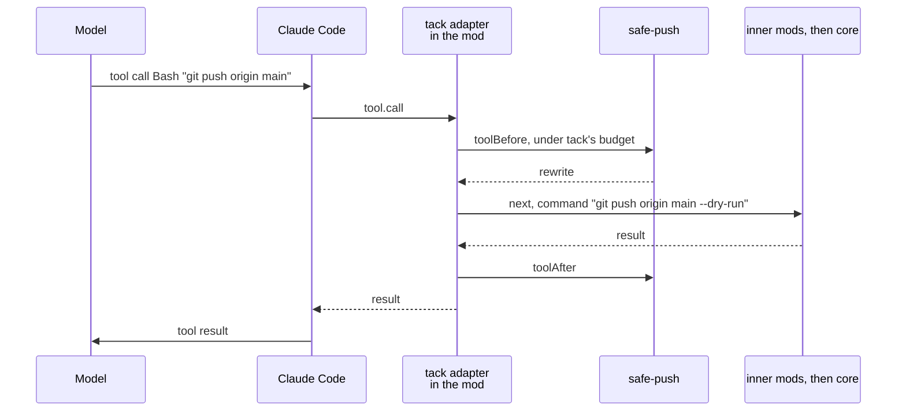
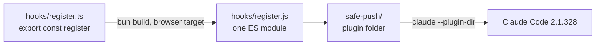

# T4: Claude Code mod

**Status: Planned.** Claude Code 2.1.328 runs the same plugins as a mod: T1's
hooks, T2's session actions and events, and T3's tools, proven in the real CLI
in CI against a stand-in model. A probe run closes the items under
[Left open](#left-open) before the build starts. It unblocks Chauffeur slice 9.
Part of [tack v1](https://github.com/wrkhse/tack/issues/1).

## You can

Run a plugin in Claude Code as a mod. It is the plugin OpenCode and Pi load;
Claude Code loads its `claude()` output from a plugin folder.

```ts
import { createAgentPlugin } from "@workhorse/tack";

export const safePush = createAgentPlugin(() => ({
  name: "safe-push",

  toolBefore: (call) =>
    call.tool === "shell" && call.input.command.startsWith("git push")
      ? { rewrite: { command: `${call.input.command} --dry-run` } }
      : undefined,
}));
```

```ts
// safe-push/hooks/register.ts
export const register = safePush.claude();
```

```sh
claude --plugin-dir ./safe-push
```

`call.tool` is `shell` for Claude Code's `Bash` tool, and `call.name` carries
`Bash`. Claude's `git push origin main` runs as
`git push origin main --dry-run`.

A mod has no Node APIs, so a plugin does its I/O through `ctx.io`, which every
handler and every tool receives. The same call runs in all four transports:

```ts
run: async (input, ctx) => {
  const argv = ["git", "tack-tool", "monitor_create", input.key];
  const done = await ctx.io.run(argv);

  return done.exitCode === 0
    ? { content: [`watching ${input.key}`] }
    : { content: [done.stderr], isError: true };
},
```

## Path



Each tack plugin is one mod carrying its own copy of tack. Claude Code gives
every mod a realm of its own, so two tack plugins meet in Claude Code's hook
chain: each rewrites the input it receives and passes it on with `next`, and a
deny from either stops the call. The chain's order is Claude Code's.

CC is `anthropics/claude-code` at `v2.1.328`. A `d.ts` line is in its
`mods/types/claude-code.d.ts`, and a named section is a page under
[Mods](https://code.claude.com/docs/en/plugins/mods/overview).

## What it builds

### Mod output

`plugin.claude(options)` returns the `register(on, options)` function a mod's
hooks module exports (`d.ts` L12036). `Agent` gains `"claude"`, and the factory
receives `meta.agent: "claude"`.



A mod is a plugin folder with three files:

```text
safe-push/
├── .claude-plugin/plugin.json   { "name": "safe-push", "version": "1.0.0" }
└── hooks/
    ├── hooks.json               { "modules": ["./register.js"] }
    └── register.js              the plugin, tack and Effect in one module
```

```sh
bun build safe-push/hooks/register.ts --target=browser --format=esm \
  --outfile safe-push/hooks/register.js
```

Claude Code loads a hooks module in an environment with no DOM and no Node. The
module imports only files of its own folder and `claude-code`, and a module
holding `import()` does not load (`d.ts` L24–28). The bundle is therefore one
unminified ES module with no bare import, so each mods API call keeps the
spelling Claude Code checks at load. The plugin's name is the mod's name, and
T4 writes the folder from the conformance harness; `tack build` is a later
slice.

Claude Code publishes no types package, so the adapter declares the part of
the mods API it calls as its own types, read from the type file at the pinned
tag.

Files: `src/agents/claude.ts`, `src/create.ts` (the `claude` output),
`src/plugin.ts` (`Agent`), `src/agents/README.md`,
`test/adapters/claude.test.ts`, `test/mod-bundle.test.ts`.

Verification: `test/adapters/claude.test.ts` runs `register` against an `on`
and a mods API with the same methods and checks each registration and its
answers. `test/mod-bundle.test.ts` bundles an entry for the browser target and
asserts the output names no `node:` module, holds no `import(`, and has no bare
import. The conformance suite proves the load in the real CLI.

### Hooks and failure

One registration per event carries every tack hook of the plugin:

| tack                             | Claude Code 2.1.328                                                               |
| -------------------------------- | --------------------------------------------------------------------------------- |
| `toolBefore` deny                | `tool.call` answers `{ deny: reason }` before `next`                              |
| `toolBefore` rewrite             | `tool.call` calls `next({ ...e, command })`; a tool's arguments are fields of `e` |
| `toolAfter`                      | the result `await next(e)` resolves to in `tool.call`                             |
| `promptSent` append              | `prompt.submit` calls `next({ ...e, context })` with the text added               |
| `responseFinished`               | `turn.complete`                                                                   |
| `sessionCreated`, `sessionEnded` | `session.start`, `session.end`                                                    |
| `sessionIdle`                    | raised when `turn.complete` returns; Claude Code has no idle event                |
| `permissionAsked`                | `tool.check`, when `await next(e)` resolves the decision `ask`                    |

Sources: Mods reference → Events, and Events → Approve or refuse a tool call
before the user is asked.

Claude Code skips a hook that throws, overruns its 10 seconds or answers a
wrong shape, and the call proceeds: a guard fails open unless its registration
carries a `.catch` (`d.ts` L4844–4849, L6307–6315; Events → Handle a hook that
fails). Tack fails closed in two layers. Its own budget runs inside the hook, so
a handler that throws or outlasts `budgetMs` answers `{ deny }` naming the
plugin. Each guarding registration also carries a `.catch` for a failure of the
adapter itself:

```ts
on("tool.call", guard).catch(($, e, next) =>
  next.called ? next(e) : { deny: `tack: safe-push failed: ${next.error.kind}` },
);
```

A plugin whose `onError.toolBefore` is `allow` registers no refusal: its failed
guard passes the call on. Two limits hold on this agent. A hook has 10 seconds
of its own time, so a plugin whose `budgetMs` is over 9000 is refused at load,
naming the limit. A mod that fails to load guards nothing; Claude Code names
the mod and the reason on stderr.

`session.end` gives every hook 1.5 seconds together (Mods reference → Limits),
so a `sessionEnded` handler finishes inside it. Its reason is `replaced` for
Claude Code's `clear` and `resume`, and `shutdown` for every other.

Files: `src/agents/claude.ts`, `src/plugin.ts` (the load refusal),
`test/adapters/claude.test.ts`.

Verification: the adapter test covers each row of the table, a throwing
handler, a handler past its budget, the `.catch` answer with `next.called` true
and false, the `allow` opt-out, and the `budgetMs` refusal. The conformance
rows `fail closed` and `fail closed slow` prove both failures in the real CLI.

### Session actions and events

The session handle is T2's, over the mods API. A mod has one session per
process, and `$.session.id()` names it (`d.ts` L3358).

| Action                | Claude Code 2.1.328                                                         |
| --------------------- | --------------------------------------------------------------------------- |
| `append`, `next`      | `$.session.append({ message })` (`d.ts` L3497)                              |
| `append`, `now`       | the same call during a turn                                                 |
| `append`, `wake`      | `$.prompt.submit({ text })`, which waits for idle and starts a turn (L3561) |
| `compact`             | `$.session.compact()` (L3471); `refused` while a turn runs                  |
| `interrupt`           | `$.turn.abort({ turnId })` (L3543), with the id `turn.start` gave           |
| `setModel`            | every later `turn.step` calls `next({ ...e, model })`                       |
| acting outside a hook | a `ctx.io.after` or `ctx.io.every` callback, on `$.clock` (L4215, L4225)    |

`setModel` takes `ModelRef.id`; Claude Code has no session-wide switch, so
tack holds the choice and applies it per request (Events → Send a request to a
different model). `$.prompt.submit` is refused after the user's Esc until they
type, and in a `claude -p` run past `--max-turns`; both report `refused` with
Claude Code's reason.

Files: `src/agents/claude.ts`, `test/adapters/claude.test.ts`.

Verification: the adapter test checks each action's call and each `Outcome`,
including a rejection becoming `refused`. T2's rows prove them in the real CLI.

### I/O capability

`ctx.io` is how a plugin reaches processes, files, the network and timers. It
is on every `HookContext` and `ToolContext`, in every transport, with one set of
bounds:

| Call                                                   | Resolves to                                                      | Bounds                                                   |
| ------------------------------------------------------ | ---------------------------------------------------------------- | -------------------------------------------------------- |
| `ctx.io.run(argv, { cwd?, env?, stdin?, timeoutMs? })` | `{ exitCode, stdout, stderr, stdoutTruncated, stderrTruncated }` | no shell; 30 s by default, 600 s at most; 4 MiB a stream |
| `ctx.io.readText(path)`                                | the file's text                                                  | 4 MiB; a relative path is under the session's directory  |
| `ctx.io.writeText(path, text)`                         | nothing; the file and its directories exist                      | 4 MiB                                                    |
| `ctx.io.fetch(url, { method?, headers?, body? })`      | `{ status, ok, headers, text }`                                  | 4 MiB each way, 30 s, 5 redirects                        |
| `ctx.io.after(ms, fn)`, `ctx.io.every(ms, fn)`         | `{ cancel() }`                                                   | cancelled when the session ends                          |

```ts
sessionCreated: ({ session }, ctx) => {
  const note = ctx.io.after(300, () => {
    void session.append("the build finished", { when: "wake" });
  });

  ended = () => note.cancel();
},
```

`run` resolves for any exit code. A call that cannot complete rejects with
`IoFailed`, naming the call and the reason: a command that cannot start or
outlasts its timeout, a file over the limit, a response over the limit. A
rejection a handler lets through is a handler failure, so a guard that cannot
do its I/O fails closed.

The bounds are Claude Code's own (Mods reference → Limits; `d.ts` L4297,
L10365–10398, L4002–4009, L4272, L6412–6474, L17255), applied in every
transport, so a plugin meets one limit everywhere.

| Transport         | Backing                                                                                      |
| ----------------- | -------------------------------------------------------------------------------------------- |
| OpenCode, Pi, MCP | Node: `child_process`, `fs`, `fetch`, timers                                                 |
| Claude Code mod   | `$.process.run`, `$.fs.read`, `$.fs.write`, `$.http.fetch`, `$.clock.after`, `$.clock.every` |

Claude Code hands a mod its API only inside a hook, so `io` is on contexts and
is absent from the factory and from module scope. A plugin that imports a Node
module does not load as a mod: its bundle fails on the import.

Every conformance plugin does its I/O through `ctx.io`, so one plugin file
serves all four legs: `tool-create`, `observe`, `tool-witness`,
`t2/append-outside`, `t2/interrupt-action` and the marker writes.

Files: `src/io/io.ts` (the capability and its bounds), `src/io/node.ts`,
`src/io/README.md`, `src/agents/claude.ts` (the mod backing),
`src/hooks/tool-before.ts` and `src/tools/tool.ts` (the contexts),
`src/index.ts`, `test/io.test.ts`, `conformance/plugins/`.

Verification: `test/io.test.ts` runs the Node backing against a temporary
directory and a loopback server: an exit code, output cut at the cap with its
flag, a read and a write, each over-limit refusal, a status and a body, a timer
that fires and a cancelled timer that never does. The timeout case stops a
child process, so it runs in CI with the other process tests. The adapter test
covers the mod backing, and every conformance leg proves it in a real run.

### Tools

T3's tools register in the mod at `session.start`:
`$.tool.register({ name, description, inputSchema })` takes tack's header
unchanged, and the model calls the tool as `mcp__<plugin>__<name>` (`d.ts`
L3717–3732, L18058; API → Add a tool). The plugin's `tool.call` hook answers a
call to one of its own tools with `{ result }`, through T3's `invokeTool`:
decode, timeout, the size limit, and an error result for each failure.

| tack     | Claude Code 2.1.328                                                                      |
| -------- | ---------------------------------------------------------------------------------------- |
| register | `$.tool.register` from `session.start` on; registering a name again replaces it          |
| name     | `call.name` is `mcp__tool-create__monitor_create`; the definition keeps `monitor_create` |
| result   | `{ result }` carrying the content; an error result carries tack's error text             |
| withdraw | no unregister: the tool stays declared, and tack answers its call with an error result   |
| session  | a `needsSession` tool receives the session; a mod has one                                |

The mod's full names live in a namespace of the plugin's own, so a tool collides
with no built-in and no other plugin's tool. A plugin's `toolBefore` sees its
own tools' calls. It sees another plugin's tool only from a mod ahead of the
owner in Claude Code's chain, because the owning mod answers the call itself.

Files: `src/agents/claude.ts`, `src/tools/registry.ts`,
`test/adapters/claude.test.ts`.

Verification: the adapter test checks the registered spec, a call's result, an
error result, a rewrite decoded before `run`, and a withdrawn tool's refusal.
T3's rows prove them in the real CLI and fill the Claude Code column on
[T3's page](t3.md#fidelity-table).

### Runtime in a mod

Tack's core and Effect run inside the mod. The type file declares no timer
global for a hooks module, so the adapter supplies what the core takes from
the platform:

| Need        | In a mod                                                           |
| ----------- | ------------------------------------------------------------------ |
| time        | Effect's `Clock` on `$.clock`, so a budget and a tool timeout fire |
| byte counts | `TextEncoder`, in `src/tools/tool.ts` for every transport          |
| logging     | `$.ui.log(text, { to: "debug" })`                                  |
| the host    | none: one plugin per mod, so the plugin runs its own hooks         |

Files: `src/agents/claude.ts`, `src/tools/tool.ts`, `test/mod-bundle.test.ts`.

Verification: `test/mod-bundle.test.ts` for the module graph, and the
`fail closed slow` row for a timeout that fires inside Claude Code.

### Fidelity table

`FidelityTable` gains `claude`, with `versions` `>=2.1.328 <2.2.0` and
`verifiedWith` `2.1.328`. Every capability has a cell, and a cell turns
`unsupported` when its row fails.

```ts
import { fidelity } from "@workhorse/tack";

const cell = fidelity.claude.cells["session.model"];
// → { fidelity: "fallback", how: "…", source: "…" }
```

| Capability               | Claude Code 2.1.328 mod                                                                                                                   |
| ------------------------ | ----------------------------------------------------------------------------------------------------------------------------------------- |
| `toolBefore.deny`        | native: `tool.call` answers `{ deny }` before `next` (Mods reference → Events)                                                            |
| `toolBefore.rewrite`     | native: `next({ ...e, command })` (Mods reference → Events; API → Add a tool)                                                             |
| `toolBefore.failClosed`  | native: tack's budget in the hook, and a `.catch` on the registration (`d.ts` L4844–4849, L6307–6315; Events → Handle a hook that fails)  |
| `promptSent.append`      | native: `prompt.submit`, `next({ ...e, context })` (Mods reference → Events)                                                              |
| `toolAfter.observe`      | native: the result of `await next(e)` in `tool.call` (Mods reference → Events)                                                            |
| `tool.register`          | native: `$.tool.register` from `session.start` (`d.ts` L3717–3732, L18058; API → Add a tool)                                              |
| `tool.remove`            | fallback: no unregister; the tool stays declared and its call answers an error result (`d.ts` L3638–3733)                                 |
| `tool.call`              | native: a `tool.call` hook answers `{ result }` (API → Add a tool)                                                                        |
| `tool.result`            | native: `{ result }` is what the model reads (API → Add a tool)                                                                           |
| `tool.schema`            | native: `inputSchema` is a JSON Schema object (`d.ts` L18058; API → Add a tool)                                                           |
| `tool.mcp`               | fallback: Claude Code is an MCP client, so the generated entry reaches it; the mod registers in process                                   |
| `host.sharedRealm`       | unsupported: a realm per mod; plugins combine in Claude Code's chain order, and `priority` has no effect (Events → The order mods run in) |
| `session.append.now`     | native: `$.session.append` during a turn (`d.ts` L3497)                                                                                   |
| `session.append.next`    | native: `$.session.append({ message })` (`d.ts` L3497)                                                                                    |
| `session.append.wake`    | native: `$.prompt.submit({ text })` (`d.ts` L3561; API → Start a turn from a background job)                                              |
| `session.compact`        | native: `$.session.compact()`; rejects while a turn runs (`d.ts` L3471)                                                                   |
| `session.interrupt`      | native: `$.turn.abort({ turnId })` (`d.ts` L3543)                                                                                         |
| `session.model`          | fallback: no session-wide switch; each `turn.step` calls `next({ ...e, model })` (Events → Send a request to a different model)           |
| `event.responseFinished` | native: `turn.complete` (Mods reference → Events)                                                                                         |
| `event.sessionCreated`   | native: `session.start`, once for each loaded mod before the first prompt (`d.ts` L15125–15139)                                           |
| `event.sessionEnded`     | native: `session.end` with its reason; every hook shares 1.5 seconds (Mods reference → Events, Limits)                                    |
| `event.sessionIdle`      | fallback: no idle event; raised when `turn.complete` returns (Mods reference → Events)                                                    |
| `event.permissionAsked`  | native: `tool.check`, when `next(e)` resolves `ask` (Events → Approve or refuse a tool call before the user is asked)                     |
| `session.actOutsideHook` | native: a `$.clock.after` or `$.clock.every` callback runs outside any event (`d.ts` L4215, L4225; API → Run work in the background)      |

Each cell is read from the type file and the docs at the pinned tag, and the
conformance suite re-proves it in the real CLI.

Files: `src/fidelity/index.ts`, `src/fidelity/claude.ts`,
`src/fidelity/README.md`, `test/fidelity.test.ts`, `docs/plans/slices/t3.md`
(the Claude Code column of its `tool.*` rows).

Verification: `test/fidelity.test.ts` checks every cell of the `claude` entry
has a citable source.

### Stand-in model

Claude Code speaks the Anthropic Messages API, so the stand-in gains a second
face. `ANTHROPIC_BASE_URL` sends inference to `POST /v1/messages?beta=true`,
streamed (LLM gateway protocol → Optional endpoints and startup traffic).

```ts
const baseUrl = Effect.gen(function* () {
  const model = yield* standInModel("Bash", { wire: "anthropic" });

  return model.baseUrl; // "http://127.0.0.1:53124"
});
```

The face answers with the same script as the OpenAI face, as `message_start`,
`content_block_start`, `content_block_delta`, `content_block_stop`,
`message_delta` and `message_stop` events: a `tool_use` block for the scripted
call, text for `done`. It answers 404 to `/v1/messages/count_tokens` and to the
`HEAD /api/hello` probe; Claude Code estimates the first and ignores the
second. Each request is recorded in the shape the rows already read: `system`
as a system message, `tools[].input_schema` as a function tool's parameters,
and a `tool_result` block as a tool message. The row tables and their checks
are shared by every agent.

Files: `conformance/model/stand-in.ts`, `conformance/model/anthropic.ts`,
`test/stand-in-anthropic.test.ts`.

Verification: `test/stand-in-anthropic.test.ts` posts Messages requests to the
face over loopback and asserts the exact events of a tool call and of `done`,
the two 404s, and each recorded request. It starts no agent.

### Conformance suite

A fourth leg runs the shared rows in Claude Code 2.1.328, in a throwaway
directory, against the stand-in and T1's git recorder. No real model is called
and the leg needs no secret.

```sh
claude -p "push it" --plugin-dir "$MODS/safe-push" --model scripted \
  --output-format stream-json --verbose --max-turns 4
```

| Variable                                   | Value                          |
| ------------------------------------------ | ------------------------------ |
| `CLAUDE_CONFIG_DIR`                        | a directory inside the sandbox |
| `ANTHROPIC_BASE_URL`                       | the stand-in's `baseUrl`       |
| `ANTHROPIC_API_KEY`                        | a dummy value                  |
| `CLAUDE_CODE_DISABLE_NONESSENTIAL_TRAFFIC` | `1`                            |
| `DISABLE_UPDATES`                          | `1`                            |

A mod's hooks run in a `claude -p` run (Overview → Where mods run). `--bare`
turns plugin hooks off, so no run passes it. One-shot rows use the command
above. Long-lived rows add `--input-format stream-json` and run over T2's
duplex child, behind a third `Driver`. The harness writes each mod's folder and
bundle, and `claude plugin validate` checks each one before its run.

| Rows               | On Claude Code                                                                                                                                  |
| ------------------ | ----------------------------------------------------------------------------------------------------------------------------------------------- |
| T1's nine          | as on OpenCode and Pi; `combine` and `combine reversed` each expect the flags in the order the mods loaded                                      |
| `fail closed slow` | a handler that never answers is denied when `budgetMs` passes, and the recorder sees nothing; on all three agents                               |
| T2's fifteen       | each action and event, with this agent's expectations: one idle after a turn, `scripted-2` on the request after `setModel`                      |
| T3's tool rows     | the model's list declares `mcp__tool-create__monitor_create`, a scripted call records `tack-tool monitor_create PROJ-1`, and the result arrives |
| `withdraw`         | the tool stays declared, and a scripted call to it answers an error result with no recorder line                                                |

The T3 rows are how T4 shows the mod calling a T3 tool: the handler runs
`git tack-tool monitor_create PROJ-1` through `ctx.io.run`, and the recorder
holds that line.

Files: `conformance/claude.test.ts`, `conformance/harness/claude.ts` (one
shot), `conformance/harness/claude-stream.ts` (long-lived),
`conformance/harness/t2-claude.ts` (the `Driver`), `conformance/harness/mod.ts`
(the folder and its bundle), `conformance/harness/sandbox.ts`,
`conformance/scenarios.ts` (`AgentName` and the new row),
`conformance/plugins/entries/*.claude.ts`, `conformance/README.md`.

Verification: the suite itself, in CI on every pull request. Each run asserts
that Claude Code loaded exactly the scenario's mods.

### CI

`.github/workflows/check.yml`'s conformance matrix gains `claude`, and
`package.json` gains the script `conformance:claude`.

| Job                    | Runs                                              |
| ---------------------- | ------------------------------------------------- |
| `conformance (claude)` | the conformance suite against Claude Code 2.1.328 |

`@anthropic-ai/claude-code` is a dev dependency pinned at exactly `2.1.328` in
`bun.lock`, and it joins `trustedDependencies` because its postinstall places
the platform binary. The job compares the installed `claude` with its platform
package's binary byte for byte, as the OpenCode job does. Claude Code is
licensed under Anthropic's Commercial Terms, which the owner accepts for
conformance runs in CI. `bun install` also places the binary on a development
machine, where nothing runs it.

Files: `.github/workflows/check.yml`, `package.json`, `bun.lock`.

Verification: the job passes on the pull request that adds it, and
`conformance (claude)` becomes a required check on `main`.

## End to end

- `bun run check` exits 0 with no warnings: format, Oxlint with the vendored
  anti-slop and landmines rules, `tsc`, Effect diagnostics, the anti-slop,
  landmines and unit Vitest projects, `fallow audit` and `bun audit`.
  `bun audit` ignores exactly one advisory, GHSA-fc5q-39xc-vjpf: picomatch
  4.0.7 has a ReDoS with no patched release, it arrives only through dev
  chains, `bun audit --production` is clean, and tack globs only its own
  patterns. The ignore goes when picomatch 4.0.8 or later ships, and every
  dependency bump re-checks it.
- In Claude Code 2.1.328, every T1, T2 and T3 row passes from a fresh
  `CLAUDE_CONFIG_DIR`, and every run loads exactly the mods its row names.
- `fail closed` and `fail closed slow` pass: a throwing handler and a slow one
  each refuse the call.
- The T3 `call` row passes: the mod calls `monitor_create` and the recorder
  sees it. T3 stays Building until T5 shows the same in Codex.
- The OpenCode, Pi and MCP legs pass with every conformance plugin on
  `ctx.io`.
- The suite starts real agent processes, so it runs in CI or in a disposable
  container, never on the machine's own agents:

```sh
bun run check
bun run conformance:claude
bun run conformance:opencode
bun run conformance:pi
bun run conformance:mcp
```

The container recipe is [T1's](t1.md#end-to-end).

## Left open

A probe closes the first group before the build starts: a branch that is never
merged, with one `workflow_dispatch` job that installs Claude Code 2.1.328,
loads probe mods under `claude -p` against a stand-in, and prints what it
finds. Each finding is written into this page.

- Whether Effect 4.1.4, bundled into a mod, loads and fires a timeout on
  `$.clock`. Nothing has run it there. If it cannot, the alternative is a thin
  mod that forwards each event to one tack process for the session, and that
  choice is the owner's.
- Whether a bundled module passes Claude Code's load check of mods API calls.
- The chain order of two mods loaded with `--plugin-dir`.
- Which requests Claude Code sends the stand-in beside the turn's own, and
  whether it accepts the model id `scripted`.
- Where a run names its loaded mods and a skipped hook when the output format
  is `stream-json`.
- Whether the `Bash` tool and `$.process.run` both resolve `git` to the
  recorder first on `PATH`.
- How a long-lived run takes a second prompt, an interrupt and a permission
  `ask` over `--input-format stream-json`.
- Whether a running turn reads `$.session.append`; the `now` cell follows it.
- Whether every mod has a realm of its own at 2.1.328, as at 2.1.314.

The rest are decided by their rows or by review of this page:

- `tool.remove` leaves the tool in the model's list. The `withdraw` row asserts
  the refusal, and the cell reads `fallback`.
- Whether a `tool.call` answer can flag an error; until a run shows a flag, an
  error result is its text.
- After `clear` or `resume`, Claude Code raises `session.end` and no second
  `session.start`. Tack opens the next session's handle at the first event
  that follows; no headless row reaches it.
- `ctx.io.fetch` has no Unix-socket option. Claude Code's `$.http.fetch` takes
  `socketPath` (`d.ts` L6412), so a daemon bridge can gain it when one needs it.
- `sessionIdle` is raised at `turn.complete`; a prompt already queued can start
  the next turn at once.
