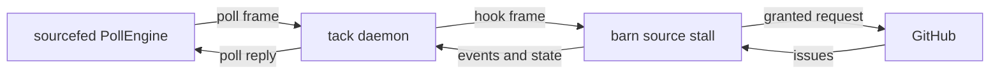

# Source SDK: a source stall behind tack's framed hook

**Status: Planned.** This plan waits on owner review at the manager's
13:00 IST presentation on 2026-11-29. No code ships from this page.

## You can

Run a GitHub issues source as a Luau stall. A due poll reads issues and emits
an event such as `item.matched:wrkhse/tack#23:2026-11-28T12:00:00Z`.

## The path of a poll



## What it builds

### 1. Framed poll hook

sourcefed's PollEngine calls a `poll` hook with the same framed client shape
as `FramedEventBefore`. tack registers `poll` in its closed hook registry
and dispatches it to the source stall over the existing one-line socket.
tack launches barn; sourcefed passes no stall names to the loader and never
launches barn. sourcefed owns its small client; there is no tack-client crate.

Files: `crates/protocol/src/wire.rs`, `crates/daemon/src/stall.rs`,
`rust/crates/core/src/event_before_framed.rs` in sourcefed.

```rust
let request = Request::Hook {
    id: 7,
    version: PROTOCOL_VERSION,
    hook: "poll".into(),
    call: ToolCall {
        tool: "sourcefed".into(),
        name: "github-issues".into(),
        input: json!({ "config": { "repo": "wrkhse/tack" }, "cursor": null }),
        session_id: None,
    },
    _meta: None,
};

let frame = encode_line(&request)?;
```

The protocol uses one NDJSON line, version 1 and a 1 MiB frame cap.
`Request` and `Reply` are non-exhaustive; downstream matches use a wildcard.

**Verified by** protocol and real-stall tests that assert exact poll dispatch,
reply identity, unknown-hook refusal and malformed-frame refusal.

### 2. Source context: poll trigger, ctx.input, ctx.state, ctx.emit

`on.poll` receives bounded framed input in `ctx.input`, including source
config and the due cursor. Host-held JSON in `ctx.state` returns with each
poll reply; its cursor is bounded by sourcefed's `MAX_POSITION_LEN`.
`ctx.emit` accepts one bounded event with `id`, `kind`, `subject`,
`summary?`, `at`, `author?` and `body?`.

Files: `crates/sdk/tack.d.luau`, `crates/sdk/src/lib.rs`;
sourcefed's `docs/source-plugins/p4-github-issues-source.md`.

```luau
return {
    name = "github-issues",
    needs = { "sdk", "http" },
    on = {
        poll = function(ctx)
            local repo = ctx.input.config.repo
            local cursor = ctx.state.cursor

            for _, issue in ctx.http.get("/issues", {
                repo = repo,
                cursor = cursor,
            }) do
                ctx.emit({
                    id = "item.matched:" .. repo .. "#"
                        .. tostring(issue.number) .. ":" .. issue.at,
                    kind = "item.matched",
                    subject = { repo = repo, number = issue.number },
                    summary = issue.title,
                    at = issue.at,
                })
            end

            return { state = ctx.state }
        end,
    },
}
```

The GitHub source uses IDs `item.matched:<repo>#<number>:<at>` and
`issue.comment:<repo>#<number>:<commentId>`; comments carry `body`.
The SDK declarations are emitted only for plugins declaring the `sdk` need.

**Verified by** SDK declaration and real-stall tests that assert exact emitted
events and returned state across polls, including the cursor bound.

### 3. Grants for the http capability

A plugin declares the `http` need and the host grants exact hosts per source.
A request passes only with both the declared need and the exact host grant.
The default is deny, with no wildcards, prefixes or case folding. This applies
tack#125's declared-needs intersection with host grants to barn's
`net.request` and `network_hosts` seam. Identity comes from the launched
plugin, never from a frame.

Files: `crates/daemon/src/grants.rs`, `crates/daemon/src/control.rs`,
`crates/sdk/tack.d.luau`.

```json
{"grants":{"github-issues":{"http":{"hosts":["api.github.com"]}}}}
```

```luau
local issues = ctx.http.get("https://api.github.com/repos/wrkhse/tack/issues")
```

The build audit is developer feedback, not a security boundary: aliases,
computed keys, concatenation, `pairs(ctx)` and dynamic require can bypass
its literal control-call checks. The daemon refuses unauthorized calls.

**Verified by** real-stall tests that assert exact outcomes for a declared
need and exact host grant, each missing half, case changes and wildcard hosts.

### 4. Bounds and proofs

One deadline covers connect, write, read and decode. Each poll returns one
reply; emitted event count and bytes are capped from `MAX_FRAME_BYTES`.
There is no retry inside the VM. The sandbox retains depth 16, 1024 entries,
1 MiB modules and a 16 MiB allocator ceiling. Its per-call deadline is the
minimum of the requested budget and sandbox cap; synchronous capability
callbacks bound their own work.

Files: `crates/protocol/src/wire.rs`, `crates/luau/src/sandbox/errors.rs`,
`crates/luau/src/require.rs`, `.github/workflows/check.yml`.

```rust
let line = read_line(&mut reader)?.ok_or("no poll reply")?;
let reply: Reply = serde_json::from_slice(&line)?;
```

**Verified by** boundary tests that assert exact results at and beyond each
limit, one reply per poll, and named deadline and oversize refusals.

## End to end

tack CI builds barn at its pinned revision and runs a real source stall:
sourcefed sends a due poll, the granted HTTP request returns an issue, and
the reply carries the exact event and state for the next poll. A missing need
or host grant yields a named refusal. Event hook failures keep the event with
a named reason; deny-on-failure belongs to tool hooks.

CI runs formatting, clippy, workspace tests, dependency checks, mutation
shards, end-to-end and packaged smoke checks. sourcefed CI has no Luau runner;
the real-stall proof runs in tack CI.

## Decided

| Choice | Decision | By | When |
| --- | --- | --- | --- |
| Drive path | PollEngine calls tack's framed poll hook. | supervisor | 2026-11-28 |
| Grants | Need and exact host grant required. | supervisor | 2026-11-28 |
| State | The host holds JSON state across reloads. | supervisor | 2026-11-28 |
| VM ownership | barn: engine; tack: declaration and wire. | owner | 2026-11-28 |
| Proof runner | tack CI uses its pinned barn revision. | supervisor | 2026-11-28 |

## Open questions

1. How do poll results return?
   - **(Recommended)** `annotate` fields on `Reply::Hook` carry `events`
     and `state`; sourcefed reuses its existing verdict mapping.
   - A new `Reply::Poll` variant gives polls a separate wire reply.
2. Who decides a poll is due?
   - **(Recommended)** sourcefed's PollEngine, since tack holds no source state.
   - A daemon timer moves scheduling into tack.
3. Which SDK contract major applies?
   - **(Recommended)** Keep major 1 and add declarations additively, since
     `check_contract_major` requires an exact match.
   - Bump to 2 to mark the expanded contract.
4. How are barn pins aligned?
   - **(Recommended)** Use one revision for tack CI proof and the sourcefed P4
     runner, bumped in its own PR, so both prove the same engine.
   - Use independent pins to let each project advance separately.
