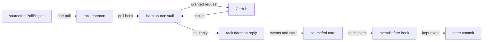

# Source SDK: a source stall behind tack's framed hook

**Status: Planned.** Awaits owner approval.

## You can

Run a GitHub issues source as a Luau stall. A due poll reads issues and emits
an event such as `item.matched:wrkhse/tack#23:2026-11-28T12:00:00Z`.

## The path of a poll



## What it builds

This page proposes the `poll` hook, `on.poll`, `ctx.emit`, `ctx.state`,
`ctx.input`, `ctx.http` and a `Reply::Poll` carrying `events` and `state`.

### 1. Framed poll hook

sourcefed's PollEngine calls a `poll` hook using `FramedEventBefore`'s
client. tack registers `poll` in its closed hook registry
and dispatches it to the source stall over the existing one-line socket.
tack launches barn; sourcefed passes no stall names to the loader and never
launches barn. sourcefed adds a poll entry point to the same client in
`rust/crates/core/src/event_before_framed.rs`; there is no new client file
or tack-client crate.

Files: `crates/protocol/src/wire.rs`, `crates/daemon/src/stall.rs`,
`rust/crates/core/src/event_before_framed.rs` in sourcefed.

Poll request (proposed):

```rust
let request = Request::Hook {
    id: 7,
    version: PROTOCOL_VERSION,
    hook: "poll".into(),
    call: ToolCall {
        tool: "sourcefed".into(),
        name: "github-issues".into(),
        input: json!({ "config": { "repo": "wrkhse/tack" }, "cursor": null }),
        session_id: None,
    },
    _meta: None,
};

let frame = encode_line(&request)?;
```

The protocol uses one NDJSON line, version 1 and a 1 MiB frame cap.
`Request` and `Reply` are non-exhaustive; downstream matches use a wildcard.

**Verified by** protocol and real-stall tests that assert exact poll dispatch,
reply identity, unknown-hook refusal and malformed-frame refusal.

### 2. Source context: poll trigger, ctx.input, ctx.state, ctx.emit

`on.poll` receives bounded framed input in `ctx.input`, including source
config and the due cursor. sourcefed's store owns state and cursor alongside
the pending queue and passes them on each poll; the stall keeps nothing
between polls. The store commits new state with the events, so a crash replays
them without skipping. The cursor is bounded by sourcefed's `MAX_POSITION_LEN`.
`ctx.emit` accepts one bounded event with `id`, `kind`, `subject`,
`summary?`, `at`, `author?` and `body?`.

Files: `crates/sdk/tack.d.luau`, `crates/sdk/src/lib.rs`;
sourcefed's `docs/source-plugins/p4-github-issues-source.md`.

Source handler (proposed):

```luau
return {
    name = "github-issues",
    needs = { "sdk", "http" },
    on = {
        poll = function(ctx)
            local repo = ctx.input.config.repo
            local cursor = ctx.state.cursor

            for _, issue in ctx.http.get(
                "https://api.github.com/repos/wrkhse/tack/issues", {
                repo = repo,
                cursor = cursor,
            }) do
                ctx.emit({
                    id = "item.matched:" .. repo .. "#"
                        .. tostring(issue.number) .. ":" .. issue.at,
                    kind = "item.matched",
                    subject = { repo = repo, number = issue.number },
                    summary = issue.title,
                    at = issue.at,
                    author = issue.user.login,
                })
            end

            return { state = ctx.state }
        end,
    },
}
```

The GitHub source uses IDs `item.matched:<repo>#<number>:<at>` and
`issue.comment:<repo>#<number>:<commentId>`; comments carry `body`.
The SDK declarations are emitted only for plugins declaring the `sdk` need.

**Verified by** SDK declaration and real-stall tests that assert exact emitted
events and returned state across polls, including the cursor bound.

### 3. Grants for the http capability

A plugin declares the `http` need and the host grants exact hosts per source.
A request passes only with both the declared need and the exact host grant.
The default is deny, with no wildcards, prefixes or case folding. This applies
tack#125's declared-needs intersection with host grants to barn's
`net.request` and `network_hosts` seam. Identity comes from the launched
plugin, never from a frame.

Files: `crates/daemon/src/grants.rs`, `crates/daemon/src/control.rs`,
`crates/sdk/tack.d.luau`.

Grant and call (proposed):

```json
{ "grants": { "github-issues": { "http": { "hosts": ["api.github.com"] } } } }
```

```luau
local issues = ctx.http.get("https://api.github.com/repos/wrkhse/tack/issues")
```

**Credentials.** The host holds the token; proposed `ctx.http` attaches it
only for the granted host. Luau never sees the token, and it never appears in
frames or logs. barn's host configuration places the credential alongside the
`network_hosts` grant, with `NetAuth` naming the secret, such as
`github-token`, and its scheme. The owner sets real secrets; this page names
the mechanism.

The build audit is developer feedback, not a security boundary: aliases,
computed keys, concatenation, `pairs(ctx)` and dynamic require can bypass
its literal control-call checks. The daemon refuses unauthorized calls.

**Verified by** real-stall tests that assert exact outcomes for a declared
need and exact host grant, each missing half, case changes and wildcard hosts.

### 4. Bounds and proofs

One deadline covers connect, write, read and decode. Each poll returns one
reply. There is no retry inside the VM. The sandbox retains depth 16, 1024
entries and 1 MiB modules; its configurable memory ceiling has a 16 MiB
minimum floor. Synchronous capability callbacks bound their own work.

sourcefed's framed client owns the 8500 ms poll deadline. The daemon's poll
dispatch uses a separate poll budget proposed in the barn and tack PRs; the VM
takes the minimum of that budget and its own per-call cap.

These proposed caps refuse excess with the named reason, never silently
truncate, and leave the cursor unchanged when a poll is refused.

| Cap                    | Value         | At the cap                |
| ---------------------- | ------------- | ------------------------- |
| Events per poll        | 64            | `emit_limit`              |
| Bytes per event        | 16 KiB        | `emit_event_too_large`    |
| Emit bytes per poll    | 1 MiB         | `emit_limit`              |
| Whole `ctx.state`      | 64 KiB        | `state_limit`             |
| `ctx.state.cursor`     | 4096 bytes    | `cursor_limit`            |
| `ctx.input`            | 64 KiB        | `input_limit`             |
| HTTP requests per poll | 20            | `http_limit`              |
| HTTP request bytes     | 1 MiB         | `http_request_too_large`  |
| HTTP response bytes    | 4 MiB         | `http_response_too_large` |
| HTTP request timeout   | 2 seconds     | `http_timeout`            |
| HTTP redirects         | None followed | `http_redirect_denied`    |
| Poll deadline          | 8500 ms       | `poll_timeout`            |

The poll emit-byte cap matches tack's `MAX_FRAME_BYTES`; the cursor cap
matches sourcefed's `MAX_POSITION_LEN`. The HTTP response cap matches barn's
`DEFAULT_MAX_BODY_BYTES`.

**Failed poll.** A failed poll returns `Reply::Error` with the named reason
`poll_failed:<reason>`, emits no accepted events and leaves the cursor
unchanged. sourcefed core records the reason and re-polls. A denied HTTP host
is a named refusal, not a silent drop. An event-hook failure after a successful
poll keeps the event with a named reason, as P4 decides.

Files in barn at `95065f65`:

- `crates/barn-luau/src/sandbox/mod.rs`: 16 MiB memory floor and per-call clock.
- `crates/barn-luau/src/sandbox/errors.rs`: `MAX_DEPTH` 16, `MAX_ENTRIES`
  1024, `MAX_HANDLERS` 64 and `MAX_OUTPUT_BYTES` 8 MiB.
- `crates/barn-luau/src/sandbox/values.rs`: `MAX_NODES` 16384.
- `crates/barn-luau/src/sandbox/clock.rs`.
- `crates/barn-luau/src/sandbox/deadline.rs`.
- `crates/barn-luau/src/sandbox/capabilities.rs`.
- `crates/barn-luau/src/require.rs`: 1 MiB module cap.
- `crates/barn/src/policy.rs`: exact `network_hosts`.

Bounded reply read (proposed):

```rust
let line = read_line(&mut reader)?.ok_or("no poll reply")?;
let reply: Reply = serde_json::from_slice(&line)?;
```

**Verified by** boundary tests that assert exact results at and beyond each
limit, one reply per poll, and named deadline and oversize refusals.

## Barn changes

At barn rev `95065f65`, named by sourcefed P4, barn-luau looks up
`invocation.hook` by name. Wired hook names include `eventBefore` and the
tool hooks; there is no poll hook. barn-stall frames carry hook and tool
requests and hook, tool and error replies; no reply shape carries source
emissions or state. There is no collecting `ctx.emit`, host-held `ctx.state`,
`ctx.http` bridge to `net.request`, or per-source host-config grant wiring
to `network_hosts`.

Each change has its own planned barn PR before tack's pin bump:

1. Dispatch the proposed poll hook.
2. Collect `ctx.emit` events in one bounded reply and return `ctx.state`
   for the sourcefed store.
3. Bridge `ctx.http` to `net.request` with exact-host checks.
4. Wire per-source declared needs to the host grant's `network_hosts`.

These PRs are separate from chauffeur#92, where barn stays unchanged. No new
dependency is added. tack pins barn at
`52b736505ec82b1e058f1ab27bd7c280b6b8724b`; its CI uses that manifest pin.

## Files by repo

- tack: `crates/protocol/src/wire.rs`, `crates/sdk/tack.d.luau`,
  `crates/daemon/src/stall.rs`, `crates/daemon/src/grants.rs`,
  `.github/workflows/check.yml`.
- barn at `95065f65`: `crates/barn-luau/src/sandbox/*`,
  `crates/barn-luau/src/require.rs`, `crates/barn-stall/src/frames.rs`,
  `crates/barn/src/policy.rs`, `crates/barn/src/supervisor.rs`.
- sourcefed: `rust/crates/core/src/event_before_framed.rs`,
  `docs/source-plugins/p4-github-issues-source.md`,
  `docs/source-plugins/p3-framed-client.md`.

barn needs new code for the poll hook, the `net.request`/`network_hosts`
seam, and `ctx.http` and `ctx.emit`. Barn changes carries the owner-visible
scope.

## End to end

tack CI builds barn at its pinned revision and runs a real source stall with
a fixture source. sourcefed CI runs tack's daemon at a pinned commit; tack
launches barn. CI never touches live GitHub: a local HTTP fixture serves issue
payloads under an exact host:port grant. Grants match the authority string by
exact equality, including a named port, with no wildcard or case folding.

sourcefed sends a due poll and the reply carries the exact event and state to
sourcefed core. Core sends each event through `eventBefore` before
`store.commit`, which commits the events and state together. A missing need
or host grant yields a named refusal. Deny-on-failure belongs to tool hooks.

This matches P4's diagram in sourcefed#164, so P4's flow needs no change.
Only its blocker paragraph needs updating when this plan is approved; that
update is outside this PR.

CI runs formatting, clippy, workspace tests, dependency checks, mutation
shards, end-to-end and packaged smoke checks. tack CI proves the SDK fixture;
sourcefed CI proves the P4 table through the pinned daemon.

## Decided

| Choice        | Decision                                    | By         | When       |
| ------------- | ------------------------------------------- | ---------- | ---------- |
| Drive path    | PollEngine calls tack's framed poll hook.   | supervisor | 2026-11-28 |
| Grants        | Need and exact host grant required.         | supervisor | 2026-11-28 |
| State         | Store commits cursor and state with events. | supervisor | 2026-11-28 |
| VM ownership  | barn: engine; tack: declaration and wire.   | owner      | 2026-11-28 |
| Proof runner  | tack CI uses its pinned barn revision.      | supervisor | 2026-11-28 |
| Cap behaviour | Refuse with a named reason.                 | supervisor | 2026-11-28 |

## Open questions

1. How do poll results return?
   - **(Recommended)** A new `Reply::Poll` variant carries events and state.
     `Request` and `Reply` are non-exhaustive, so the variant is additive.
   - `annotate` fields carry `events` and `state`. P3 caps annotations at
     32 entries, 64-byte keys and 512-byte values, so an event list cannot
     ride there; overloading annotations also mixes a verdict with data.
2. Who owns state and cursor?
   - **(Recommended)** sourcefed's store commits them with events and keeps
     the pending queue, so a crash replays without skipping.
   - The stall holds state, coupling recovery to the stall's lifetime.
3. Who decides a poll is due?
   - **(Recommended)** sourcefed's PollEngine, alongside its stored state.
   - A daemon timer moves scheduling into tack.
4. Which SDK contract major applies?
   - **(Recommended)** Keep major 1 and add declarations additively, since
     `check_contract_major` requires an exact match.
   - Bump to 2 to mark the expanded contract.
5. How are barn pins aligned?
   - **(Recommended)** Use one revision for tack CI proof and the sourcefed P4
     runner, bumped in its own PR, so both prove the same engine.
   - Use independent pins to let each project advance separately.
6. Where is P4 proven?
   - **(Recommended)** tack CI proves the SDK with a fixture source; sourcefed
     CI proves the P4 table with tack's daemon at a pinned commit, and tack
     launches barn. Each project proves its own artifact with one launch path;
     sourcefed never launches barn.
   - One joint proof in chauffeur's CI puts both artifacts in one runner.
