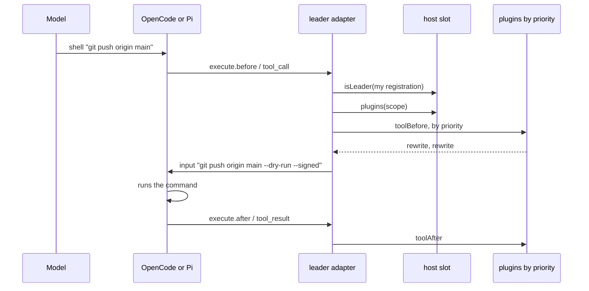

# agents

One adapter per agent. Each turns a resolved plugin into the native object that
agent loads, reads the same definitions from the host slot, and runs the same
hook runners, so a plugin behaves the same in both.

| Module        | Export           | Native shape                     |
| ------------- | ---------------- | -------------------------------- |
| `opencode.ts` | `opencodePlugin` | `{ id, setup }` server plugin    |
| `pi.ts`       | `piExtension`    | `(pi) => void` extension factory |

`text.ts` holds `joinTextParts`, the shared helper both adapters use to join a
result's text parts.

## Mapping

| tack                 | OpenCode 2.3.0             | Pi 1.5.2                                |
| -------------------- | -------------------------- | --------------------------------------- |
| `toolBefore` deny    | `execute.before` throws    | `tool_call` returns `{ block, reason }` |
| `toolBefore` rewrite | assigns `event.input`      | mutates `event.input.command`           |
| `promptSent` append  | `prompt` hook edits `text` | `input` transform                       |
| `toolAfter`          | `execute.after`            | `tool_result`                           |
| scope                | `opencode:<directory>`     | `pi`, one per process                   |
| registration ends    | the setup cleanup          | `session_shutdown`                      |

A rewrite keeps the agent's other input fields. On OpenCode the adapter spreads
the input and replaces `command`; Pi requires the command to change in place.
OpenCode's after event carries `Tool.Result`, whose model-facing text is
`content` (a string, or text and file parts); `output` is structured output.

## Usage

`createAgentPlugin` resolves the definition when each output is called, which
is the moment the agent loads the module.

```ts
// .opencode/plugins/safe-push/index.ts
export default safePush.opencode();
```

```ts
// safe-push.ts, loaded with pi -e safe-push.ts
export default safePush.pi();
```

## Leader rule

Every output registers its own agent hooks and its own entry in the host slot.
Each hook invocation checks `slot.isLeader(registration)` at call time and
returns immediately when it is not the leader. Exactly one instance runs the
chain per call. If the leader unloads, the next registration becomes leader and
its already-registered hooks run the chain: no gap, no double run.



## Dependencies and reloads

Both `@opencode/plugin` and `@earendil-works/pi-coding-agent` are development
dependencies used only for their types. The adapters import nothing from them at
run time: OpenCode loads the plain object, and Pi receives the factory function.

A reload replaces the plugin's registration in place by name, so it keeps its
position in the scope and its previous hooks stop being the leader. The new
registration's hooks take over from that position.
