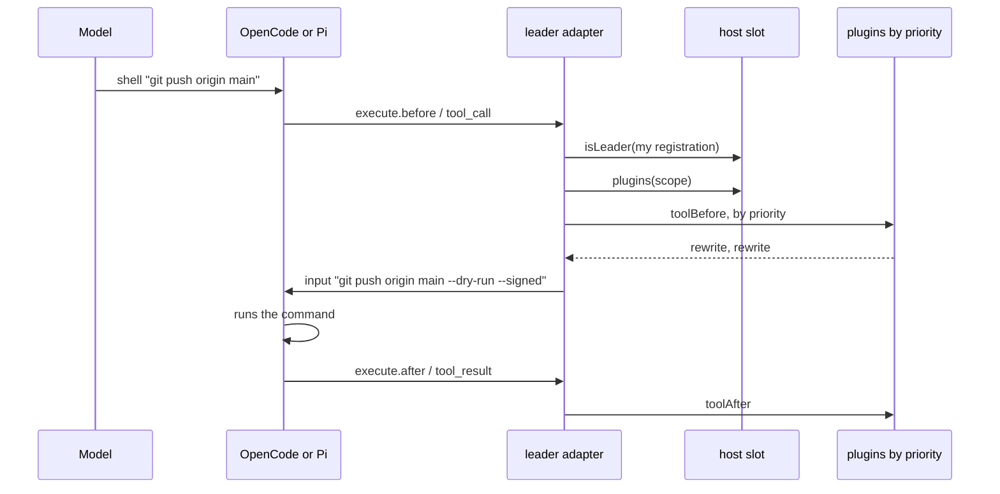

# agents

One adapter per agent. Each turns a resolved plugin into the native object that
agent loads, reads the same definitions from the host slot, and runs the same
hook runners, so a plugin behaves the same in both.

| Module        | Export           | Native shape                     |
| ------------- | ---------------- | -------------------------------- |
| `opencode.ts` | `opencodePlugin` | `{ id, setup }` server plugin    |
| `pi.ts`       | `piExtension`    | `(pi) => void` extension factory |

`chain.ts` holds `runBefore`, the single leader rule and `toolBefore`
decision match that both adapters call. Each passes how it expresses a deny
(OpenCode throws the reason, Pi returns `{ block, reason }`) and how it
applies a rewrite (assign `event.input` on OpenCode, mutate
`event.input.command` on Pi).
`text.ts` holds `joinTextParts`, the shared helper both adapters use to join a
result's text parts.

## Mapping

| tack                 | OpenCode 2.3.0             | Pi 1.5.2                                |
| -------------------- | -------------------------- | --------------------------------------- |
| `toolBefore` deny    | `execute.before` throws    | `tool_call` returns `{ block, reason }` |
| `toolBefore` rewrite | assigns `event.input`      | mutates `event.input` in place          |
| `promptSent` append  | `prompt` hook edits `text` | `input` transform                       |
| `toolAfter`          | `execute.after`            | `tool_result`                           |
| `tools` register     | one `ctx.tool.transform`   | one `pi.registerTool`                   |
| `tools` withdraw     | `editor.remove` transform  | re-register the name hidden             |
| scope                | `opencode:<location>`      | `pi`, one per process                   |
| registration ends    | the setup cleanup          | `session_shutdown`                      |

Every tool a definition declares is installed in OpenCode in one transform
during `setup`, and each tool a plugin adds or withdraws later is one more
transform. Pi registers each tool with `pi.registerTool` when the first session
starts: its action methods throw during extension loading, so that is the
first moment a tool's name can be checked against every name Pi already holds.
A tool registered there is declared on the first request. Pi has no unregister:
a withdrawal re-registers the same name with `exposure: "hidden"`, which
withdraws it from the model, and tack answers a call to the name with an error
instead of reaching a stale handler.

A shell rewrite keeps the agent's other input fields. On OpenCode the adapter
spreads the input and replaces `command`; Pi requires the command to change in
place. A whole-input rewrite replaces the call's input on both: OpenCode assigns
it, and Pi mutates the input object its executor already holds.

OpenCode's after event carries `Tool.Result`, whose model-facing text is
`content` (a string, or text and file parts); `output` is structured output.

The OpenCode scope key is `opencode:` followed by
`JSON.stringify([directory, workspaceID ?? null])`. The workspace is part of
it because two workspaces can share one directory and must not share a chain.

## Usage

`createAgentPlugin` resolves the definition when each output is called, which
is the moment the agent loads the module.

```ts
// .opencode/plugins/safe-push/index.ts
export default safePush.opencode();
```

```ts
// safe-push.ts, loaded with pi -e safe-push.ts
export default safePush.pi();
```

## Leader rule

Every output registers its own agent hooks and its own entry in the host slot.
A scope holds one live registration per name. Each hook invocation checks
`slot.isLeader(registration)` at call time and returns immediately when it is
not the leader. Exactly one instance runs the chain per call: the earliest live
registration in the scope. If the leader unloads, the next registration becomes
leader and its already-registered hooks run the chain: no gap, no double run.



## Dependencies, reloads and duplicate names

Both `@opencode/plugin` and `@earendil-works/pi-coding-agent` are development
dependencies used only for their types. The adapters import nothing from them at
run time: OpenCode loads the plain object, and Pi receives the factory function.

A reload disposes the old registration before it registers again: OpenCode runs
the setup cleanup before the new setup, and Pi disposes at `session_shutdown`.
Depth one is therefore the only legitimate case. Registering a name that is
still live in the scope fails that plugin's load: OpenCode's setup rejects with
the duplicate's message, and Pi's extension factory throws an `Error` carrying
it. Both messages come from `DuplicatePlugin` and name the plugin, the scope
and the two source files. Two different plugins named `guard`, loaded with
`pi -e a.js -e b.js`, are refused instead of one silently replacing the other.
