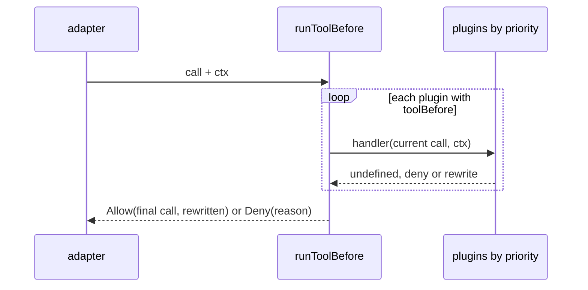

# hooks

The three hooks tack combines across plugins, plus the budget and ordering
every handler runs under. All runners are pure Effect programs: they never
touch the agent, so the adapters can test them directly.

| Module           | Responsibility                                     |
| ---------------- | -------------------------------------------------- |
| `order.ts`       | `byPriority`: lower priority first, ties by name   |
| `budget.ts`      | `callHandler`: one handler under `budgetMs`        |
| `tool-before.ts` | `runToolBefore`: chains rewrites, first deny wins  |
| `prompt-sent.ts` | `runPromptSent`: joins appends, caps at 16 KiB     |
| `tool-after.ts`  | `runToolAfter`: observes the final call and result |

## Order and budgets

Plugins combine in `byPriority` order: lower `priority` first, ties by name.
A handler may return its value directly or as a promise. It gets
`budgetMs` (default 5000) to settle; a throw, a rejection or a missed budget
becomes a `HandlerFailed` whose message is `tack: <plugin> failed: <reason>`.

| Hook         | A failed handler                                    |
| ------------ | --------------------------------------------------- |
| `toolBefore` | Denies unless `onError.toolBefore` is `"allow"`     |
| `promptSent` | The append is dropped and the failure logged        |
| `toolAfter`  | The failure is logged; the other handlers still run |

`toolBefore` decodes each handler result with Effect Schema. Anything other
than `undefined`, `{ deny }` or `{ rewrite: { command } }` fails the handler,
and a rewrite on a non-shell call fails it too.

## Usage

```ts
import { Effect } from "effect";
import { ToolDecision, runToolBefore } from "@workhorse/tack";

const decision = await Effect.runPromise(runToolBefore(plugins, call, ctx));

ToolDecision.$match(decision, {
  Allow: ({ call, rewritten }) => runTool(call, rewritten),
  Deny: ({ reason }) => report(reason),
});
```



The combined result of `runPromptSent` is a single string or `undefined`
when nothing was appended; the adapter adds it to the prompt. `runToolAfter`
returns `void`; its only effect is what the handlers choose to do.
