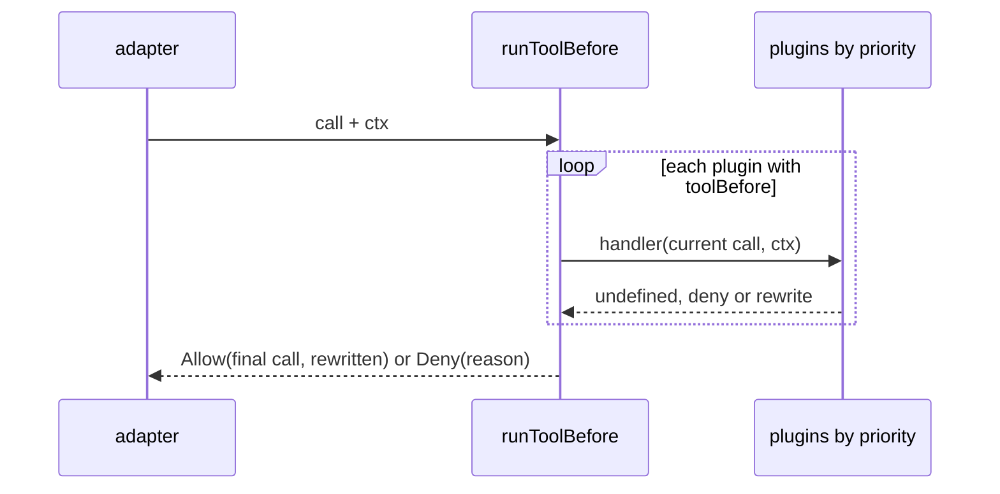

# hooks

The eight hooks tack combines across plugins, plus the budget and ordering
every handler runs under. All runners are pure Effect programs: they never
touch the agent, so the adapters can test them directly. A handler acts on the
agent through `ctx.session` and on its plugin's tools through `ctx.tools`,
which the runners only pass through.

| Module                 | Responsibility                                                             |
| ---------------------- | -------------------------------------------------------------------------- |
| `order.ts`             | `byPriority`: lower priority first, ties by name                           |
| `budget.ts`            | `callHandler`: one handler under `budgetMs`                                |
| `tool-before.ts`       | `runToolBefore`: chains rewrites, first deny wins                          |
| `prompt-sent.ts`       | `runPromptSent`: joins appends, caps at 16 KiB                             |
| `tool-after.ts`        | `runToolAfter`: observes the final call and result                         |
| `lifecycle.ts`         | `runSessionCreated`, `runSessionEnded`: observes a session's start and end |
| `response-finished.ts` | `runResponseFinished`: observes one model request                          |
| `session-idle.ts`      | `runSessionIdle`: observes a session with no pending input                 |
| `permission-asked.ts`  | `runPermissionAsked`: combines allow and deny answers                      |

## Order and budgets

Plugins combine in `byPriority` order: lower `priority` first, ties by name.
A handler may return its value directly or as a promise. It gets
`budgetMs` (default 5000) to settle; a throw, a rejection or a missed budget
becomes a `HandlerFailed` whose message is `tack: <plugin> failed: <reason>`.

| Hook              | A failed handler                                                                                                 |
| ----------------- | ---------------------------------------------------------------------------------------------------------------- |
| `toolBefore`      | Denies unless `onError.toolBefore` is `"allow"`                                                                  |
| `promptSent`      | The append is dropped and the failure logged                                                                     |
| `toolAfter`       | The failure is logged; the other handlers still run                                                              |
| `permissionAsked` | Denies when `onError.permissionAsked` is `"deny"`; otherwise logs it, records a leave, and runs the next handler |

`toolBefore` decodes each handler result with Effect Schema. Anything other
than `undefined`, `{ deny }` or `{ rewrite: { command } }` fails the handler,
and a rewrite on a non-shell call fails it too.

## The five lifecycle hooks

These hooks observe a session or decide one permission request. Each handler
runs under its plugin's `budgetMs`, and each returned value is decoded with
Effect Schema before tack acts on it.

| Hook               | Arguments                     | Combination rule                                                                                                          | A failed handler                                                  |
| ------------------ | ----------------------------- | ------------------------------------------------------------------------------------------------------------------------- | ----------------------------------------------------------------- |
| `sessionCreated`   | `({ session, resumed }, ctx)` | Every plugin runs, in priority order                                                                                      | Logged; the other handlers still run                              |
| `sessionEnded`     | `({ session, reason }, ctx)`  | Every plugin runs, in priority order                                                                                      | Logged; the other handlers still run                              |
| `responseFinished` | `({ session, reason }, ctx)`  | Every plugin runs, in priority order                                                                                      | Logged; the other handlers still run                              |
| `sessionIdle`      | `({ session }, ctx)`          | Every plugin runs, in priority order                                                                                      | Logged; the other handlers still run                              |
| `permissionAsked`  | `(request, ctx)`              | The first deny wins; `{ allow: true }` only when every handler allows; any leave, empty answer or failure decides nothing | `"deny"` denies with the message; `"leave"` logs it and continues |

`{ allow: true }` from `permissionAsked` skips the person's configured ask, so
the action proceeds without a prompt. It is consent only when every handler
allows: an `undefined` answer and a handler that failed are each not
consent, so the person's configured ask still runs.
`request.effect` is the harness's current effect, `allow` or `ask`; a
configured `deny` never reaches the hook.

## Usage

```ts
import { Effect } from "effect";
import { ToolDecision, runToolBefore } from "@workhorse/tack";

const decision = await Effect.runPromise(runToolBefore(plugins, call, ctx));

ToolDecision.$match(decision, {
  Allow: ({ call, rewritten }) => runTool(call, rewritten),
  Deny: ({ reason }) => report(reason),
});
```



The combined result of `runPromptSent` is a single string or `undefined`
when nothing was appended; the adapter adds it to the prompt. `runToolAfter`
returns `void`; its only effect is what the handlers choose to do.
