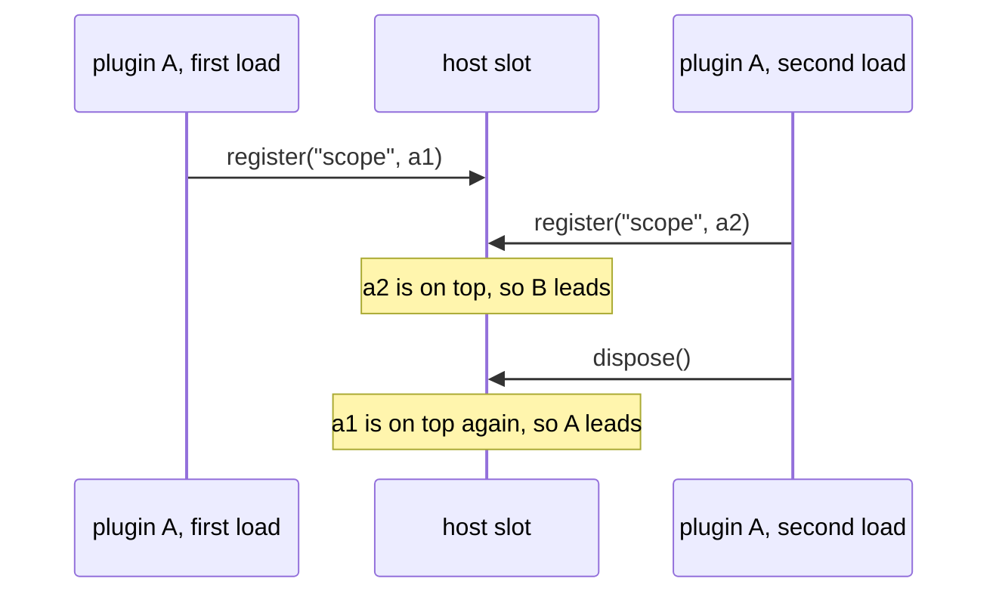

# host

Every tack plugin in one agent process shares one slot,
`globalThis[Symbol.for("@workhorse/tack/host")]`. Plugins are bundled with
their own copy of tack, so the slot holds only plain data and handler
functions under a protocol version.

| Export             | Meaning                                                                  |
| ------------------ | ------------------------------------------------------------------------ |
| `HOST_KEY`         | `Symbol.for("@workhorse/tack/host")`                                     |
| `hostSlot()`       | `Effect<HostSlot, ProtocolMismatch \| ForeignHostSlot>`; gets or creates |
| `HostSlot`         | `register`, `plugins`, `isLeader`                                        |
| `Registration`     | `scope`, `token`, `dispose`                                              |
| `ProtocolMismatch` | a tack slot at another protocol number; refused, naming both             |
| `ForeignHostSlot`  | a value at the symbol that is not a tack slot; refused                   |

The protocol number is `1`; the module keeps it private and writes it on the
slot it creates. A slot at another number is refused, naming both. A value
that is not a tack slot at all (no finite protocol number, or no scopes map)
is refused as foreign.

The copy that creates the slot fixes it at the symbol with
`Object.defineProperty`, non-writable and non-configurable. Every copy reads
and mutates that one slot; no later copy can replace or delete it, so a
registration an earlier copy holds cannot be silently detached.

## Scopes and leadership

The slot is divided into scopes: one per OpenCode location, one for a Pi
process. An OpenCode location is its directory and its workspace, so two
workspaces open on one directory get two scopes and neither plugin can
replace the other.

Each scope holds one stack of registrations per plugin name.

- A registration goes on top of its name's stack and becomes that name's
  definition in force. A name already in the scope keeps its position.
- `plugins(scope)` returns one definition per name, the top of each stack, in
  first-registration order.
- `dispose` removes only its own registration. A name leaves the scope only
  when its stack empties; the registration below then becomes the definition
  in force again.
- The leader is the top of the first name's stack, the earliest live
  registration, provided its token is still current. Only the leader runs the
  combined hooks.

```ts
import { Effect } from "effect";
import { hostSlot } from "@workhorse/tack";

const slot = await Effect.runPromise(hostSlot());
const scope = `opencode:["/work/app",null]`;
const registration = slot.register(scope, definition);

if (slot.isLeader(registration)) {
  const decision = await Effect.runPromise(runToolBefore(slot.plugins(scope), call, ctx));
}

registration.dispose();
```



There are no caches: the slot is the only state, and removing every
registration deletes the scope it used.
