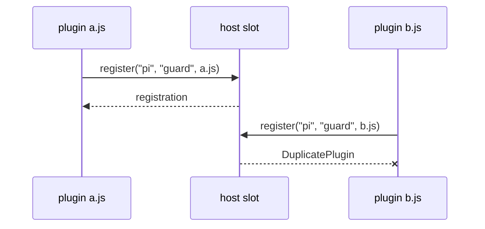

# host

Every tack plugin in one agent process shares one slot,
`globalThis[Symbol.for("@workhorse/tack/host")]`. Plugins are bundled with
their own copy of tack, so the slot holds only plain data and handler
functions under a protocol version.

| Export             | Meaning                                                                  |
| ------------------ | ------------------------------------------------------------------------ |
| `HOST_KEY`         | `Symbol.for("@workhorse/tack/host")`                                     |
| `hostSlot()`       | `Effect<HostSlot, ProtocolMismatch \| ForeignHostSlot>`; gets or creates |
| `HostSlot`         | `register`, `plugins`, `isLeader`                                        |
| `Registration`     | `scope`, `token`, `dispose`                                              |
| `ProtocolMismatch` | a tack slot at another protocol number; refused, naming both             |
| `ForeignHostSlot`  | a value at the symbol that is not a tack slot; refused                   |
| `DuplicatePlugin`  | a second live registration of a name in one scope; refused               |

The protocol number is `1`; the module keeps it private and writes it on the
slot it creates. A slot at another number is refused, naming both. A value
that is not a tack slot at all (no finite protocol number, or no scopes map)
is refused as foreign.

The copy that creates the slot fixes it at the symbol with
`Object.defineProperty`, non-writable and non-configurable, and freezes the
slot object, so `globalThis[HOST_KEY].scopes = new Map()` cannot split the
process's registrations. The property cannot be created when something else is
already at the symbol, including a fixed property holding `undefined`, or when
`globalThis` refuses another property; both fail the load as
`ForeignHostSlot`, never a raw `TypeError`. Every copy reads and mutates that
one slot, so a registration an earlier copy holds cannot be silently detached.

## Scopes, names and leadership

The slot is divided into scopes: one per OpenCode location, one for a Pi
process. An OpenCode location is its directory and its workspace, so two
workspaces open on one directory get two scopes and neither plugin can
replace the other.

Each scope maps a plugin name to its one live registration.

- `register(scope, plugin, source)` fails with `DuplicatePlugin` when the name
  is already live in the scope. The error names the plugin, the scope and both
  sources, and the existing registration keeps its place and its hooks.
- A reload disposes before it registers again, so registering a name once its
  registration is disposed is the only legitimate re-registration.
- `plugins(scope)` returns the live definitions in first-registration order.
- `dispose` removes only its own registration; a token that is no longer live
  removes nothing.
- The leader is the earliest live registration in the scope, provided its
  token is still current. Only the leader runs the combined hooks.

```ts
import { Effect } from "effect";
import { hostSlot } from "@workhorse/tack";

const slot = await Effect.runPromise(hostSlot());
const scope = `opencode:["/work/app",null]`;
const source = "/work/app/.opencode/plugins/guard/index.ts";
const registration = await Effect.runPromise(slot.register(scope, definition, source));

if (slot.isLeader(registration)) {
  const decision = await Effect.runPromise(runToolBefore(slot.plugins(scope), call, ctx));
}

registration.dispose();
```

The source is the adapter module's own path, so under a bundle it names the
plugin's bundle file. A refused registration fails that plugin's load with the
message:

```text
tack: two plugins named "guard" are loaded in pi (/work/a/bundle.js and /work/b/bundle.js); give them different names.
```



There are no caches: the slot is the only state, and removing the last
registration deletes the scope.
