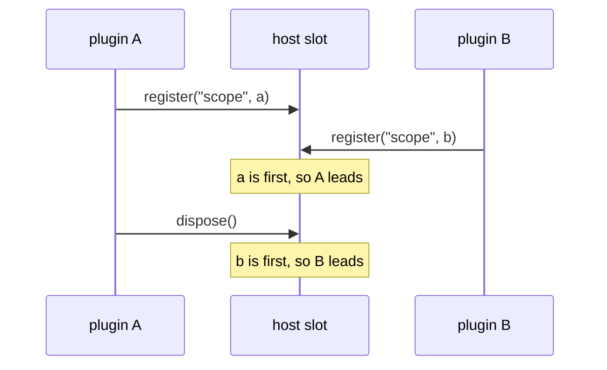

# host

Every tack plugin in one agent process shares one slot,
`globalThis[Symbol.for("@workhorse/tack/host")]`. Plugins are bundled with
their own copy of tack, so the slot holds only plain data and handler
functions under a protocol version.

| Export          | Meaning                                                         |
| --------------- | --------------------------------------------------------------- |
| `HOST_KEY`      | `Symbol.for("@workhorse/tack/host")`                            |
| `HOST_PROTOCOL` | `1`; a slot at another version is refused, naming both versions |
| `hostSlot()`    | `Effect<HostSlot, ProtocolMismatch>`; gets or creates the slot  |
| `HostSlot`      | `register`, `plugins`, `isLeader`                               |
| `Registration`  | `scope`, `token`, `dispose`                                     |

## Scopes and leadership

The slot is divided into scopes: one per OpenCode location, one for a Pi
process. Each plugin registers its resolved definition in its scope.

- Registering a name already in the scope replaces that entry in place, so a
  reloaded plugin keeps its position and gets a new token.
- The scope's leader is its first entry, provided that entry's token is still
  current. Only the leader runs the combined hooks.
- `dispose` removes the entry only when its token still matches; a replaced
  registration's dispose is a no-op. An empty scope is deleted.

```ts
import { Effect } from "effect";
import { hostSlot } from "@workhorse/tack";

const slot = await Effect.runPromise(hostSlot());
const registration = slot.register("opencode:/work/app", definition);

if (slot.isLeader(registration)) {
  const decision = await Effect.runPromise(
    runToolBefore(slot.plugins("opencode:/work/app"), call, ctx),
  );
}

registration.dispose();
```



There are no caches: the slot is the only state, and removing every
registration deletes the scope it used.
