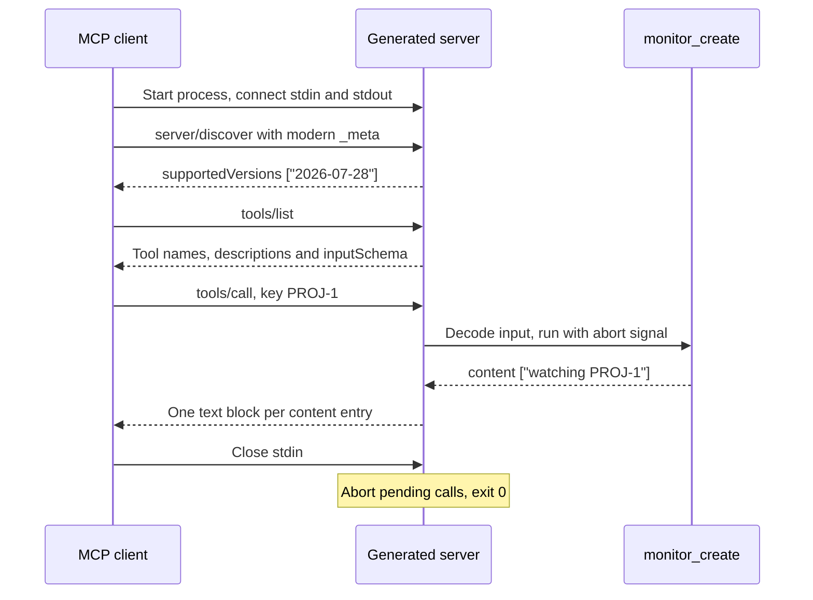

# MCP tools over stdio

`serveMcp(plugin, options)` serves a plugin's tools to an MCP client in a
separate process. The client starts the generated entry and owns its stdin.
There is no network listener or channel back to the agent's session.



## Entry and lifecycle

The generated entry imports the plugin and calls:

```ts
import monitor from "./index.ts";
import { serveMcp } from "@workhorse/tack";

await serveMcp(monitor, { timeoutMs: 30_000 });
```

| Module     | Responsibility                                                      |
| ---------- | ------------------------------------------------------------------- |
| `serve.ts` | Build the live registry, serve both eras, map calls and close stdio |

The plugin factory runs once per process with `meta.agent: "mcp"`, before
the transport starts. A throwing factory or a refused definition rejects
`serveMcp`; an entry's unhandled rejection reaches stderr and exits non-zero.
A tool declaring `needsSession: true` is refused at start, naming the tool.
Handlers receive no session, and the server runs no agent hooks.

The SDK's `serveStdio` may construct a discarded discovery probe and a
legacy instance. Those instances share the already-built tool registry;
they never rerun the plugin factory.

Only JSON-RPC goes to stdout. Transport diagnostics go to stderr. When the
client closes stdin, the SDK closes the connection and aborts pending calls.
`serveMcp` resolves, with no timer or listener keeping the entry alive.

## Protocol eras

The server is [dual-era][lifecycle]. A request with per-request `_meta`
uses `2026-07-28`, carrying its version, client identity and capabilities.
There is no modern `initialize` handshake.

[Discovery][discovery] advertises exactly `["2026-07-28"]`. A modern
`UnsupportedProtocolVersionError` has code `-32022`, the same modern-only
`data.supported`, and the sent version in `data.requested`: a legacy
revision cannot be retried per-request.

An `initialize` request selects legacy semantics for the stdio process.
Its answer names `2025-11-25`, never `2026-07-28`. A claim-less opening
selects the SDK's legacy fallback with reason `no-claim`.

[lifecycle]: https://modelcontextprotocol.io/specification/2026-07-28/basic/lifecycle#backward-compatibility-with-initialization-based-versions
[discovery]: https://modelcontextprotocol.io/specification/2026-07-28/server/discover

## Calls and limits

`tools/list` reads the live registry. It describes each tool with its name,
description and unchanged JSON Schema header as `inputSchema`.
`tools/call` decodes arguments before invoking the handler. Schema failures
and thrown handlers become text results with `isError: true`.
`details` stays local; tack declares no MCP `outputSchema`.

The MCP server does not run `toolBefore`: it has no agent session to build a
`HookContext` from, so a plugin that needs its tool guarded on this path guards
inside the handler.

- `timeoutMs` defaults to 30 000 ms. A tool's own smaller timeout wins.
  A deadline aborts `ctx.signal` with a `TimeoutError` naming the tool and
  limit, and returns an error result carrying that message.
- `MAX_RESULT_BYTES` is 262 144 UTF-8 bytes, summed over content text.
  A larger result is refused, never truncated.
- `notifications/cancelled` aborts the handler's signal. The SDK sends no
  response for that call, even if the handler later returns.
- Connection closure aborts pending calls too. A handler doing slow work
  listens to its signal and stops its own I/O.

## Live tool changes

`ctx.tools.add(tool)` installs a definition and returns a disposal handle;
`ctx.tools.remove(name)` withdraws it. The server advertises
`tools: { listChanged: true }`.

The SDK sends `notifications/tools/list_changed` directly on a legacy
connection. On a modern connection it routes the notification only to
`subscriptions/listen` streams whose `notifications.toolsListChanged`
filter is true. A client without an opted-in stream must list again itself.

The next `tools/list` reflects the change. A call to a removed name returns
an error naming that tool and never invokes its withdrawn handler.

## Verification

`test/mcp.test.ts` checks each era in memory: handshake, listing, calls,
schema rejection, throws, timeouts, oversized results and cancellation.
It also checks dynamic lists and their legacy and modern notifications.

`conformance/mcp.test.ts` runs the generated entry through the SDK's
`StdioClientTransport` in CI. The `mcp stdio` row lists and calls
`monitor_create`, checks its own git-shim record, closes stdin and checks
the real process exit status. The load-refusal row checks exit 1 and stderr.
Neither row starts an agent CLI.
