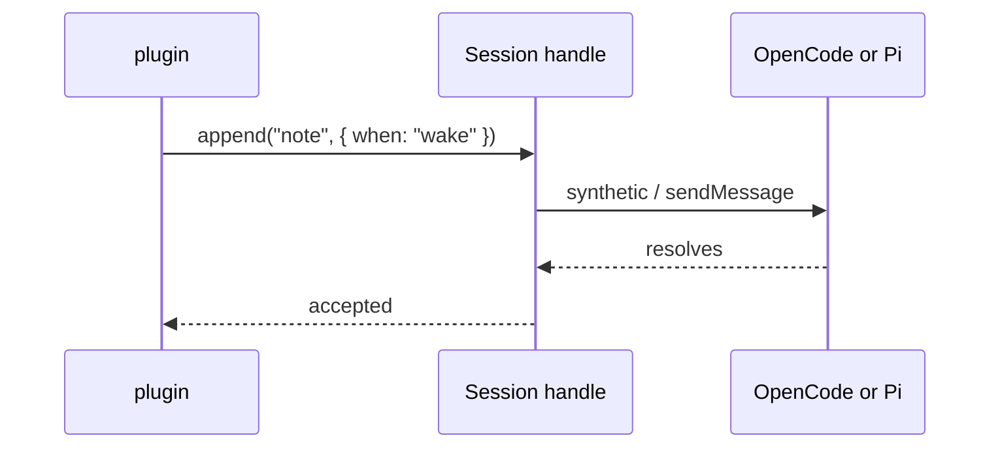

# session

The handle a plugin acts on a session with. `src/session.ts` holds the handle,
the port an adapter fills with its agent's native calls, and the outcome every
action reports.

| Action                   | OpenCode 2.3.0                                                 | Pi 1.5.2                                                          |
| ------------------------ | -------------------------------------------------------------- | ----------------------------------------------------------------- |
| `append(text, { when })` | `ctx.session.synthetic({ sessionID, text, delivery, resume })` | `pi.sendMessage({ customType: "tack.append", … }, { deliverAs })` |
| `compact()`              | `ctx.session.compact({ sessionID })`                           | `ctx.compact({})`, which aborts the running turn first            |
| `interrupt()`            | `ctx.session.interrupt({ sessionID })`                         | `ctx.abort()`                                                     |
| `setModel(model)`        | `ctx.session.switchModel({ sessionID, model })`                | `pi.setModel(ctx.modelRegistry.find(providerID, id))`             |

An append is a synthetic message nobody typed, never a user prompt. `when`
says when it arrives, and only `wake` starts a turn on an idle session:

```text
when   OpenCode                            Pi
now    delivery: "steer", resume: false     deliverAs: "steer"
next   delivery: "queue", resume: false     deliverAs: "followUp"
wake   delivery: "steer", resume: true      deliverAs: "steer", triggerTurn: true
```

Pi tests `triggerTurn !== false` before it reads `deliverAs`, so an explicit
`false` would make `next` behave as `now`; leaving the key out also means an
idle session stores the message without starting a run.



## Usage

Inside a hook, `ctx.session` is the handle for that hook's session:

```ts
const note = createAgentPlugin(() => ({
  name: "retry-note",

  toolAfter: (call, result, ctx) => {
    if (result.isError) {
      void ctx.session.append(`Check the log for ${call.name}.`, { when: "next" });
    }
  },
}));
```

Actions from several plugins are not combined: each is carried out in the
order it was made. An action resolves to an `Outcome` and never throws or
rejects, so a plugin may ignore the result:

| `status`      | Meaning                                                  |
| ------------- | -------------------------------------------------------- |
| `accepted`    | The agent took the action.                               |
| `unsupported` | This agent has no such action.                           |
| `refused`     | The agent or its harness declined; `reason` says why.    |
| `ended`       | The session is over, which a plugin may reach by design. |

Because a caller may ignore the result, the handle does the reporting: it logs
one warning for `refused` and for `unsupported`, and none for `ended`.

## Port

`SessionPort` is what an adapter supplies: one promise-returning function per
action, each carrying the session's id and, for an append, the `when`. The
handle adds the default `when`, the outcome, and the log line, so an adapter's
job is to make each native call and say what happened. A port call that throws
or rejects becomes `refused` with the error's message.

OpenCode's plugin context is a client, so its port is one client call per
action; a refusal by the harness, such as a `404` or `409` for a session it no
longer holds, becomes `refused` with the harness's message. Pi's API acts on
the session its extension context is bound to, so its port uses that context
and ignores the session id; a context from an instance that has shut down
reports `ended` instead of calling into Pi.
