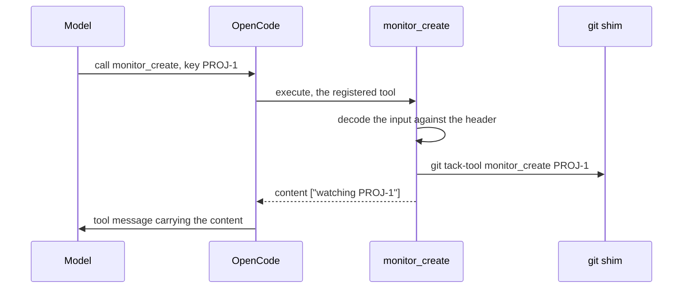

# tools

One tool definition serves every agent. A plugin lists its tools in the
definition it already returns, and each adapter registers those definitions in
its own process: OpenCode through `ctx.tool.transform`, and Pi in a later
slice. The header is plain JSON Schema, so the model, the harness and a later
core in another language describe and validate the same object.

| Module        | Responsibility                                                      |
| ------------- | ------------------------------------------------------------------- |
| `tool.ts`     | `tool()`, the load check, the compiled header, and one call         |
| `registry.ts` | the tools one plugin holds, `add` and `remove`, and the scope check |

## The definition

`tool()` names the handler's input type. `input` is the wire contract: the
model reads it, and tack decodes every call against it before `run` sees the
value.

```ts
import { createAgentPlugin, tool } from "@workhorse/tack";

const monitorCreate = tool<{ key: string }>({
  name: "monitor_create",
  description: "Start watching a Jira issue",
  input: {
    type: "object",
    properties: { key: { type: "string" } },
    required: ["key"],
    additionalProperties: false,
  },
  run: (input, ctx) => ({
    content: [`watching ${input.key}`],
    details: { id: ctx.callId },
  }),
});

export default createAgentPlugin(() => ({
  name: "monitor",
  tools: { monitor_create: monitorCreate },
}));
```

| Field          | Holds                                                                      |
| -------------- | -------------------------------------------------------------------------- |
| `name`         | the tool's name, the same on every transport                               |
| `description`  | what the model reads to decide whether to call it                          |
| `input`        | the JSON Schema header, draft 2020-12                                      |
| `needsSession` | `true` when the handler needs the session; an agent without one refuses it |
| `timeoutMs`    | the longest the handler may run; default `DEFAULT_TIMEOUT_MS`              |
| `run`          | `(input, ctx) => ({ content, details?, isError? })`                        |

`content` is what the model reads, one entry per message; `details` is JSON
data for the plugin and the harness UI, never the model; `isError` reports a
failure the model reads as a result. `ctx` carries the call's id, the
transport's abort signal, the session when the agent has one, and
`ctx.tools`.

The type argument is a JSON value type. Write it inline or as a type alias;
an `interface` gets no implicit index signature, so it does not satisfy the
JSON type the header describes.

## What the load checks

- The name matches `[a-z][a-z0-9_]*`, so no transport renames or namespaces it.
- The key in `tools` equals the tool's own `name`.
- Two entries never share a name.
- The header imports as draft 2020-12 once, at load: `JsonSchema.fromSchemaDraft2020_12`,
  then `SchemaRepresentation.fromJsonSchemaDocument`. A keyword the importer
  cannot translate fails the load, naming the tool and the keyword.
- `needsSession` is refused on a transport with no session, such as the
  generated MCP server.
- `timeoutMs`, when given, is a positive integer.
- A name already live in the scope fails the load with `DuplicateTool`, naming
  the scope and both sources: the agent's own tools, or the plugin that holds
  it.

The check runs before any native registration, because Pi's `registerTool`
replaces a definition of the same name without an error, and a collision that
reached it would silently change which handler the model calls.

## One call



A call never throws out of tack for a reason the model should read. The input is
decoded against the header; a missing or mistyped field becomes an error result
naming the field, and a handler that throws becomes an error result naming the
tool and its message. A handler that returns the wrong shape becomes one too.

## Limits

`timeoutMs` bounds the handler: one that runs past it is interrupted, and the
model reads an error result naming the tool and the timeout. The default is
30 000 ms.

A result whose content totals over `MAX_RESULT_BYTES` (262 144 UTF-8 bytes) is
refused with an error result naming the tool, the size and the limit. Tack does
not truncate: a partial answer the model cannot tell is partial is worse than a
failure the tool can page around.

## Adding and withdrawing

Every context a plugin's hooks receive carries `ctx.tools`. `add` checks and
compiles the definition, installs it in one native registration, and returns a
handle whose `dispose()` withdraws it; `remove(name)` is the same by name. A
definition `add` refuses throws its tagged error, which the hook's own failure
path reports.

```ts
responseFinished: (_response, ctx) => {
  ctx.tools.remove("monitor_create");
},
```

A withdrawn tool is gone from the agent's next tool snapshot, so nothing reaches
a stale definition.
