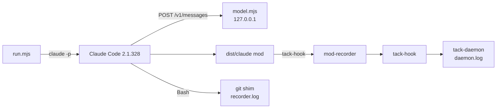

# Claude Code conformance

The CI check `conformance (claude)` runs the pinned Claude Code 2.1.328
against the safe-push fixture built with `--target claude`. A push through
Bash is denied by the generated mod, and `guard_status` runs in tack's
daemon.



- `model.mjs` is the Anthropic Messages stand-in: scripted SSE turns, and
  one JSON line for each request it receives.
- `git-shim` is installed as `git` first on PATH. It records pushes and
  delegates every other call to the real git.
- `mod-recorder` is a template. `run.mjs` installs it as `tack-hook` first
  on PATH, ahead of `target/debug`, with `@RECORDER@` replaced by the
  recorder file and `@EXEC@` by the real `tack-hook`, both quoted absolute
  paths. It records each call the mod makes through `$.process.run`, then
  runs the real `tack-hook` with the same input. It reads nothing from the
  environment, since `$.process.run` may not pass it on.
- `run.mjs` builds the throwaway tree, runs Claude Code and checks the
  evidence.

## The stand-in

`model.mjs` listens on `127.0.0.1:0`, prints its port, and answers
`POST /v1/messages` (with or without `?beta=true`) and
`POST /v1/messages/count_tokens`. Any model id is accepted, `scripted`
included. A request that offers `Bash` follows the script; any other
request gets plain text.

| tool_result blocks | Reply                                               |
| ------------------ | --------------------------------------------------- |
| 0                  | `Bash` with `{ "command": "git push origin main" }` |
| 1                  | `mcp__tack__guard_status` with `{}`                 |
| 2 or more          | the text `done`                                     |

It serves at most 80 requests, reads at most 8 MiB a body, and exits after
120 seconds.

## The run

`run.mjs` makes a throwaway tree under `RUNNER_TEMP` with its own `HOME`,
`CLAUDE_CONFIG_DIR` and XDG folders, then runs:

```sh
claude -p --plugin-dir dist/claude --dangerously-skip-permissions \
  --model scripted --output-format stream-json --verbose 'push my branch'
```

with `ANTHROPIC_BASE_URL` on the stand-in, `ANTHROPIC_API_KEY=dummy`,
`CLAUDE_CODE_DISABLE_NONESSENTIAL_TRAFFIC=1` and `DISABLE_AUTOUPDATER=1`.
No run passes `--bare`, which turns plugin hooks off. The mod runs the
plain name `tack-hook`, which resolves to the mod recorder with its paths
written in; `TACK_DAEMON_BIN` names the daemon.

The run is bounded at 90 seconds and passes when:

- the `system/init` frame lists the `tack` plugin as loaded, with no
  `plugin_errors`, and no other plugin apart from Claude Code's built-ins,
  those whose `source` ends in `@builtin` or whose name starts with
  `cc-plugin-`; the rows below count only then;
- no stream-json frame or stderr line says the `tack` hooks module was not
  loaded, did not load or was unloaded, or a hook of it was skipped, and no
  line says hooks modules are turned off for the process;
- the session output holds `tack: push blocked` and
  `guard_status: daemon ok`;
- `daemon.log` holds `hook toolBefore deny push blocked` and
  `tool guard_status ok`;
- the mod recorder holds at least one call;
- the git shim's recorder holds no push, a line whose first word is
  `push`, checked whether or not the mod loaded. The mod recorder's lines
  are shown beside it as evidence and never decide this check, since they
  name paths such as `fixtures/safe-push`.

For each plugin in the `system/init` frame, the run prints how many
stream-json frames and stderr lines mention hooks and that plugin, and
prints them. On failure it prints the last 60 lines of Claude Code's stderr,
and copies the stream-json output, the stderr, the stand-in's request log,
both recorders and `daemon.log` to `TACK_CLAUDE_ARTIFACTS`. The throwaway
tree is always removed.

Before the run, the workflow runs `claude plugin validate dist/claude` as a
diagnostic that never fails the job. It prints the output, says whether it
holds a `hooks:` line, which a loadable hooks module gives, and keeps it as
`validate.log` in the same artifact folder.

Run it only in CI or a disposable container, from the repository root, with
Node, Rust 1.100 and Claude Code 2.1.328 installed:

```sh
cargo build --workspace --bins --locked
tack build fixtures/safe-push --out dist --target claude
node test/claude/run.mjs
```
