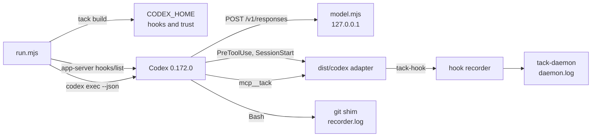

# Codex conformance

The CI check `conformance (codex)` runs the pinned Codex 0.172.0 against the
safe-push fixture built with `--target codex`. A push through Bash is
blocked by tack's PreToolUse handler, a harmless `git status --short` is
allowed by tack and runs, and `guard_status` runs in tack's daemon through
the adapter's MCP server.



- `package.json` and `package-lock.json` pin `@openai/codex` 0.172.0
  and its native packages. CI installs them with
  `npm ci --prefix test/codex --ignore-scripts`.
- `model.mjs` is the Responses API stand-in: scripted SSE turns and one
  JSON line for each request it receives.
- `run.mjs` builds the throwaway tree for each case, runs tack and Codex,
  checks the evidence and writes `verdict.txt`.
- The git shim is `test/claude/git-shim`. It records pushes and runs
  every other call with the real git. The harmless case wraps it in a
  recorder that appends each call's exit status and arguments to
  `git-runs.log` once it returns, such as `0 status --short`.

## The stand-in

`model.mjs` listens on `127.0.0.1:0`, prints its port, and answers
`POST /v1/responses`. Each request's reply follows the script and the
function outputs already in its input:

| Step     | Reply                                                   |
| -------- | ------------------------------------------------------- |
| bash     | `exec_command` with `{ "cmd": "git push origin main" }` |
| harmless | `exec_command` with `{ "cmd": "git status --short" }`   |
| status   | `guard_status` in the `mcp__tack` namespace, with `{}`  |
| last     | the text `done`                                         |

When Codex offers `shell_command` or `shell` in place of
`exec_command`, the bash step uses that tool. When `guard_status` is
deferred behind `tool_search`, the status step searches for it first.
Each logged request holds the offered tool names, the outputs by call id
and a timestamp. It serves at most 20 requests, reads at most 8 MiB a body, refuses a
websocket upgrade, which Codex never asks for here, and exits after 150 seconds.

## The run

Each case gets its own `HOME`, `CODEX_HOME` and XDG folders under
`RUNNER_TEMP`. tack's state folder is `HOME/.local/state/tack`, which
`TACK_STATE_DIR`, `XDG_STATE_HOME` and `HOME` all name, so an MCP
server started with a reduced environment finds the same daemon.

After `tack build` writes tack's hooks and their trust into `CODEX_HOME`,
the run takes the user's one remaining step: it puts the generated
`<out>/codex/config.toml` fragment at the top of `CODEX_HOME/config.toml`.
That fragment registers the `tack` MCP server and turns analytics and update
checks off, which the run checks. Codex then runs with
`CODEX_API_KEY=dummy` and these session flags, with no
`--ignore-user-config` and no trust bypass. The model is a custom Responses
provider over plain HTTP, since the built-in `openai` provider uses the
Responses websocket:

```sh
codex -c feedback.enabled=false -c 'otel.metrics_exporter="none"' \
  -c mcp_optional_startup_grace_ms=0 -c 'web_search="disabled"' \
  -c 'model_provider="loopback"' -c 'model_providers.loopback.name="loopback"' \
  -c 'model_providers.loopback.base_url="http://127.0.0.1:<port>/v1"' \
  -c 'model_providers.loopback.env_key="CODEX_API_KEY"' \
  -c 'model_providers.loopback.wire_api="responses"' \
  -c model_providers.loopback.supports_websockets=false \
  exec --json --sandbox danger-full-access -m scripted 'push my branch'
```

Every case first runs `tack build` and checks that the throwaway folders
hold only `config.toml` and `hooks.json` in `CODEX_HOME` and the empty
tack state folder, before any Codex process runs. It then asks `codex app-server` for `hooks/list` and
checks Codex's own view: every listed hook is tack's, from the user layer,
enabled and `trusted`, keyed `<source>:<event>:<group>:<handler>`, with
the current hash recomputed from the listing as Codex computes it; one
PreToolUse handler matches Bash and one SessionStart handler loads.

| Case                 | Passes when                                                            |
| -------------------- | ---------------------------------------------------------------------- |
| normal               | trusted after a rebuild into a new folder with the same IDs and a new hash; `tack: push blocked`; `guard_status: daemon ok`; exact daemon log |
| harmless             | `git status --short` runs with no block reason and its output shows the untracked `harmless.txt`; `git-runs.log` holds exactly one `0 status --short`; tack-hook runs once; the daemon log is exactly `tack-daemon: hook toolBefore allow` |
| missing-hook         | `tack: hook_missing`                                                   |
| daemon-crash         | `tack: socket_closed`                                                  |
| timeout              | `tack: timeout`, before the stalled tack-hook exits                    |
| invalid-reply        | `tack: malformed_reply`                                                |
| invalid-guard-status | the call fails with `tack: malformed` and never reaches tack-hook       |
| mcp-start-failure    | Codex names the `tack` MCP server's failure and pushes nothing; it stops, or runs on with the push blocked and no `guard_status` |
| node-missing         | the PreToolUse command, run with `$SHELL -lc`, exits 2 with `tack: node_missing` on stderr |
| node-crash           | with a `node` that dies of SIGSEGV, it exits 2 with `tack: node_failed` on stderr |
| stale-trust          | a changed PreToolUse handler lists as `modified` and blocks nothing    |
| config-parse-error   | an unparsable hooks file fails the trust and load checks               |

Every session case also needs a clean exit with the text `done` and these
lines in `TACK_RECORDER`: zero pushes from the git shim, exactly one
`{"call":"tack-loaded"}` from tack's SessionStart handler, and one adapter
line for each successful call, `{"call":"bash","id":1}` for the blocked
push or the allowed `git status --short` and `{"call":"guard_status","id":1}`
for a working `guard_status`.
The hook recorder runs as `tack-hook` first on PATH, passes each call to
the real one, and logs each verdict it returned; those lines match the same
calls one for one.

`verdict.txt` holds one `PASS` or `FAIL` row for each check, then the row
`harmless_allowed=true` when the harmless case ran and every one of its
checks passed, or `harmless_allowed=false`. The run exits 0 only when every
check passed and that row is true.

The workflow runs the cases in a network namespace that holds loopback
alone. Before and after them, `run.mjs` checks from inside it that it sees
only `lo`, that no route leaves loopback, and that an outbound connect is
refused. On failure it
uploads each case's requests, recorders, JSONL, stderr, hook listings,
daemon log and generated Codex config. The throwaway tree is always
removed.

Run it only in CI or a disposable Linux container, from the repository
root, with Node, Rust 1.100 and the locked Codex installed:

```sh
cargo build --workspace --bins --locked
npm ci --prefix test/codex --ignore-scripts
PATH="$PWD/test/codex/node_modules/.bin:$PWD/target/debug:$PATH" \
  CI=true TACK_CODEX_OFFLINE=1 \
  unshare -rn sh -c 'ip link set lo up && node test/codex/run.mjs'
```
