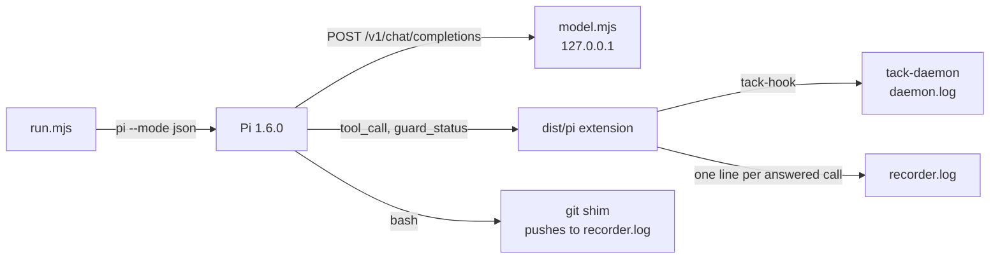

# Pi conformance

The CI check `conformance (pi)` runs the pinned Pi 1.6.0 with the extension
that `tack build --target pi` writes for the safe-push fixture. A push through
Bash is blocked by tack, a harmless `git status --short` is allowed by tack
and runs, and `guard_status` runs in tack's daemon.



- `package.json` and `package-lock.json` pin
  `@earendil-works/pi-coding-agent` 1.6.0. CI installs it with
  `npm ci --prefix test/pi --ignore-scripts`.
- `model.mjs` is the Chat Completions stand-in: scripted SSE turns and one
  JSON line for each request it receives.
- `run.mjs` builds the throwaway tree for each case, runs Pi, checks the
  evidence and writes `verdict.txt`.
- The git shim is `test/claude/git-shim`. It records pushes and runs every
  other call with the real git. The harmless case wraps it in a recorder that
  appends each call's exit status and arguments to `git-runs.log` once it
  returns, such as `0 status --short`.

## The stand-in

`model.mjs` listens on `127.0.0.1:0`, prints its port, and answers
`POST /v1/chat/completions`. Each reply follows the script and the tool
results already in the request:

| Script       | Tool calls, in order                                                               |
| ------------ | ---------------------------------------------------------------------------------- |
| normal       | `bash` with `{ "command": "git push origin main" }`, then `guard_status` with `{}` |
| bash         | `bash` with `{ "command": "git push origin main" }`                                |
| harmless     | `bash` with `{ "command": "git status --short" }`                                  |
| invalid-tool | `guard_status` with `{ "unexpected": true }`                                       |

Once every call has a result, it replies with the text `done`. Each logged
request holds the offered tool names, the result ids, and each result's text
by call id, so the run can check what the model saw. It serves at most 12
requests, reads at most 1 MiB a body, and exits after 60 seconds.

## The run

Each case gets its own `HOME`, XDG folders, `PI_CODING_AGENT_DIR` and
tack state folder under `RUNNER_TEMP`, an isolated `PATH` and a loopback
model with a dummy key. Pi starts with
`--mode json --no-extensions -e dist/pi/extension.js`, so only tack's
extension loads.

| Case                 | Passes when                                                                                                                                                                                                                                                           |
| -------------------- | --------------------------------------------------------------------------------------------------------------------------------------------------------------------------------------------------------------------------------------------------------------------- |
| normal               | `tack: push blocked`; `guard_status: daemon ok`; the daemon log is exactly `tack-daemon: hook toolBefore deny push blocked` and `tack-daemon: tool guard_status ok`                                                                                                   |
| harmless             | `git status --short` finishes with no error and its output is exactly `?? harmless.txt`; the stand-in received that same text as the bash result; `git-runs.log` holds exactly one `0 status --short`; the daemon log is exactly `tack-daemon: hook toolBefore allow` |
| missing-hook         | `tack: hook_missing`                                                                                                                                                                                                                                                  |
| daemon-crash         | `tack: socket_closed`                                                                                                                                                                                                                                                 |
| timeout              | `tack: timeout`, between 8000 and 10000 ms                                                                                                                                                                                                                            |
| invalid-reply        | `tack: malformed_reply`                                                                                                                                                                                                                                               |
| invalid-guard-status | the call fails with `tack: malformed` and never reaches tack-hook                                                                                                                                                                                                     |

Every case also needs a clean exit with valid JSONL and the text `done`,
exactly one `tack-loaded` entry and no extension error, exactly the scripted
tools, and zero pushes from the git shim. The extension's recorder lines are
`{"call":"bash","id":1}` and `{"call":"guard_status","id":2}` in the
normal case, `{"call":"bash","id":1}` for the allowed call in the harmless
case, and none for a failure.

`verdict.txt` holds one `PASS` or `FAIL` row for each check, then the row
`harmless_allowed=true` when the harmless case ran and every one of its
checks passed, or `harmless_allowed=false`. The run exits 0 only when every
check passed and that row is true. On failure, CI uploads each case's
requests, recorders, JSONL, stderr and daemon log. The throwaway tree is
always removed.

Run it only in CI or a disposable Linux container, from the repository root,
with Node, Rust 1.100 and the locked Pi installed:

```sh
npm ci --prefix test/pi --ignore-scripts
export PATH="$PWD/test/pi/node_modules/.bin:$PWD/target/debug:$PATH"

cargo build --workspace --bins --locked
tack build fixtures/safe-push --out dist --target pi

node test/pi/run.mjs
```
